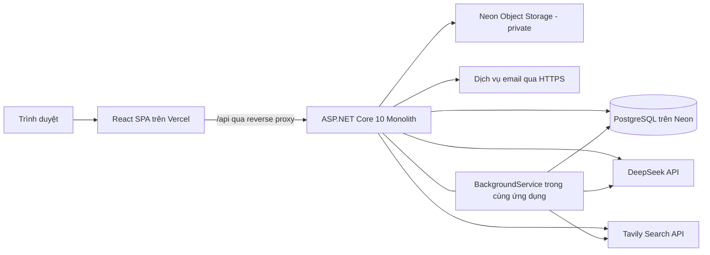

# CareerGap AI – Quyết định Công nghệ & Lưu ý Phát triển

> Cập nhật thực thi GĐ1 ngày 15/10/2026: đã có prototype local và lockfile. Xem [hợp đồng/giới hạn thực tế](phase-01-implementation.md) và [dependency/giấy phép](dependency-licenses.md). Các lựa chọn cloud/AI thật phía dưới vẫn cần kiểm chứng, không được coi là đã triển khai từ prototype.

> Bối cảnh đã được người dùng xác nhận: đồ án chuyên ngành do **1 người tự thực hiện**, mục tiêu 3 tháng, tập trung web, ngân sách phát triển và demo khoảng 4 USD/tháng cho toàn dự án. Phạm vi nghiệp vụ theo `01-system-specification.md`.
>
> **Đã xác nhận:** React + TypeScript + Vite, .NET 10 Monolith, PostgreSQL 16+, DeepSeek Cloud. **Đề xuất kỹ thuật trong tài liệu:** thư viện, cách xác thực, dịch vụ phụ trợ và cấu hình triển khai để hiện thực phạm vi đó. Các đề xuất cần được kiểm chứng bằng một bản tích hợp nhỏ trước khi áp dụng rộng; tài liệu này không có nghĩa hệ thống đã được cài đặt hoặc triển khai.
>
> Giá và giới hạn dịch vụ được đối chiếu tài liệu chính thức ngày **14/10/2026**. Kiểm tra lại khi tạo dịch vụ hoặc đổi gói; không coi hạn mức miễn phí là cam kết vận hành lâu dài.

## 1. Kiến trúc tổng thể

**Quyết định ngày 15/10/2026:** dừng deploy; xây dựng, tích hợp và kiểm thử trên localhost trước. Dùng PostgreSQL local, storage Development/Testing và fake provider mặc định. CI chỉ build/test; Docker smoke local không phải deploy cloud. Các phương án hosting/domain, production và kiểm chứng sau deploy ở mục 3, 4.4 chỉ là tham khảo cho giai đoạn sau: chỉ thực hiện khi sản phẩm hoàn thiện local và người dùng yêu cầu mở lại deploy. Không tiếp tục migration cloud hoặc thay đổi dịch vụ đã có. DeepSeek vẫn là stack đích; thử provider thật từ localhost cần được cho phép trong ngân sách, không tự bật khi sửa tài liệu.

### 1.1. Monolith theo module nghiệp vụ

Sử dụng một ứng dụng ASP.NET Core Web API, một cơ sở dữ liệu PostgreSQL và một frontend React SPA. Backend chia module theo nghiệp vụ để một người có thể phát triển, kiểm thử và bảo trì theo từng lát tích hợp; cùng build và triển khai thành một dịch vụ.



Các module dự kiến:

| Module | Trách nhiệm |
| --- | --- |
| Accounts | Tài khoản, vai trò, đăng nhập, khôi phục mật khẩu |
| Profiles | Profile ứng viên, trường cho phép hiển thị, thông tin công ty |
| Jobs | Tin tuyển dụng, JD, tìm kiếm, lưu việc |
| Resumes | File CV, dữ liệu trích xuất, phiên bản, mẫu CV và quyền công khai |
| Applications | Ứng tuyển, bản CV tại thời điểm nộp, trạng thái và ghi chú sàng lọc |
| Matching | Chuẩn hóa CV/JD, tìm ứng viên/việc làm, đánh giá phù hợp và giải thích |
| Learning | Tìm nguồn học và giải thích lý do đề xuất |
| Administration | Quản trị, báo cáo nội dung, theo dõi sử dụng dịch vụ |

Trong từng module, tách endpoint/controller, xử lý nghiệp vụ và truy cập dữ liệu. Dùng dependency injection có sẵn của .NET. Các tích hợp bên ngoài nằm sau các interface như `ILlmClient`, `IWebSearchClient`, `IFileStorage`, `IEmailSender` để thay nhà cung cấp hoặc dùng bản giả lập khi kiểm thử.

Đề xuất bắt đầu với một project Web API tổ chức theo thư mục tính năng và một project test. Chỉ tách thêm class library khi có ranh giới hoặc nhu cầu kiểm thử rõ ràng. Không cần microservices, message broker, Redis, một backend Python riêng hoặc framework điều phối AI trong bản đầu.

### 1.2. Giao tiếp frontend–backend

- REST API, JSON, tiền tố `/api`; dùng DTO thay vì trả trực tiếp entity của EF Core.
- Công bố hợp đồng API bằng OpenAPI, thống nhất mã lỗi và cấu trúc `ProblemDetails`.
- Danh sách có phân trang, giới hạn kích thước trang và bộ lọc do backend kiểm tra.
- Frontend dùng đường dẫn tương đối `/api/...`. Local dùng Vite dev proxy; trên Vercel dùng external rewrite sang Render, giữ cùng origin đối với trình duyệt.
- Rewrite `/api` phải đứng trước quy tắc fallback SPA về `index.html`. Không cache CDN cho phản hồi tài khoản, CV, đơn ứng tuyển hoặc kết quả AI riêng tư.
- Đây là phương án cần thử sớm với đăng nhập, cookie, antiforgery, upload multipart và lỗi timeout. Không mặc định gọi cookie trực tiếp giữa `*.vercel.app` và `*.onrender.com` sẽ hoạt động trên mọi trình duyệt.

Vercel hỗ trợ external rewrites làm reverse proxy cho API. Đây là cơ sở cho đề xuất giữ cùng origin mà chưa cần mua tên miền. [Tài liệu Vercel Rewrites](https://vercel.com/docs/routing/rewrites)

### 1.3. Tác vụ AI và xử lý dài

Đọc, trích xuất và đánh giá CV có thể mất lâu hơn một request thông thường. Đề xuất API tạo tác vụ, trả `202 Accepted` kèm mã tác vụ, rồi frontend đọc trạng thái bằng polling có khoảng nghỉ tăng dần.

- Lưu trạng thái tác vụ trong PostgreSQL: chờ xử lý, đang chạy, thành công, thất bại; có chủ sở hữu, thời điểm, số lần thử và phiên bản dữ liệu đầu vào.
- Dùng `BackgroundService` trong cùng ứng dụng để xử lý; khởi đầu với một tác vụ nặng chạy đồng thời, tăng sau khi đo bộ nhớ và chi phí.
- Đánh thức worker khi có tác vụ mới trong tiến trình đang chạy và kiểm tra hàng đợi bền vững lúc startup. Khi hàng đợi rỗng, tăng khoảng nghỉ hoặc chờ tín hiệu; tránh truy vấn database liên tục làm Neon không thể nghỉ và tiêu hao compute quota.
- Nhận việc bằng thao tác nguyên tử và lease có hạn để phục hồi sau khi ứng dụng khởi động lại. Không giữ transaction cơ sở dữ liệu trong lúc chờ LLM hoặc web search.
- Nếu bị gián đoạn sau khi nhà cung cấp đã xử lý nhưng trước khi lưu kết quả, lần thử lại có thể phát sinh thêm phí; phải tính vào hạn mức, không tuyên bố xử lý đúng một lần tuyệt đối.
- Không dùng `Task.Run` hoặc hàng đợi chỉ trong RAM làm nơi lưu duy nhất cho công việc đã nhận.
- Render Free có thể ngủ hoặc restart. Tác vụ được lưu sẽ tiếp tục khi ứng dụng hoạt động trở lại; không hứa xử lý nền liên tục khi không có người dùng. Không thêm dịch vụ ping để giữ gói miễn phí thức liên tục.

### 1.4. Dữ liệu có phiên bản

Kết quả AI phải gắn với CV/JD cụ thể, phiên bản nội dung, model, phiên bản prompt, schema đầu ra và quy tắc tính điểm. Dữ liệu thay đổi thì kết quả cũ không được trình bày như đánh giá của bản mới.

Lưu file gốc, văn bản trích xuất, dữ liệu được người dùng xác nhận và kết quả AI thành các lớp dữ liệu phân biệt. Nội dung người dùng sửa không được gán lại thành trích dẫn nguyên văn từ file gốc. Thiết kế bảng chi tiết thuộc `04-database-design.md`.

## 2. Tech Stack theo từng tính năng

### 2.1. Bộ công nghệ đề xuất

| Thành phần | Lựa chọn | Lý do và phạm vi |
| --- | --- | --- |
| Giao diện | React + TypeScript + Vite | Công nghệ đã thống nhất; SPA cho hai vai trò và quản trị |
| Runtime build frontend | Node.js 24 LTS, npm | Dùng cùng phiên bản Node ở local và CI; commit lockfile |
| Điều hướng | React Router ở chế độ SPA | Phân trang ứng viên, nhà tuyển dụng và quản trị |
| Dữ liệu từ API | TanStack Query + `fetch` | Cache dữ liệu phía client, quản lý trạng thái tải/lỗi, phân trang và polling |
| Form | React Hook Form + Zod | Form profile, JD, CV; kiểm tra dữ liệu phía client |
| Giao diện dùng chung | Tailwind CSS và các component tái sử dụng trong dự án | Thống nhất form, bảng, dialog, trạng thái tải và thiết kế responsive |
| Backend | ASP.NET Core Web API trên .NET 10 | Monolith; controllers, DI, cấu hình và logging có sẵn |
| ORM | EF Core 10 + `Npgsql.EntityFrameworkCore.PostgreSQL` 10 | Truy cập PostgreSQL và quản lý migrations |
| Tài khoản | ASP.NET Core Identity + cookie authentication | Quản lý mật khẩu, vai trò và token khôi phục bằng cơ chế có sẵn |
| Database | PostgreSQL 16 làm mốc triển khai ban đầu | Đáp ứng yêu cầu 16+; thống nhất major giữa local, CI và cloud |
| Đọc PDF có văn bản | PdfPig | Trích xuất văn bản và vị trí/trang trong .NET |
| Đọc DOCX | `DocumentFormat.OpenXml` | Đọc cấu trúc Word mà không cần cài Microsoft Word |
| Tạo PDF CV | `@react-pdf/renderer` phía trình duyệt | Một bộ mẫu cố định, xem trước và xuất PDF; giảm tải backend |
| Lưu file | Neon Object Storage private, qua `IFileStorage` | File bền vững, backend quản lý quyền truy cập |
| S3 client | `AWSSDK.S3` với endpoint Neon | Dùng API S3-compatible; không phụ thuộc AWS hosting |
| LLM | DeepSeek API qua typed `HttpClient` | Kiểm soát request, timeout, JSON và thống kê token |
| Tìm nguồn học | Tavily Search qua typed `HttpClient` | Một công cụ tìm kiếm web có hạn mức; khởi đầu bằng Basic Search |
| Thông báo | Bảng thông báo trong PostgreSQL, đọc qua API | Đáp ứng thông báo trạng thái; chưa cần SignalR |
| Email khôi phục tài khoản | Resend HTTPS API, đề xuất có điều kiện | Chỉ bật gửi thật khi đã xác minh tên miền gửi và thử thành công |
| Logging | `ILogger`, log có cấu trúc ra stdout | Xem trên nền tảng triển khai, không phụ thuộc file log cục bộ |

Node.js 24 đang thuộc dòng LTS tại thời điểm đối chiếu; khóa bản cụ thể khi khởi tạo. Các package frontend chọn phiên bản ổn định tương thích với nhau và khóa trong `package-lock.json`, không để CI tự lấy `latest`. [Node.js Releases](https://nodejs.org/en/about/previous-releases), [Vite Guide](https://vite.dev/guide/)

React Router phục vụ routing SPA; TanStack Query quản lý dữ liệu từ server, còn trạng thái form/UI giữ tại component hoặc context khi cần. Zod không thay thế validation phía backend. [React Router](https://reactrouter.com/start/declarative/installation), [TanStack Query](https://tanstack.com/query/latest/docs/framework/react/overview), [React Hook Form](https://github.com/react-hook-form/react-hook-form), [Zod](https://zod.dev/), [Tailwind với Vite](https://tailwindcss.com/docs/installation/using-vite)

EF Core 10 yêu cầu .NET 10; provider Npgsql 10 đã có bản phát hành tương ứng. Dùng cùng major 10 và chọn patch tương thích khi khởi tạo; cấu hình phiên bản PostgreSQL mục tiêu là 16 nếu toàn bộ môi trường dùng 16. [EF Core 10](https://learn.microsoft.com/en-us/ef/core/what-is-new/ef-core-10.0/whatsnew), [Npgsql 10](https://www.npgsql.org/efcore/release-notes/10.0.html), [Npgsql configuration](https://www.npgsql.org/efcore/)

### 2.2. Xác thực và quyền truy cập

Chọn Identity để quản lý tài khoản và cookie cho phiên đăng nhập web. Không xây đồng thời một hệ thống JWT/refresh token riêng trong bản đầu.

- Cookie production có `HttpOnly`, `Secure`, `SameSite=Lax` với phương án cùng origin; không cố định `Domain` vào hostname Render khi API được proxy qua frontend.
- Request thay đổi dữ liệu dùng antiforgery token và kiểm tra quyền ở backend. Không coi `SameSite` hoặc CORS là phương án thay thế kiểm tra CSRF.
- Role chỉ là bước đầu; phải kiểm tra chủ hồ sơ, quyền trên tin tuyển dụng, trạng thái công khai và quan hệ đơn ứng tuyển trước khi trả dữ liệu.
- Chặn người dùng tự chọn vai trò quản trị khi đăng ký. Nhà tuyển dụng được truy cập kho CV công khai mà không cần bước admin duyệt, theo đặc tả.
- Lưu Data Protection key ring trong PostgreSQL bằng `Microsoft.AspNetCore.DataProtection.EntityFrameworkCore`, giữ application name ổn định để cookie/token vẫn dùng được sau restart.
- Cấu hình bảo vệ key ring bằng chứng thư lưu trong secret của môi trường triển khai; không commit khóa riêng. Lưu key trong database tự nó không có nghĩa key đã được mã hóa ở cấp ứng dụng. Sao lưu key ring và khóa giải mã theo cùng kế hoạch khôi phục.

Microsoft khuyến nghị cookie cho ứng dụng chạy trong trình duyệt và cung cấp cơ chế lưu Data Protection keys bằng EF Core. [Identity cho SPA](https://learn.microsoft.com/en-us/aspnet/core/security/authentication/identity-api-authorization?view=aspnetcore-10.0), [Data Protection](https://learn.microsoft.com/en-us/aspnet/core/security/data-protection/configuration/overview?view=aspnetcore-10.0)

Đã chốt theo đặc tả: khách chỉ xem JD; CV yêu cầu đăng nhập; ứng viên khác chỉ xem bản ẩn liên hệ, recruiter xem bản có liên hệ đúng quyền, admin không có quyền mặc định đọc private. Bản dẫn xuất lưu private và được xác minh độc lập; chưa có bản an toàn thì không trả file gốc cho ứng viên khác. Không mở bucket public để thực hiện việc công khai CV.

### 2.3. Đọc CV và quản lý file

Luồng đề xuất: **kiểm tra file → lưu private → trích xuất văn bản → DeepSeek trả dữ liệu có cấu trúc → kiểm tra schema → người dùng rà soát và xác nhận**.

- Kiểm tra phần mở rộng, MIME và cấu trúc thực của file; giới hạn kích thước, số trang hoặc lượng văn bản và thời gian xử lý. Đề xuất ban đầu 4 MB/file và 20 trang PDF, sau đó điều chỉnh qua dữ liệu thật; số này là giới hạn sản phẩm dự kiến, không phải giới hạn mặc định của thư viện.
- PdfPig cần chiến lược thứ tự đọc phù hợp cho CV nhiều cột. Không chỉ nối `page.Text` rồi giả định thứ tự luôn đúng; giữ trang/đoạn để truy vết. PDF không có đủ văn bản được báo chưa hỗ trợ OCR. [PdfPig](https://github.com/UglyToad/PdfPig)
- Open XML SDK đọc đoạn, bảng và các phần chứa nội dung liên quan. DOCX là package nén nên giới hạn cả dữ liệu sau giải nén; không chỉ kiểm tra kích thước file upload. Đây không phải bộ render Word hoặc bộ chuyển DOCX sang PDF. [Open XML SDK](https://github.com/dotnet/Open-XML-SDK)
- Không chạy macro, script hoặc tải các tài nguyên ngoài được nhúng trong tài liệu. Văn bản trích xuất là dữ liệu đầu vào, không phải chỉ dẫn hệ thống cho AI.
- PostgreSQL lưu metadata, quyền và phiên bản; Object Storage lưu file. File tạm trong container chỉ dùng trong quá trình xử lý và được dọn sau đó.
- Mỗi file có object key ngẫu nhiên, chủ sở hữu, loại file, kích thước và hash nội dung. Không dùng đường dẫn hoặc tên file do client gửi làm căn cứ quyền truy cập.
- Để đáp ứng việc đổi quyền hiển thị, phương án mặc định là đọc/tải file qua backend sau khi kiểm tra quyền. URL ký ngắn hạn chỉ dùng khi cần tối ưu và phải chấp nhận URL còn hiệu lực đến hết TTL; không hứa thu hồi ngay một URL đã phát hành hoặc bản đã tải về.
- Với DOCX tải lên, bản đầu có thể hiển thị dữ liệu đã trích xuất và cho tải bản gốc theo quyền; không cam kết xem trước giống hoàn toàn Microsoft Word.

### 2.4. Tạo CV theo mẫu

Sử dụng `@react-pdf/renderer` để dựng PDF từ dữ liệu có cấu trúc, với số mẫu dự kiến theo đặc tả. Lưu dữ liệu và mã phiên bản mẫu để có thể chỉnh sửa; khi công khai hoặc ứng tuyển cần lưu file PDF của phiên bản tương ứng.

- AI chỉ đề xuất nội dung; người dùng xem và chấp nhận trước khi lưu.
- Backend vẫn kiểm tra file được frontend tải lên; không coi file do chính giao diện tạo là đầu vào đáng tin tuyệt đối.
- Nhúng font TTF tĩnh hỗ trợ đầy đủ tiếng Việt, có các kiểu chữ cần dùng. Kiểm tra dấu, xuống dòng, phân trang, liên kết và khả năng chọn/copy văn bản trong PDF.
- Lazy-load bộ tạo PDF để không tăng tải ban đầu của mọi màn hình.
- Không đưa Chromium/LibreOffice hoặc một dịch vụ render PDF riêng vào backend trong bản đầu. Nếu sau này cần xuất PDF hoàn toàn phía server, đánh giá lại thư viện và điều kiện giấy phép trước khi đổi.

`@react-pdf/renderer` hỗ trợ tạo và tải PDF trong trình duyệt; tài liệu font nêu TTF/WOFF và cần đăng ký các font tương ứng. Đây là thư viện tạo PDF, không phải package `react-pdf` thường dùng để hiển thị PDF có sẵn. [React-pdf Components](https://react-pdf.org/docs/v4/components), [Fonts](https://react-pdf.org/docs/v4/fonts)

### 2.5. DeepSeek và dữ liệu có cấu trúc

Gọi DeepSeek trực tiếp từ backend bằng `HttpClient`, nhận cấu trúc JSON và ánh xạ sang DTO. Model được chọn bằng cấu hình để có thể đổi mà không sửa luồng nghiệp vụ.

- Đề xuất thử `deepseek-flash` trước vì mức giá thấp; không xem đây là kết luận đã đạt chất lượng. Model này được tài liệu hiện tại liệt kê hỗ trợ JSON Output và Tool Calls. [DeepSeek Models & Pricing](https://api-docs.deepseek.com/quick_start/pricing/)
- Dùng chế độ không suy luận cho các tác vụ trích xuất/viết lại ban đầu; chỉ bật chế độ khác nếu thực nghiệm cho thấy lợi ích tương xứng với chi phí và độ trễ. Cấu hình chế độ một cách tường minh theo model được chọn. [DeepSeek Thinking Mode](https://api-docs.deepseek.com/guides/thinking_mode/)
- JSON hợp lệ chưa đồng nghĩa đúng schema hay đúng sự thật. Backend kiểm tra trường bắt buộc, kiểu dữ liệu, enum, độ dài, ID nguồn và bằng chứng trước khi lưu.
- JSON rỗng, bị cắt hoặc không hợp lệ phải được báo lỗi có kiểm soát. Tối đa một lần thử lại cho lỗi phù hợp, trong ngân sách đã dự trù; không retry vô hạn. [DeepSeek JSON Output](https://api-docs.deepseek.com/guides/json_mode/)
- Không gửi toàn bộ CV hoặc lịch sử chat khi tác vụ chỉ cần một phần dữ liệu. Loại thông tin liên hệ khỏi tác vụ chấm mức phù hợp khi không cần thiết.
- Lưu `model`, `promptVersion`, `schemaVersion`, phiên bản CV/JD, usage và trạng thái. Không ghi nội dung CV hay khóa API vào log vận hành.
- Khóa API chỉ nằm ở backend; frontend không gọi trực tiếp DeepSeek.

### 2.6. Tìm kiếm, xếp hạng và chấm điểm

Đề xuất cách tiếp cận hai bước để không gọi LLM cho từng CV trong toàn bộ hệ thống ở mỗi lần tìm kiếm:

1. **Chọn tập có khả năng phù hợp:** backend lọc theo quyền/trạng thái trước, sau đó dùng kỹ năng chuẩn hóa, lĩnh vực, kinh nghiệm và từ khóa để lấy một tập kết quả giới hạn.
2. **Phân tích sâu:** DeepSeek đối chiếu các cặp CV–JD được chọn, trả mức đáp ứng và bằng chứng theo tiêu chí; backend tính điểm bằng quy tắc người thực hiện thống nhất với giảng viên.

Các lựa chọn kỹ thuật:

- PostgreSQL cho lọc có cấu trúc; tìm từ khóa bắt đầu bằng dữ liệu chuẩn hóa và chỉ mục phù hợp. `pg_trgm` hỗ trợ tìm tương tự và `unaccent` hỗ trợ bỏ dấu. Hai extension này không tạo ra khả năng hiểu ngữ nghĩa Việt–Anh. [pg_trgm](https://www.postgresql.org/docs/16/pgtrgm.html), [unaccent](https://www.postgresql.org/docs/16/unaccent.html)
- Dùng danh mục tên kỹ năng chuẩn và tên tương đương, ví dụ `.NET`, `ASP.NET Core`, `React.js`; không đồng nhất các kỹ năng khác nhau chỉ vì tên gần giống. Giữ nguyên tên và bằng chứng gốc.
- Số kết quả phân tích sâu là cấu hình; đề xuất bắt đầu tối đa 10 cặp/lượt. Điểm sơ bộ và điểm CV–JD đã phân tích phải có trạng thái khác nhau; không hiển thị kết quả chưa phân tích như đã có điểm AI đầy đủ.
- Người dùng vẫn có thể yêu cầu phân tích một cặp CV–JD cụ thể trong quyền của mình. “Tìm toàn bộ kho CV công khai” nghĩa là tập được truy vấn bao phủ kho đó, không phải mọi CV đều được gửi vào LLM.
- Cache kết quả theo phiên bản CV, JD, prompt, model và quy tắc chấm điểm; mỗi lần trả kết quả vẫn kiểm tra quyền hiện tại. Không dùng cache để vượt qua việc CV đã bị ẩn.
- Chưa bổ sung embedding model, `pgvector` hoặc vector database trong bản đầu. Nếu thực nghiệm cho thấy bước chọn tập bỏ sót nhiều cặp phù hợp, bổ sung và so sánh phương án này sau; không gọi đối sánh từ khóa là tìm kiếm ngữ nghĩa.

Trọng số, ngưỡng và cách xử lý yêu cầu bắt buộc là quyết định nghiệp vụ/thực nghiệm còn cần hoàn thiện. Tài liệu công nghệ không tự đặt một công thức đã được chứng minh hiệu quả.

### 2.7. Công cụ tìm nguồn học

Đề xuất Tavily Search ở chế độ `basic`, backend bọc thành công cụ `search_learning_resources` với tham số kỹ năng, trình độ và ngôn ngữ. Giới hạn tối đa ba truy vấn tìm kiếm cho một yêu cầu ban đầu; không cho AI lặp công cụ không giới hạn.

- Backend có thể gọi công cụ theo luồng cố định, hoặc xử lý tool call do DeepSeek đề xuất sau khi kiểm tra tham số. Model không tự truy cập internet chỉ nhờ được đặt tên công cụ trong prompt.
- Chỉ nhận URL từ kết quả tìm kiếm đã trả về; phản hồi chứa nguồn, đường dẫn và lý do đề xuất. Không suy luận chi phí hoặc nội dung khóa học khi nguồn chưa cung cấp.
- Không cho tool call đọc CV người khác, đổi quyền hoặc thay trạng thái ứng tuyển. Nội dung trang web là dữ liệu không đáng tin để điều khiển công cụ.
- Nếu cần đọc thêm trang, chỉ dùng cơ chế truy xuất đã kiểm soát; không tạo endpoint backend tải tùy ý mọi URL, đặc biệt địa chỉ nội bộ.
- Việc lưu và tái sử dụng kết quả phụ thuộc điều khoản nhà cung cấp. Khi được phép, khóa cache theo kỹ năng, trình độ, ngôn ngữ và thời hạn; không gắn cache tài liệu công khai với thông tin liên hệ cá nhân.
- Theo dõi credits riêng với chi phí DeepSeek. Gói miễn phí hiện có 1.000 credits/tháng, Basic Search tốn 1 credit/request; các tác vụ Extract hoặc chế độ khác có chi phí riêng. [Tavily Credits & Pricing](https://docs.tavily.com/documentation/api-credits)

### 2.8. Thông báo và email

Thông báo trạng thái ứng tuyển lưu trong database, frontend đọc khi mở trang và polling có giới hạn khi cần. Bản đầu không cần hệ thống chat hoặc kết nối thời gian thực.

Email chỉ phục vụ các luồng tài khoản cần thiết. Đề xuất Resend qua HTTPS API, sau khi xác minh domain gửi; khi phát triển local/CI dùng email giả lập. Chưa có domain đã xác minh thì chưa coi luồng khôi phục qua email thật là hoàn tất. [Resend Verified Domains](https://resend.com/docs/dashboard/domains/introduction), [Resend Pricing](https://resend.com/pricing)

Render Free chặn SMTP outbound trên các cổng phổ biến 25, 465 và 587, nên không chọn gửi SMTP trực tiếp từ backend này. [Render SMTP restriction](https://render.com/changelog/free-web-services-will-no-longer-allow-outbound-traffic-to-smtp-ports)

## 3. Database, Hosting & Phân Bổ Tên Miền (teamnexus.cloud)

### 3.1. PostgreSQL và lưu trữ CV

- Dùng PostgreSQL 16 ở local bằng Docker và chọn cùng major trên Neon. Có thể dùng phiên bản mới hơn trong yêu cầu 16+ khi người thực hiện xác nhận, nhưng phải cập nhật local, CI và kiểm tra tương thích.
- Chỉ một database ứng dụng cho bản đầu, gồm Identity và các module nghiệp vụ. Một `DbContext` có thể kế thừa Identity để quản lý migrations thống nhất.
- Dữ liệu cần lọc, liên kết và ràng buộc dùng bảng/cột quan hệ. Dùng `jsonb` cho payload AI hoặc metadata có schema/version; không đưa toàn bộ nghiệp vụ vào một cột JSON.
- Ràng buộc database hỗ trợ quy tắc một CV công khai/ứng viên, trạng thái hợp lệ và tính duy nhất của các quan hệ cần thiết; chi tiết ở tài liệu database.
- Connection string runtime dùng endpoint pooled của Neon, TLS và pool ứng dụng có giới hạn; kiểm tra tương thích transaction pooling với cấu hình Npgsql đã chọn. Migrations/backup dùng kết nối direct khi công cụ hoặc thao tác yêu cầu, không tái sử dụng mặc định kết nối qua transaction pool cho mọi việc. [Neon Connection Pooling](https://neon.com/docs/connect/connection-pooling)
- File CV dùng bucket **private** trên Neon Object Storage. Qua `AWSSDK.S3`, cấu hình endpoint và credentials của Neon; kiểm tra upload, đọc, xóa và quyền truy cập trên một file mẫu trước khi tích hợp đầy đủ.
- Ưu tiên region database/storage gần backend; nếu các gói cho phép thì thử Singapore. Region được chọn sau khi kiểm tra trên tài khoản, không mặc định mọi dịch vụ miễn phí đều có cùng lựa chọn.

Neon Object Storage hỗ trợ S3-compatible API, private bucket và presigned URL; tài liệu liệt kê Singapore trong các region hỗ trợ. Giá hiện tại của Free gồm 1 GB database, 100 CU-hours/tháng và 5 GB Object Storage mỗi project. [Neon Storage](https://neon.com/docs/storage/overview), [Neon Pricing](https://neon.com/pricing)

### 3.2. Mô hình triển khai

| Thành phần | Môi trường phát triển | Môi trường demo |
| --- | --- | --- |
| Frontend | Vite dev server | Vercel Hobby, build ra `dist` |
| Backend | .NET 10 SDK | Render Free Web Service, Docker Linux |
| Database | PostgreSQL 16 qua Docker | Neon Free cùng major |
| File | Adapter lưu local trong thư mục được bỏ qua bởi Git, hoặc bucket dev riêng | Neon Object Storage private |
| AI/search/email | Fake client mặc định cho test; API thật khi thử có chủ đích | Credentials riêng của môi trường demo và hạn mức |

Render hỗ trợ .NET bằng Docker. Container build nhiều giai đoạn, dùng SDK để build và ASP.NET runtime để chạy; lắng nghe trên `0.0.0.0` và cổng do nền tảng cung cấp. Không chạy Vite dev server trên cloud. [Render FAQ](https://render.com/docs/faq)

Render Free hiện có 512 MB RAM, 0.1 CPU và ngủ sau 15 phút không có traffic vào; lần truy cập đầu có thể mất khoảng một phút để khởi động. File cục bộ không bền vững và không có persistent disk trên Free. Vì vậy bản đầu giới hạn tác vụ nặng đồng thời và đo bộ nhớ khi đọc CV. [Render Compute Plans](https://render.com/docs/compute-plans), [Render Free](https://render.com/docs/free)

Người thực hiện dùng tài khoản sở hữu repository để kiểm chứng quyền deploy và điều kiện gói Vercel Hobby trước khi chốt. Không còn yêu cầu phối hợp tác giả commit của nhiều thành viên; vẫn không mặc định repository cá nhân sẽ tự deploy thành công hoặc phù hợp điều khoản hiện hành. Các giới hạn dịch vụ được nêu theo lần đối chiếu trong tài liệu, cần kiểm tra lại khi tạo môi trường. [Vercel Hobby](https://vercel.com/docs/plans/hobby), [Project Collaboration](https://vercel.com/docs/deployments/troubleshoot-project-collaboration)

**Phương án dự phòng nếu Vercel không phù hợp:** build React thành static assets, để cùng ứng dụng .NET phục vụ giao diện và API trên Render. Vẫn giữ React/Vite và backend Monolith, nhưng cả giao diện sẽ chịu cold start của Render và không còn lợi thế phân phối static riêng. Cần cấu hình fallback SPA sau các route API. Đây là lựa chọn thay thế về hosting, không phải mở thêm dịch vụ trả phí.

### 3.3. Tên miền và cùng origin

`teamnexus.cloud` xuất hiện trong khung tài liệu ban đầu, nhưng chưa có xác nhận người thực hiện sở hữu hoặc quản lý DNS của domain này. Các địa chỉ dưới đây là phương án phân bổ, chưa phải cấu hình đã tạo; tên domain không có nghĩa dự án do một nhóm thực hiện.

| Địa chỉ dự kiến | Mục đích | Điều kiện |
| --- | --- | --- |
| `careergap.teamnexus.cloud` | Frontend, đồng thời proxy `/api` sang backend | Chỉ dùng khi có quyền DNS và đã gắn domain vào Vercel |
| `api-careergap.teamnexus.cloud` | Hostname backend, nếu cần | Không bắt buộc; có thể dùng hostname Render làm đích rewrite |
| Subdomain gửi email riêng | Xác minh SPF/DKIM và gửi email tài khoản | Theo nhà cung cấp email; không trộn với cấu hình web một cách tùy tiện |
| Hostname mặc định của nhà cung cấp | Demo khi chưa có domain riêng | Dùng reverse proxy `/api` hoặc phương án frontend cùng backend |

Không cần mua domain để hoàn thành luồng web cơ bản. Nếu truy cập API trực tiếp qua subdomain khác, vẫn phải xử lý CORS vì đó là khác origin dù cùng site. Nếu dùng proxy cùng origin, vẫn phải bảo vệ CSRF. Quy tắc cookie không được quyết định chỉ dựa vào việc hai URL đều dùng HTTPS.

### 3.4. Ngân sách và giới hạn sử dụng

Phân bổ dưới đây là **đề xuất**, không phải chi phí thực tế đã đo:

| Khoản | Ngân sách tháng | Cách giữ trong giới hạn |
| --- | --- | --- |
| Frontend, backend, database, file | 0 USD | Giữ đúng gói miễn phí và hạn mức; chấp nhận dừng/giới hạn khi hết quota |
| Tìm kiếm web | 0 USD | Tavily Free; không bật pay-as-you-go |
| Email tài khoản | 0 USD | Chỉ dùng free quota sau khi xác minh sender/domain |
| DeepSeek | Mục tiêu tối đa 3 USD | Giới hạn token, số cặp phân tích, retries và tổng chi phí |
| Dự phòng | Khoảng 1 USD | Khoảng đệm cho chênh lệch sử dụng, phí hoặc thuế nếu có |
| Tổng mục tiêu | Không vượt khoảng 4 USD | Đối chiếu hóa đơn và usage, không tự nâng gói |

Phí mua/gia hạn domain chưa nằm trong bảng vì quyền sở hữu chưa xác nhận. Nếu cần mua mới thì phải lập lại dự toán, không mặc định còn nằm trong ngân sách trên. Số tiền nạp tối thiểu và số tiền tiêu thụ API có thể khác nhau; kiểm tra điều kiện thanh toán trên tài khoản trước khi nạp.

Ví dụ ước lượng theo mức giá cao điểm, không tính cache của `deepseek-flash` tại ngày đối chiếu: 5.000 token đầu vào và 1.000 token đầu ra tương đương khoảng **0,0027 USD/lần gọi**. Đây không phải giá của một lượt thao tác người dùng: một lượt xếp hạng có thể cần nhiều lần gọi, nhiều token hoặc thử lại. Giá và tên model có thể thay đổi. [DeepSeek Pricing](https://api-docs.deepseek.com/quick_start/pricing/)

Cơ chế kiểm soát đề xuất:

- Trước mỗi tác vụ, đặt trước một khoản chi phí ước lượng tối đa trong transaction ngắn; từ chối nhận thêm khi không còn ngân sách cho phần đã cam kết.
- Ước lượng gồm toàn bộ lời gọi dự kiến, output tối đa và retries; sau khi hoàn tất đối soát usage thực. Với request timeout chưa rõ đã tính phí hay chưa, không giải phóng dự trù ngay như một request miễn phí.
- Giá tính theo cấu hình đã kiểm tra; đối chiếu dashboard nhà cung cấp. Hạn mức trong ứng dụng không thay thế việc theo dõi số dư và điều kiện tính phí của dịch vụ.
- Theo dõi cả quota truyền dữ liệu, thời gian build và compute. Tải CV qua backend/proxy có thể sử dụng băng thông của Neon, Render và Vercel; hạn mức miễn phí không chỉ gồm dung lượng lưu file. [Render Free Limits](https://render.com/docs/free), [Neon Pricing](https://neon.com/pricing), [Vercel Hobby](https://vercel.com/docs/plans/hobby)
- Khóa cache gồm phiên bản dữ liệu và phương pháp; không gọi lại AI chỉ vì người dùng tải lại trang.
- Cấu hình hạn mức tài khoản và số lượt đồng thời ở backend; frontend chỉ hiển thị hạn mức và trạng thái.
- Khi hết AI/search quota, hệ thống vẫn hỗ trợ nghiệp vụ tuyển dụng thông thường và cho xem các kết quả đã lưu còn quyền truy cập.

## 4. CI/CD & Testing

### 4.1. Repository và phiên bản công cụ

Đề xuất một repository chứa frontend, backend, test và tài liệu. Cấu trúc dưới đây là định hướng khi khởi tạo mã nguồn:

```text
frontend/
backend/
tests/
project-docs/
.github/workflows/
```

- Nhánh chính giữ ở trạng thái build được; mỗi thay đổi có phạm vi rõ, tự review diff/quyền/dữ liệu và chạy CI trước khi merge. Có thể nhờ giảng viên hoặc người đánh giá góp ý, nhưng không yêu cầu một thành viên khác phê duyệt trong dự án một người.
- Khóa .NET SDK bằng `global.json`, Node bằng cấu hình phiên bản của dự án, package frontend bằng lockfile. Dùng bản package ổn định tương thích, không nâng major tự động giữa giai đoạn tích hợp.
- Commit migrations và cấu hình mẫu không có bí mật; không commit `.env`, khóa API, file CV thật hoặc dữ liệu thử chứa thông tin cá nhân.
- Dùng dữ liệu giả hoặc đã được phép sử dụng trong fixtures; tách dữ liệu demo khỏi dữ liệu đánh giá.

### 4.2. Pipeline CI đề xuất

Sử dụng GitHub Actions sau khi repository được thiết lập. PR chạy các bước liên quan đến phần thay đổi:

1. **Frontend:** `npm ci`, lint, kiểm tra TypeScript, unit/component test phù hợp và build production.
2. **Backend:** restore, build, unit test và integration test với PostgreSQL cùng major bản demo.
3. **Hợp đồng và migrations:** kiểm tra frontend/backend dùng DTO tương thích; thử migrations trên database test mới và đường nâng từ phiên bản trước khi thay schema.
4. **Docker:** build image backend để phát hiện sớm khác biệt môi trường Linux.
5. **Luồng chính:** chạy một tập E2E nhỏ bằng Playwright khi có thay đổi ảnh hưởng đăng nhập, công khai CV, ứng tuyển hoặc sàng lọc.

CI thông thường dùng fake LLM/search/email; không gửi CV hay tiêu tiền API ở mọi PR. Test với API thật là tác vụ chạy có chủ đích, có hạn mức và credentials riêng; không cấp secrets cho workflow từ nguồn không tin cậy.

### 4.3. Bộ công cụ và trường hợp kiểm thử

| Lớp kiểm thử | Công cụ đề xuất | Trường hợp cần ưu tiên |
| --- | --- | --- |
| Frontend | Vitest + React Testing Library | Form nhập liệu, thông báo lỗi, trạng thái AI đang chạy/hết quota, hiển thị quyền |
| Backend unit | xUnit | Quy tắc điểm, chuẩn hóa kỹ năng, trạng thái sàng lọc, tính hạn mức |
| Backend integration | `WebApplicationFactory` + PostgreSQL test qua Docker/CI service | Auth, CSRF, quyền tài nguyên, transaction, migrations và ràng buộc dữ liệu |
| E2E | Playwright | Ứng viên tải CV và ứng tuyển; nhà tuyển dụng xem đúng hồ sơ và sàng lọc |
| File | Bộ PDF/DOCX mẫu và kiểm tra PDF xuất | CV nhiều cột, tiếng Việt có dấu, bảng, file lỗi/scan, phân trang và font |
| AI thực nghiệm | Bộ dữ liệu gán nhãn và script đánh giá có phiên bản | Trích xuất, xếp hạng hai chiều, bằng chứng, độ ổn định, chi phí |

Vitest phù hợp hệ sinh thái Vite; Playwright kiểm thử hành vi trên trình duyệt. ASP.NET Core có `WebApplicationFactory` để tạo ứng dụng phục vụ integration test. [Vitest](https://vitest.dev/guide/), [Playwright](https://playwright.dev/docs/intro), [ASP.NET Core Integration Tests](https://learn.microsoft.com/en-us/aspnet/core/test/integration-tests?view=aspnetcore-10.0)

Các trường hợp phải có trước khi demo:

- Ứng viên khác không đọc được profile được chia sẻ riêng với nhà tuyển dụng; không đọc CV riêng tư bằng cách đoán ID.
- Nhà tuyển dụng A không đọc đơn, CV nộp riêng hoặc ghi chú thuộc tin của nhà tuyển dụng B.
- CV vừa ẩn không còn truy cập được qua kết quả tìm kiếm/cache cũ theo đường đọc có kiểm tra quyền; bản CV đã gửi ứng tuyển xử lý theo chính sách riêng.
- CV riêng tư dùng để ứng tuyển hoặc gợi ý việc cho chính chủ không tự trở thành CV công khai.
- Thay CV không ghi đè bản đã nộp; thay JD/CV không tái dùng nhầm kết quả AI cũ.
- AI JSON sai, timeout hoặc hết hạn mức không tạo điểm 0 giả, không chuyển trạng thái sàng lọc và không làm mất đơn ứng tuyển.
- Các request đồng thời không vượt hạn mức do cùng đọc một số dư; job được phục hồi sau restart mà không sinh nhiều bản kết quả hợp lệ trùng nhau.
- Cookie, antiforgery và Data Protection hoạt động qua proxy và sau khi redeploy.

Đánh giá AI dùng cùng dữ liệu cho baseline và phương pháp có LLM; đo riêng khả năng chọn tập kết quả trước khi xếp hạng để phát hiện bỏ sót. Không dùng việc gọi API thành công làm bằng chứng chất lượng AI. Các mục tiêu và giới hạn nghiên cứu tuân theo đặc tả, không tự đặt ngưỡng đạt khi chưa có đánh giá của giảng viên.

### 4.4. Triển khai và khôi phục

- Chỉ triển khai bản đã qua CI, ghi lại commit/version và phiên bản migration.
- Có thể dùng tích hợp Git của Vercel/Render nếu đáp ứng giới hạn gói. Nếu không thể chờ CI tự động trên nền tảng, triển khai có chủ đích bản đã pass; không mặc định mọi push đều được đưa lên demo.
- Chạy migration bằng một bước có kiểm soát từ CI hoặc máy người phụ trách với quyền riêng; không giả định Render Free có pre-deploy job và không để mọi lần app khởi động tự sửa schema.
- Migration ưu tiên tương thích ngược. Backup trước thay đổi có khả năng mất dữ liệu; rollback ứng dụng không tự rollback dữ liệu.
- Kiểm tra sau deploy: health endpoint, đăng nhập, một file CV, một đơn ứng tuyển, quyền đọc và một tác vụ AI có giới hạn.
- Backup database, metadata và file theo kế hoạch; thử khôi phục dữ liệu mẫu. Không coi cửa sổ khôi phục ngắn của gói free là bản sao lưu duy nhất.
- Preview dùng dữ liệu/credentials tách biệt; không để một bản PR tùy ý truy cập database hoặc CV thật của môi trường demo.

## 5. Nguyên tắc chung khi phát triển

### 5.1. Phạm vi và quyết định kỹ thuật

- Dùng đặc tả hệ thống làm nguồn yêu cầu nghiệp vụ. Tài liệu công nghệ không tự thay đổi quyền xem hồ sơ hoặc mở rộng quản lý tuyển dụng sau sàng lọc.
- Chọn một cách làm chính cho mỗi nhu cầu: một ORM, một cơ chế xác thực web, một PDF renderer và một dịch vụ search trong bản đầu.
- Bổ sung dependency khi giải quyết được nhu cầu cụ thể; ghi lại lý do và kiểm tra giấy phép của đúng phiên bản dùng.
- Thay đổi làm phát sinh chi phí, dịch vụ mới hoặc đổi thuật toán cần cập nhật tài liệu cùng đánh giá tác động; không nâng gói tự động khi gặp lỗi quota.
- Bắt đầu bằng một bản tích hợp xuyên suốt: đăng nhập → tải CV → đọc → xem theo quyền → gọi AI có giới hạn. Dùng kết quả này để xác nhận lựa chọn trước khi triển khai toàn bộ màn hình.

### 5.2. Dữ liệu, bảo mật và tính nhất quán

- Secrets chỉ ở backend/CI hoặc secret store của nền tảng. Biến có tiền tố `VITE_` được xem là dữ liệu công khai trong bundle, không dùng cho khóa API.
- Backend validation là bắt buộc dù frontend đã dùng Zod. Không nhận user ID, role, điểm AI hoặc trạng thái quyền từ client mà không kiểm tra.
- Mật khẩu do Identity xử lý; không tự thiết kế thuật toán băm hoặc ghi mật khẩu/token vào log.
- Dùng HTTPS/TLS, giới hạn upload, rate limit cho đăng nhập và tác vụ tốn phí; log chỉ các dữ liệu cần cho chẩn đoán.
- Xử lý CV, JD, phản hồi LLM và kết quả web như dữ liệu không đáng tin. Chỉ cho phép các tool đã định nghĩa; không để nội dung tài liệu trở thành lệnh hệ thống, câu SQL hoặc HTML tùy ý.
- Quyền luôn kiểm tra ở thời điểm trả dữ liệu, kể cả kết quả cache. Riêng file đã tải về không thể bị thu hồi bằng thay đổi quyền trên hệ thống.
- Thời gian lưu ở UTC; hiển thị theo múi giờ của người dùng. Các hạn mức tháng phải có quy ước kỳ tính rõ ràng và đối chiếu với chu kỳ nhà cung cấp.
- Xóa hoặc ẩn dữ liệu phải xử lý cả bản ghi, file và kết quả liên quan theo chính sách được chốt; không xóa CV đã nộp một cách ngầm định.

### 5.3. Chất lượng AI và trải nghiệm

- Điểm 0–100 phải truy được tiêu chí và bằng chứng; lỗi dịch vụ khác với kết quả không phù hợp.
- Giữ nhãn giải thích theo vai trò trong đặc tả. Không biến việc CV chưa ghi kỹ năng thành một khẳng định đã xác minh về năng lực thực tế.
- Thông báo rõ đang xử lý, cần xác nhận dữ liệu, lỗi file, cần thử lại hoặc hết hạn mức. Không đưa thuật ngữ nội bộ như token, job lease hay stack trace vào luồng người dùng thông thường.
- Lưu phiên bản prompt và cấu hình thực nghiệm cùng mã nguồn; báo cáo giới hạn dữ liệu CNTT và khác biệt kết quả Việt–Anh nếu có.
- Tách việc xây tính năng khỏi việc chứng minh chất lượng: kết quả đạt kỹ thuật vẫn cần đánh giá trên dữ liệu có nhãn và dùng thử.

### 5.4. Các điểm phải xác nhận khi khởi tạo

| Điểm cần kiểm chứng | Điều kiện để coi là đã xác nhận |
| --- | --- |
| Bộ phiên bản frontend và NuGet | Restore/build/test thành công trên local, CI và Docker; đã khóa phiên bản |
| Vercel Hobby cho cá nhân | Tài khoản sở hữu repository deploy được và phù hợp điều kiện gói; nếu không thì dùng phương án hosting dự phòng |
| Cookie qua reverse proxy | Login/logout, CSRF, upload và quyền đọc hoạt động trên trình duyệt mục tiêu |
| Neon Object Storage | Region, credentials, bucket private và thao tác S3 đã thử thành công |
| Data Protection | Sau restart vẫn đọc được cookie/token hợp lệ; key ring được bảo vệ và có cách khôi phục |
| PDF/DOCX và font CV | Bộ mẫu Việt–Anh được đọc/xuất đủ đúng để người dùng rà soát |
| Model DeepSeek | Schema, bằng chứng, độ trễ và chi phí đạt mức người thực hiện chấp nhận qua thực nghiệm |
| Tìm nguồn học | URL có nguồn thật, credits được kiểm soát, điều khoản lưu kết quả đã được xem xét |
| Domain và email | Xác nhận quyền DNS, sender và gửi thử; chưa xác nhận thì không coi email thật đã sẵn sàng |
| Ngân sách và mức tải | Đo usage của tác vụ điển hình, thử giới hạn đồng thời và kiểm tra cơ chế ngừng nhận tác vụ tốn phí |

Các quyết định đã chốt về CV ẩn liên hệ, khách/admin, UI tiếng Việt, vai trò đăng ký, owner công ty, nộp lại/chặn theo tin và lưu/xóa 90/7/14 ngày theo `01-system-specification.md` và [chính sách lưu/xóa](phase-01-data-retention.md). Trọng số điểm, quy mô đánh giá, mẫu CV và cách chọn JD khi phân tích lại vẫn cần hoàn thiện theo giai đoạn. Dịch vụ do người dùng cung cấp sau, ghi trong [checklist](phase-01-services-checklist.md), không tự tạo hoặc mua thay.
