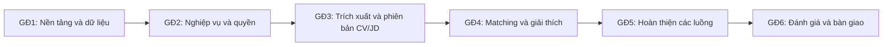

# CareerGap AI – Roadmap Phát triển

> Theo dõi thực thi GĐ1: [task](../docs/tasks/phase-01-foundation.md), [report](../docs/report/phase-01-foundation-report.md). Người dùng đã publish GitHub; CI run `38718678231` của commit `bdb3aeb` thành công. M1 localhost chưa nghiệm thu đầy đủ; cloud được hoãn theo quyết định mới, không còn là điều kiện M1; xem report để phân biệt kết quả local, CI theo commit và phần chưa kiểm chứng.

> Roadmap ở mức giai đoạn lớn (chưa chia task chi tiết). Mỗi giai đoạn kèm các yêu cầu hoàn thiện để coi là "xong" trước khi chuyển sang giai đoạn kế tiếp.

> Người dùng xác nhận dự án do **1 người tự thực hiện**. Giữ mục tiêu **3 tháng / 12 tuần làm việc**; đây chưa phải cam kết đủ nguồn lực. Tuần 1 tính từ ngày người thực hiện khởi động, không mặc định ngày viết tài liệu. Chưa xác nhận số giờ mỗi tuần; cần rà khối lượng theo năng lực thực tế, không chia tiến độ cho ba người hoặc tự cắt chức năng cốt lõi.
>
> Phạm vi nghiệp vụ theo `01-system-specification.md`; lựa chọn và điều kiện công nghệ theo `02-tech-stack-decisions.md`. Các mốc dưới đây là mục tiêu kế hoạch, **không phải trạng thái đã hoàn thành**. Các quyết định nghiệp vụ còn mở vẫn cần được chốt trước phần triển khai phụ thuộc.

## 1. Mục tiêu và nguyên tắc thực hiện

Mục tiêu cuối tuần 12 là một bản web hoàn thiện và chạy được trên localhost, phục vụ hai phía ứng viên và nhà tuyển dụng, có quản lý ứng viên đến sàng lọc, các chức năng AI cốt lõi và báo cáo thực nghiệm có thể đối chiếu với dữ liệu đã sử dụng.

Ba luồng phải hoàn chỉnh:

1. **Ứng viên tìm việc:** quản lý hồ sơ/CV → nhận gợi ý vị trí → xem điểm và giải thích → ứng tuyển → theo dõi kết quả sàng lọc.
2. **Nhà tuyển dụng tìm người:** công khai JD → tìm CV công khai hoặc xem hồ sơ đã ứng tuyển → xem mức phù hợp và bằng chứng → ghi chú, cập nhật kết quả sàng lọc.
3. **Ứng viên cải thiện hồ sơ:** xem kỹ năng còn thiếu theo CV/JD → tìm nguồn học hoặc bổ sung minh chứng → dùng AI hỗ trợ viết nội dung thật → tạo CV theo mẫu, xuất PDF và sử dụng khi ứng tuyển.

Nguyên tắc tổ chức:

- Mỗi giai đoạn tạo ra một phần hệ thống chạy được từ giao diện đến API và dữ liệu. Không chờ hoàn thiện toàn bộ frontend hoặc backend mới tích hợp.
- Dừng deploy từ 15/10/2026; ưu tiên tích hợp và kiểm thử localhost. Chỉ mở lại deploy khi sản phẩm hoàn thiện local và người dùng yêu cầu rõ ràng. Không tiếp tục cấu hình hosting/DNS hoặc migration cloud; giữ nguyên dịch vụ và dữ liệu đã có.
- Fake provider là mặc định cho phát triển/CI. Kiểm chứng AI/search/email thật từ localhost khi có đầu vào và ngân sách được cho phép; không dùng fake làm bằng chứng chất lượng hoặc tích hợp thật.
- Chuẩn bị dữ liệu, gán nhãn và viết báo cáo xuyên suốt; không dồn nghiên cứu AI vào cuối kỳ.
- Ngân sách khoảng **4 USD/tháng** áp dụng cho toàn bộ phát triển, dùng thử, thực nghiệm và demo của một người; không tách ngân sách theo môi trường.
- Người thực hiện ưu tiên một lát tích hợp tại mỗi thời điểm; build/CI có thể chạy trong lúc chuẩn bị dữ liệu hoặc tài liệu. Không lập kế hoạch nhiều nhánh cần nhiều người cùng làm. Phần phụ thuộc chỉ hoàn tất khi đầu vào đạt; hết tuần không tự đồng nghĩa giai đoạn đã xong.
- Dành tuần 11–12 cho đánh giá cuối, sửa lỗi, khôi phục dữ liệu và chuẩn bị bảo vệ. Không lên kế hoạch thêm chức năng cốt lõi mới trong hai tuần này.

## 2. Tổng quan 12 tuần

| Giai đoạn | Thời gian | Trọng tâm | Mốc đầu ra |
| --- | --- | --- | --- |
| GĐ1 | Tuần 1–2 | Chốt quyết định ưu tiên, nền tảng kỹ thuật localhost, chuẩn bị dữ liệu | M1: luồng đăng nhập–file–job fake tối thiểu chạy trên localhost; có kế hoạch dữ liệu và đánh giá |
| GĐ2 | Tuần 3–4 | Tài khoản, profile, công ty/JD, CV, ứng tuyển và sàng lọc thủ công | M2: hai vai trò hoàn thành luồng tuyển dụng cơ bản; baseline từ khóa chạy được |
| GĐ3 | Tuần 5–6 | Trích xuất CV/JD, xác nhận dữ liệu, phiên bản và tạo CV từ mẫu | M3: dữ liệu đầu vào cho matching được kiểm tra; có CV PDF tạo từ mẫu và kết quả đánh giá trích xuất ban đầu |
| GĐ4 | Tuần 7–8 | Đối sánh hai chiều, điểm 0–100, bằng chứng và thực nghiệm sơ bộ | M4: ứng viên tìm việc và nhà tuyển dụng tìm người bằng AI trên bản tích hợp |
| GĐ5 | Tuần 9–10 | Hoàn thiện AI viết CV, nguồn học, quản trị và các luồng tích hợp | M5: đủ chức năng cốt lõi; chốt phiên bản phương pháp trước đánh giá cuối |
| GĐ6 | Tuần 11–12 | Đánh giá chính thức, sửa lỗi, báo cáo, bàn giao và diễn tập | M6: có bản demo ổn định, kết quả thực nghiệm, hướng dẫn và phương án dự phòng |

Chuỗi phụ thuộc chính:

Sơ đồ thể hiện phụ thuộc nghiệm thu. Mẫu CV và tìm kiếm web được thử sớm; người thực hiện dành phần công việc dữ liệu, kiểm thử localhost và báo cáo trong từng giai đoạn, không đợi cuối kỳ và không mặc định có thêm người làm song song.

## 3. Các giai đoạn phát triển

### GĐ1 — Chốt nền tảng, quyền và kế hoạch đánh giá

**Thời gian:** tuần 1–2. **Đầu vào:** đặc tả, quyết định công nghệ và CV/JD mẫu hiện có.

Phạm vi thực hiện:

- Rà các quyết định còn mở: liên hệ khi ứng viên xem CV công khai, quyền khách, quyền quản trị trên CV riêng tư, ngôn ngữ giao diện, trạng thái sàng lọc và chính sách hồ sơ đã gửi. Ghi quyết định đã xác nhận vào đặc tả để triển khai và nghiệm thu nhất quán.
- Hoàn thiện mô hình dữ liệu tổng quan trong tài liệu database cho tài khoản, profile, công ty, tin, CV/phiên bản, đơn ứng tuyển và tác vụ AI. Chốt hợp đồng API tối thiểu trước khi làm các luồng phụ thuộc.
- Khởi tạo repository, frontend, backend, PostgreSQL local, quản lý cấu hình và pipeline build/test cơ bản; chạy bản tích hợp nhỏ trên localhost.
- Thử luồng đăng nhập → tải một file vào kho private → đọc lại theo quyền → gửi một tác vụ fake có hạn mức → xem kết quả. Thử cả PDF có văn bản và DOCX Việt–Anh trong bộ mẫu nhỏ.
- Kiểm chứng cookie/CSRF qua Vite proxy hoặc Docker smoke local, Data Protection và job sau restart; kiểm tra đọc file local theo quyền. Kiểm chứng HTTPS/hosting/storage cloud và redeploy được hoãn đến giai đoạn deploy.
- Thử xuất PDF có dấu tiếng Việt; xác định hợp đồng search/email và hành vi fake. Kiểm chứng provider thật được theo dõi riêng, không yêu cầu hosting/domain để đóng nền tảng localhost.
- Kiểm kê dữ liệu được phép dùng, xác định cách gán nhãn và nhóm dữ liệu điều chỉnh/đánh giá; trao đổi sớm với giảng viên về quy mô, tiêu chí và thời gian hỗ trợ đánh giá.

**Đầu ra:** bản tích hợp nhỏ trên localhost, các quyết định ưu tiên đã ghi nhận, mô hình dữ liệu/API ban đầu, danh mục dữ liệu và kế hoạch đánh giá dự kiến.

Điều kiện hoàn thành M1:

- Người thực hiện dựng lại được dự án theo README trong môi trường sạch; CI build được đúng commit và có bản localhost truy cập được. Không yêu cầu xác nhận của ba thành viên.
- Có ít nhất một lần chạy xuyên suốt thành công trên localhost: đăng nhập → lưu và đọc file đúng quyền → nhận kết quả job fake trong hạn mức test_credit. Các tình huống lỗi liên quan đã được thử; lỗi còn lại không chặn đầu ra M1.
- Có kiểm thử quota, timeout, restart và cách ngừng dispatch trên fake; phân biệt test_credit với USD, mặc định không gọi provider thật và không lộ secrets. Đối soát provider thật phải có bằng chứng riêng trước khi công nhận tích hợp thật.
- Có quyết định về những quyền cần cho GĐ2. Nếu còn chưa chốt, xác định rõ phần phụ thuộc chưa được mở, thay vì tự công khai dữ liệu để hoàn thành demo.
- Bộ dữ liệu mẫu có nguồn, ngôn ngữ, định dạng và mục đích sử dụng; có kế hoạch gán nhãn và trao đổi với giảng viên. Việc giảng viên chưa phản hồi không được ghi thành đã duyệt.
- Có kết luận thử nghiệm hoặc phương án xử lý cụ thể cho storage local, đọc file, xuất PDF và hợp đồng fake search/email; ghi riêng các kiểm chứng provider/production được hoãn. Tích hợp nhỏ thành công chưa có nghĩa các chức năng sản phẩm đã hoàn tất.

### GĐ2 — Hoàn thành nghiệp vụ tuyển dụng cơ bản

**Thời gian:** tuần 3–4. **Đầu vào:** nền tảng M1, mô hình quyền và các hợp đồng dữ liệu cần thiết.

Phạm vi thực hiện:

- Hoàn thiện đăng ký, đăng nhập, đăng xuất, đổi và khôi phục mật khẩu; phân quyền ứng viên, nhà tuyển dụng, quản trị viên.
- Quản lý profile ứng viên và thông tin công ty; kiểm soát các trường profile chỉ nhà tuyển dụng được xem khi chủ hồ sơ chia sẻ.
- Quản lý nhiều CV, tối đa một CV chính công khai, upload private và quyền đọc/tải file. Tạo sẵn cơ chế phiên bản CV/JD để không phải thay mô hình khi thêm AI.
- Đăng/chỉnh sửa/công khai/đóng tin; tìm kiếm, lọc, xem và lưu việc.
- Gửi đơn bằng CV đã chọn, lưu phiên bản lúc nộp; xem danh sách đơn, ghi chú nội bộ, cập nhật trạng thái đến sàng lọc và nhận thông báo trong hệ thống. Rút đơn xử lý theo quy tắc được chốt.
- Dựng baseline từ khóa bằng dữ liệu đã chuẩn bị, có kết quả cho cả chiều CV tìm JD và JD tìm CV; đây là nền so sánh nghiên cứu, không gắn nhãn thành AI đã phân tích sâu.
- Tiếp tục gán nhãn và viết phần phân tích yêu cầu, thiết kế hệ thống của báo cáo.

**Đầu ra:** bản tuyển dụng cơ bản hoạt động độc lập với AI; baseline và dữ liệu đầu tiên có thể dùng để kiểm tra phương pháp.

Điều kiện hoàn thành M2:

- Nhà tuyển dụng đăng tin, ứng viên tìm và ứng tuyển, nhà tuyển dụng xem đúng CV và cập nhật kết quả sàng lọc; ứng viên xem được thay đổi.
- CV riêng tư không tự công khai khi ứng tuyển. Sửa CV không làm thay đổi bản đã gửi; tin đóng không nhận đơn mới.
- Kiểm thử quyền giữa hai ứng viên và hai nhà tuyển dụng cho profile, file, đơn và ghi chú; gửi trực tiếp request sai quyền vẫn bị chặn.
- Nhà tuyển dụng truy cập kho CV công khai theo quyền đã thống nhất, không có bước bắt buộc admin duyệt tài khoản tuyển dụng.
- Khôi phục mật khẩu được kiểm tra trên localhost, gồm token hết hạn/không hợp lệ. Fake email chỉ nghiệm thu logic local; giao nhận email thật được theo dõi riêng và phải kiểm chứng trước khi công nhận sản phẩm hoàn thiện. Thiếu sender không chặn các luồng độc lập.
- Baseline chạy lại được trên cùng dữ liệu và lưu cách tính/xếp hạng; bộ dữ liệu dùng điều chỉnh được phân biệt với tập đánh giá cuối.

### GĐ3 — Trích xuất có xác nhận và tạo CV từ dữ liệu thật

**Thời gian:** tuần 5–6. **Đầu vào:** CV/JD, phiên bản và quyền từ M2; bản tích hợp parser/LLM ở GĐ1.

Phạm vi thực hiện:

- Hoàn thiện đọc PDF có văn bản, DOCX và chuẩn hóa nội dung CV/JD tiếng Việt–Anh; giữ thông tin nguồn để phục vụ giải thích.
- DeepSeek trích xuất dữ liệu có cấu trúc; backend kiểm tra schema, người dùng kiểm tra và sửa trước khi dùng để đối sánh.
- Hoàn thiện trạng thái tác vụ, timeout/retry có giới hạn, phục hồi khi ứng dụng khởi động lại và tránh chạy lại chỉ vì tải lại trang.
- Phân biệt file gốc, kết quả AI trước chỉnh sửa và dữ liệu đã được người dùng xác nhận. Kết quả luôn gắn đúng phiên bản nội dung.
- Xây trình tạo CV từ form, các mẫu cố định và xuất PDF. Số lượng mẫu chốt theo đặc tả; kế hoạch cơ sở dành chỗ cho 2 mẫu, mẫu thứ ba là ưu tiên sau.
- Đưa AI hỗ trợ viết một phần nội dung vào thử nghiệm trên dữ liệu thật đã cung cấp; người dùng có quyền sửa/từ chối trước khi lưu. Hoàn thiện luồng viết CV ở GĐ5.
- Đo chất lượng trích xuất ban đầu, phân tích lỗi theo ngôn ngữ/định dạng; cập nhật rubric và quy tắc chấm điểm dự kiến với giảng viên trước GĐ4.

**Đầu ra:** dữ liệu CV/JD có cấu trúc và có thể kiểm tra, bộ tạo CV hoạt động, báo cáo trích xuất sơ bộ và phiên bản baseline đã cập nhật.

Điều kiện hoàn thành M3:

- Bộ mẫu Việt–Anh được đọc và hiển thị để xác nhận; các trường thiếu không bị tự bịa. File scan, lỗi hoặc không đủ văn bản được báo đúng trạng thái chưa thể xử lý.
- Dữ liệu có thể truy ngược về nguồn; thông tin người dùng bổ sung không bị trình bày thành trích dẫn nguyên văn từ file gốc.
- Các thử nghiệm lỗi JSON, timeout, hết hạn mức và restart không làm mất trạng thái đã nhận hoặc tạo kết quả thành công giả.
- Tạo, lưu, mở lại và xuất được CV theo các mẫu đã chọn; PDF giữ dấu tiếng Việt, phân trang hợp lý và có văn bản có thể chọn/copy. CV tạo ra dùng được trong luồng ứng tuyển.
- Có kết quả đánh giá trích xuất **trước khi người dùng sửa**, kèm danh sách lỗi và giới hạn. Không dùng dữ liệu đã sửa làm bằng chứng AI trích xuất chính xác.
- Bộ tiêu chí, bằng chứng và cách tính điểm đã đủ rõ để hiện thực GĐ4. Nếu chưa có xác nhận cuối của giảng viên, ghi là phiên bản thử nghiệm và không tuyên bố là chuẩn đánh giá đã được thẩm định.

### GĐ4 — Đối sánh hai chiều và giải thích mức phù hợp

**Thời gian:** tuần 7–8. **Đầu vào:** dữ liệu có cấu trúc M3, baseline, quy tắc điểm và tập điều chỉnh.

Phạm vi thực hiện:

- Xây bước chọn tập kết quả có khả năng phù hợp từ dữ liệu được phép xem, sau đó phân tích sâu một nhóm kết quả có giới hạn theo phương án ở tài liệu công nghệ.
- Nhà tuyển dụng tìm trong toàn bộ kho CV công khai theo JD và phân tích riêng tập hồ sơ đã ứng tuyển. Không đưa CV nộp riêng vào kho công khai.
- Ứng viên nhận gợi ý các vị trí đang tuyển theo CV được chọn và phân tích một cặp CV–JD cụ thể, không cần công khai CV của mình.
- Hiển thị điểm 0–100, tiêu chí đáp ứng/một phần/chưa có bằng chứng, yêu cầu bắt buộc và giải thích theo từng vai trò. Phân biệt điểm sơ bộ với kết quả đã phân tích sâu.
- Cache theo phiên bản dữ liệu/phương pháp; kiểm tra quyền lại khi trả kết quả. Tích hợp theo dõi chi phí, hạn mức tài khoản và hạn mức tổng của bản thử nghiệm.
- So sánh baseline và phương pháp có LLM trên tập điều chỉnh; đo cả khả năng tìm ra kết quả phù hợp lẫn thứ tự xếp hạng.
- Từ cuối giai đoạn, tích hợp dần gợi ý viết CV và truy vấn nguồn học theo khoảng cách kỹ năng để chuẩn bị luồng cải thiện hồ sơ ở GĐ5.

**Đầu ra:** hai chiều matching hoạt động trên bản demo, kết quả giải thích có nguồn và bộ kết quả thực nghiệm sơ bộ.

Điều kiện hoàn thành M4:

- Có thể chạy từ giao diện cả CV tìm việc và JD tìm ứng viên; kiểm tra được ứng viên công khai chưa nộp đơn và hồ sơ nộp riêng trong đúng phạm vi.
- Điểm gắn với CV/JD và quy tắc cụ thể; tiêu chí/bằng chứng giải thích được đối chiếu. Thiếu dữ liệu hoặc lỗi dịch vụ không bị đổi thành điểm 0.
- Thay hoặc ẩn CV, thay JD và đóng tin làm kết quả cũ được xử lý đúng theo quyền/phiên bản; cache không mở lại thông tin đã mất quyền xem.
- AI không đổi trạng thái sàng lọc, tự loại hồ sơ hoặc tự ghi đè CV.
- Có bảng so sánh trên tập điều chỉnh, bao gồm trường hợp không tìm được kết quả phù hợp ngay từ bước chọn tập. Chưa gọi đây là kết quả đánh giá độc lập cuối cùng.
- Usage đo được và cơ chế hạn mức hoạt động khi có nhiều request; dùng lại kết quả hợp lệ không phát sinh lời gọi AI mới không cần thiết.

### GĐ5 — Hoàn thiện các tính năng cốt lõi và chốt bản đánh giá

**Thời gian:** tuần 9–10. **Đầu vào:** M4 và các phần tạo CV, tìm nguồn học đã thử từ trước.

Phạm vi thực hiện:

- Hoàn thiện AI viết giới thiệu, kinh nghiệm và dự án từ thông tin thật bằng tiếng Việt/Anh; người dùng duyệt và sửa trước khi lưu vào CV theo mẫu.
- Hoàn thiện tìm tài liệu theo kỹ năng còn thiếu, có tên, nguồn, URL, ngôn ngữ và lý do đề xuất. Xử lý không có kết quả hoặc hết credits độc lập với việc xem điểm CV–JD.
- Hoàn thiện quản trị tài khoản/tin, báo cáo nội dung và màn hình theo dõi lỗi/usage ở mức cần thiết cho đồ án. Quyền admin tuân theo quyết định đã chốt.
- Rà đầy đủ các luồng tài khoản, công khai hồ sơ, tìm/lưu việc, ứng tuyển, sàng lọc, thông báo và dữ liệu đã gửi. Hoàn tất các điểm còn thiếu từ giai đoạn trước.
- Người thực hiện dùng thử tích hợp và sắp xếp giảng viên/người đánh giá góp ý; sửa lỗi từ phản hồi. Kiểm tra các trường hợp đồng thời, file lỗi, nguồn web lỗi, cache, quota và restart.
- Chốt phiên bản tính năng, model, prompt, schema và quy tắc tính điểm cho đánh giá chính thức; chuẩn bị dữ liệu demo tách khỏi dữ liệu đánh giá cuối.
- Hoàn thành phần phương pháp, thiết kế thực nghiệm và hướng dẫn chạy của báo cáo; lập danh sách lỗi còn lại và kế hoạch tuần 11–12.

**Đầu ra:** bản đủ ba luồng sản phẩm cốt lõi, có quản trị cơ bản và cấu hình sẵn sàng để đánh giá cuối.

Điều kiện hoàn thành M5:

- Cả ba luồng ở mục 1 chạy xuyên suốt trên localhost, không dựa vào mock ở bước cần chứng minh tính năng thật.
- AI viết CV không tự thêm kinh nghiệm/chứng chỉ; nguồn học có URL thực từ kết quả công cụ và không giả mạo việc đã đọc nội dung nguồn.
- Các tính năng cốt lõi, bao gồm tạo CV và tìm nguồn học, đã tích hợp; không đẩy sang tuần cuối dưới nhãn mở rộng.
- Không còn lỗi đã biết làm lộ dữ liệu trái quyền, mất đơn ứng tuyển, ghi đè bản CV đã nộp hoặc tự ý thay đổi kết quả sàng lọc.
- Các bộ test cần thiết trong tài liệu công nghệ đã chạy; hạn mức và đường xử lý khi AI/search không khả dụng đã được kiểm tra.
- Cấu hình đánh giá được cố định, tập đánh giá cuối chưa dùng để tinh chỉnh; có kế hoạch sử dụng API đủ cho đánh giá và demo trong hạn mức tháng.
- Các lỗi còn lại có mức độ ảnh hưởng, người phụ trách và thời gian xử lý; nếu còn thiếu chức năng cốt lõi thì M5 chưa đạt, dù đã hết tuần 10.

### GĐ6 — Đánh giá chính thức, ổn định và bàn giao

**Thời gian:** tuần 11–12. **Đầu vào:** bản M5, dữ liệu đánh giá được giữ riêng và phương pháp đã cố định.

Tuần 11 tập trung đánh giá chính thức, tổng hợp phản hồi và sửa lỗi cần thiết. Tuần 12 ưu tiên kiểm tra lại bản bàn giao, dự phòng sự cố và diễn tập bảo vệ; không dùng tuần này làm lịch mặc định để xây thêm tính năng.

Phạm vi thực hiện:

- Chạy baseline và phương pháp có LLM trên cùng tập đánh giá; tổng hợp trích xuất, gợi ý hai chiều, điểm/bằng chứng, nguồn học, thời gian phản hồi và chi phí.
- Giảng viên dùng thử các tác vụ đã định nghĩa; ghi nhận kết quả và phản hồi thực tế, không coi lịch hẹn là bằng chứng đã đánh giá.
- Sửa lỗi còn lại, chạy kiểm thử hồi quy phù hợp. Nếu sửa làm đổi phương pháp AI thì tạo phiên bản mới và đánh giá lại phần bị ảnh hưởng, trình bày rõ trong báo cáo.
- Hoàn thiện báo cáo, phụ lục thực nghiệm, slide, hướng dẫn cài đặt, cấu hình và sử dụng; nêu giới hạn dữ liệu CNTT và các tính năng ngoài phạm vi.
- Thử backup/restore database, file CV và thành phần cần thiết cho xác thực; kiểm tra chạy lại từ hướng dẫn trên một môi trường sạch phù hợp.
- Chuẩn bị tài khoản và dữ liệu demo, kiểm tra chi phí còn lại, thời gian khởi động dịch vụ, kịch bản mạng/API lỗi và một bản ghi demo dự phòng.

**Đầu ra:** bản phát hành bàn giao, báo cáo và bằng chứng thực nghiệm, hướng dẫn vận hành và bộ tài liệu bảo vệ.

Điều kiện hoàn thành M6:

- Mọi chức năng cốt lõi trong phạm vi đã thống nhất có bằng chứng chạy và kiểm thử; phần đánh giá bắt buộc đã hoàn tất. Nếu còn thiếu chức năng hoặc đánh giá thì M6 chưa đạt, dù người thực hiện đã bàn giao được hiện trạng; chỉ các giới hạn/lỗi không chặn phạm vi được ghi nhận như tồn đọng.
- Có dữ liệu kết quả, quy tắc gán nhãn, cấu hình và phiên bản mã đủ để kiểm tra lại cách tính; phân biệt kết quả đo thật, dữ liệu minh họa và kết quả lưu từ lần chạy trước.
- Kết luận nghiên cứu phản ánh kết quả, kể cả khi phương pháp có LLM không cải thiện một tiêu chí; không sửa phương pháp theo tập cuối rồi gọi đó là đánh giá độc lập chưa từng xem.
- Không còn lỗi chặn ba luồng chính hoặc sai quyền nghiêm trọng. Bản bàn giao đã được kiểm tra trên localhost ở commit bàn giao.
- Hướng dẫn chạy và khôi phục đã được thử, tài liệu phù hợp bản localhost bàn giao; thông tin bí mật được quản lý riêng.
- Nhóm diễn tập được kịch bản của cả ứng viên và nhà tuyển dụng, trả lời được cơ sở điểm số, giới hạn AI, chi phí và kết quả thực nghiệm.

## 4. Dữ liệu, thực nghiệm và báo cáo xuyên suốt

### 4.1. Các mốc nghiên cứu

| Thời điểm | Công việc | Bằng chứng cần lưu |
| --- | --- | --- |
| Tuần 1–2 | Kiểm kê CV/JD, quyền sử dụng; chọn nhóm vị trí CNTT, ngôn ngữ/định dạng; xác định rubric và cách chia dữ liệu | Danh mục dữ liệu có phiên bản, hướng dẫn nhãn dự kiến, các câu hỏi cần giảng viên góp ý |
| Tuần 3–4 | Gán nhãn, đối chiếu bất đồng, chạy baseline từ khóa hai chiều | Nhãn, ghi nhận xử lý bất đồng, cấu hình và kết quả baseline |
| Tuần 5–6 | Đánh giá trích xuất; hoàn thiện dữ liệu có cấu trúc và tiêu chí điểm | Kết quả trước chỉnh sửa, lỗi theo loại tài liệu/ngôn ngữ, phiên bản rubric |
| Tuần 7–8 | Thực nghiệm trên tập điều chỉnh, sửa phương pháp theo các lỗi quan sát được | So sánh các phiên bản và lý do thay đổi; kết quả bước chọn tập và xếp hạng |
| Tuần 9–10 | Dùng thử, chốt giao thức và phương pháp cho đánh giá cuối | Cấu hình cố định, tập đánh giá, tiêu chí và dự toán lượt gọi |
| Tuần 11–12 | Đánh giá chính thức, phân tích giới hạn và hoàn thiện báo cáo | Dữ liệu đo, bảng/biểu kết quả, nhận xét giảng viên, hướng dẫn kiểm tra lại |

Quy mô mẫu và ngưỡng chất lượng chưa được xác nhận. Người thực hiện đề xuất quy mô khả thi từ dữ liệu có sẵn ngay GĐ1 và thống nhất với giảng viên trước các đợt đánh giá; không ghi một tỷ lệ chính xác mục tiêu như cam kết đã được chứng minh.

### 4.2. Quy tắc giữ thực nghiệm có ý nghĩa

- Giữ các biến thể của cùng CV/JD trong cùng nhóm dữ liệu khi chia tập; tách dữ liệu tinh chỉnh khỏi đánh giá cuối. Dữ liệu giả nếu dùng phải được ghi nhãn và không thay thế hoàn toàn bằng chứng trên hồ sơ đại diện thực tế.
- Phân biệt độ đúng của AI trích xuất tự động với chất lượng hồ sơ sau khi người dùng sửa; đánh giá cả hai nếu cần nhưng không gộp thành một chỉ số.
- Đánh giá cả CV tìm JD và JD tìm CV. Kiểm tra việc chọn tập có bỏ sót kết quả phù hợp trước khi chỉ đánh giá thứ tự các kết quả đã được chọn.
- Các kết quả chưa được gán nhãn không mặc định là không phù hợp. Ghi rõ phạm vi nhãn và số lượng trường hợp thực sự được người đánh giá xem.
- Khi so sánh hai phương pháp, dùng cùng dữ liệu và cùng quy ước đánh giá. Ghi model, phiên bản prompt, tham số, thời điểm chạy và cách tính chi phí.
- Ghi lại kết quả lần chạy đã lưu để phân tích, nhưng không coi đó là lời gọi mới khi đo độ ổn định hoặc độ trễ. Chỉ thực hiện số lần lặp phù hợp ngân sách đã dự trù.
- Nếu đã xem tập cuối rồi chỉnh thuật toán theo kết quả đó, ghi rõ việc sử dụng lại dữ liệu hoặc chuẩn bị tập kiểm tra khác; không che giấu giới hạn này.
- Báo cáo được viết theo tiến độ thực hiện: yêu cầu/thiết kế ở đầu kỳ, phương pháp khi xây AI, kết quả sau đo; không để mọi chương bắt đầu ở tuần 12.

## 5. Truy vết phạm vi và quyết định phụ thuộc

### 5.1. Tính năng cần có và giai đoạn hoàn thiện

| Nhóm yêu cầu | Giai đoạn chính | Bằng chứng hoàn thành |
| --- | --- | --- |
| Tài khoản, phân quyền, khôi phục mật khẩu | GĐ1–2 | Đăng nhập, logic email khôi phục và kiểm tra sai quyền trên localhost; giao nhận thật ghi riêng |
| Profile ứng viên, thông tin công ty | GĐ2 | Hai vai trò quản lý đúng dữ liệu, trường profile hiển thị đúng quyền |
| JD, tìm/lọc/lưu việc | GĐ2 | Tin công khai tìm được; tin đóng không nhận đơn mới |
| Nhiều CV, một CV công khai, phiên bản lúc nộp | GĐ2–3 | Kiểm tra quyền file, đổi/ẩn CV và không ghi đè bản đã gửi |
| Ứng tuyển, sàng lọc, ghi chú và thông báo | GĐ2; rà lại GĐ5 | Luồng hai phía hoạt động, ghi chú nội bộ không bị lộ |
| Đọc PDF/DOCX tiếng Việt–Anh | Thử GĐ1, hoàn thiện GĐ3 | Kết quả trích xuất có xác nhận và đánh giá trước chỉnh sửa |
| Tạo CV từ mẫu, xuất PDF, AI viết nội dung thật | Thử GĐ1, xây GĐ3, hoàn thiện GĐ5 | CV tạo được, nội dung được người dùng duyệt, ứng tuyển bằng bản PDF đó |
| Gợi ý việc theo CV và ứng viên theo JD | GĐ4 | Hai chiều chạy trên dữ liệu đúng quyền, có thực nghiệm so sánh |
| Điểm 0–100, bằng chứng và khoảng cách kỹ năng | GĐ4 | Giải thích truy được tiêu chí/nguồn, không có điểm giả khi xử lý lỗi |
| Tìm nguồn học bằng công cụ web | Thử GĐ1, tích hợp GĐ4–5 | Nguồn/URL thực, lý do đề xuất và xử lý hết credits |
| Quản trị tài khoản/tin, báo cáo nội dung | Khung quyền GĐ1–2, hoàn thiện GĐ5 | Người có quyền xử lý được các trường hợp mẫu |
| Localhost, kiểm soát quota, phục hồi | Từ GĐ1, hoàn thiện GĐ5–6 | Bản local, kiểm tra restart/quota, backup/restore và hướng dẫn; deploy sau khi hoàn thiện và người dùng yêu cầu |
| Báo cáo và đánh giá thực nghiệm | GĐ1–6 | Dữ liệu và cấu hình có phiên bản, kết quả thật, nhận xét và giới hạn |

### 5.2. Thời điểm cần xử lý các quyết định còn mở

| Quyết định | Mốc cần xử lý | Nếu chưa có kết luận |
| --- | --- | --- |
| Liên hệ CV công khai; khách/admin | Chốt GĐ1, hiện thực GĐ2 | Đã chốt: ứng viên chỉ bản ẩn liên hệ, khách chỉ JD, admin không mặc định đọc private; cần bản dẫn xuất/kiểm tra quyền trước mở API |
| Ngôn ngữ giao diện, role đăng ký, owner công ty | Chốt GĐ1 | Đã chốt UI tiếng Việt, một role Candidate/Recruiter khi đăng ký, một recruiter owner/công ty; không hỏi lại |
| Rút/nộp lại, chặn và lưu/xóa | Chốt chính sách GĐ1, migrations/API tương ứng GĐ2 | Đã chốt recruiter đọc sau rút trong hạn 90 ngày, nộp lại nếu không bị chặn ở tin đó; xóa tài khoản 7 ngày/backup thêm 14 ngày. Các chuyển trạng thái chi tiết còn lại hoàn thiện trước API, không coi worker đã triển khai |
| Domain/hosting và deploy | Hoãn đến sau khi sản phẩm hoàn thiện localhost và người dùng yêu cầu | Kiểm chứng production riêng, không chặn M1 local; giao nhận email thật vẫn phải xác minh trước khi công nhận sản phẩm hoàn thiện |
| Số lượng/mẫu CV | Chốt thiết kế ở GĐ1–2, trước xây GĐ3 | Theo dõi kế hoạch cơ sở 2 mẫu như đề xuất, không coi số lượng là đã được xác nhận |
| Quy mô dữ liệu, rubric và cách chia tập | Bắt đầu GĐ1, cần rõ trước các đợt đánh giá | Báo rõ phần đang thử nghiệm; xin góp ý giảng viên, không tự ghi ngưỡng đã được duyệt |
| Trọng số và cách tính điểm | Bản thử trước GĐ4; cố định cho đánh giá cuối ở M5 | Có thể thử trên tập điều chỉnh, chưa tuyên bố đã đạt chất lượng cuối |
| Hạn mức AI/search và số tác vụ đồng thời | Giới hạn nhỏ từ GĐ1, điều chỉnh theo số đo | Chặn tác vụ vượt dự trù, vẫn cho phép các chức năng không cần dịch vụ ngoài |

Các quyết định được chốt cần cập nhật về tài liệu đặc tả/công nghệ tương ứng. Roadmap ghi thời điểm và phụ thuộc, không thay người dùng quyết định chính sách hiển thị dữ liệu.

## 6. Quản lý tiến độ, chi phí và rủi ro

### 6.1. Điều kiện hoàn thành chung

Mỗi mốc M1–M6 cần được kiểm tra theo cùng nguyên tắc:

- Có đầu ra đúng phạm vi của giai đoạn, tích hợp vào phiên bản chạy được; người thực hiện tự review diff, chạy checklist và lưu bằng chứng. Góp ý của giảng viên/người đánh giá được ghi riêng, không giả định đã có một thành viên khác kiểm tra.
- Có bằng chứng từ bản localhost phù hợp, gồm trường hợp thành công, sai quyền và lỗi đầu vào/dịch vụ liên quan.
- Các kiểm thử cần thiết đã chạy; lỗi còn lại được phân loại và không làm sai kết luận hoàn thành mốc.
- Tài liệu, cấu hình, migration và dữ liệu mẫu cần thiết được cập nhật cùng thay đổi; không đưa secrets hoặc CV cá nhân vào repository công khai.
- Các tác vụ có phí có usage và chi phí để đối chiếu; thực nghiệm không vượt dự toán còn lại của tháng.

Không cần lặp mọi test hoặc gọi lại AI thật sau một thay đổi tài liệu/giao diện nhỏ. Chọn kiểm thử theo phần thay đổi và rủi ro thực tế; CI dùng fake cho dịch vụ ngoài, lần thử thật có mục đích và được tổng hợp usage chung.

### 6.2. Cách xử lý khi chậm hoặc gặp phụ thuộc

| Rủi ro | Cách xử lý trong kế hoạch |
| --- | --- |
| Hosting/proxy/storage không hoạt động như dự kiến | Hoãn kiểm chứng cloud; giữ ranh giới adapter và kiểm tra proxy/storage local. Khi mở lại deploy phải thử tích hợp production trước phát hành, chấp nhận rủi ro cần chỉnh cấu hình lúc đó |
| Email chưa xác minh sender/domain | Giải quyết từ GĐ1; giữ kiểm thử local bằng fake, nhưng báo riêng phần email thật chưa hoàn tất và xử lý trước mốc tài khoản |
| CV nhiều cột/định dạng gây trích xuất sai | Thu thập mẫu từ đầu, giữ nguồn để rà soát và cho người dùng sửa; ghi lỗi trong đánh giá và giữ OCR ngoài phạm vi hiện tại |
| Dữ liệu ít hoặc giảng viên chưa sắp xếp được lịch | Đặt lịch và chuẩn bị rubric sớm; điều chỉnh quy mô có ghi nhận, mô tả giới hạn thay vì tuyên bố độ chính xác cho mọi ngành |
| AI tốn phí hoặc chậm | Giảm số cặp phân tích mỗi lượt, dùng cache hợp lệ, giới hạn output/retry; ưu tiên các lần chạy đem lại bằng chứng cần thiết |
| Tác vụ gián đoạn do dịch vụ ngủ/restart | Lưu trạng thái và phục hồi theo tài liệu công nghệ; giao diện cho biết đang chờ hoặc cần thử lại, không hứa xử lý nền liên tục |
| Một mảng chậm hơn phần còn lại | Giảm việc đang làm đồng thời, ưu tiên phụ thuộc của luồng chính và rà lại lịch mỗi tuần; hoãn phần phụ theo thứ tự bên dưới, không giả định có người khác hỗ trợ |
| Tính năng cốt lõi chưa xong ở tuần 10 | Ghi rõ mốc chưa đạt, lập lại kế hoạch và trao đổi phạm vi; không xóa thời gian thực nghiệm hoặc tự nhận đã hoàn thành |

Thứ tự giảm khối lượng khi cần: hoãn mẫu CV thứ ba, trang trí giao diện, bộ lọc phụ và các tối ưu chưa có nhu cầu; giữ các mẫu cơ sở, luồng nghiệp vụ chính và kiểm chứng. Không tự cắt một chiều matching, giải thích điểm, tạo CV, tìm nguồn học hoặc báo cáo thực nghiệm để bảo đảm mốc trên giấy.

OCR, mobile, chat thời gian thực, quản lý phỏng vấn/offer/hợp đồng, thanh toán và huấn luyện mô hình nền tảng không nằm trong kế hoạch 12 tuần. Không bổ sung các phần này trước khi nghiệm thu phạm vi hiện tại.

### 6.3. Bảo vệ ngân sách và chuẩn bị demo

- Một bảng theo dõi chi phí DeepSeek, credits tìm kiếm và quota hạ tầng; bao gồm thử nghiệm của người thực hiện, dùng thử của giảng viên và lần chạy cuối.
- Dự trù trước đợt thực nghiệm và chỉ chạy trong phần ngân sách tháng còn lại, gồm các lần retry có thể phát sinh. Không nhân hạn mức 4 USD theo môi trường.
- Giữ một phần ngân sách cho kiểm tra bản bàn giao và demo; số cụ thể quyết định sau khi có số đo ở GĐ1, không giả định mọi lượt AI đều có cùng giá.
- Kịch bản demo có dữ liệu mẫu phù hợp, tài khoản các vai trò và một luồng dự phòng chạy local hoặc bản ghi khi dịch vụ ngoài không khả dụng.
- Kết quả đã lưu hoặc video phải được giới thiệu đúng là kết quả/lần chạy trước, không trình bày như API đang hoạt động trực tiếp. Không dùng dữ liệu mô phỏng để thay số liệu thực nghiệm.

## 7. Bộ đầu ra bàn giao

| Nhóm đầu ra | Nội dung cần có |
| --- | --- |
| Mã nguồn và triển khai | Phiên bản cuối frontend/backend, migrations, cấu hình mẫu, hướng dẫn chạy và địa chỉ localhost; URL public chỉ bổ sung sau khi deploy thật |
| Dữ liệu và quyền | Dữ liệu demo được phép dùng, chính sách công khai/lưu giữ đã chốt, cách tạo tài khoản thử và quản lý secrets riêng |
| Tài liệu dự án | Đặc tả, quyết định công nghệ, roadmap cập nhật tiến độ và thiết kế database phù hợp với hệ thống thực tế |
| Thực nghiệm AI | Danh mục dữ liệu, rubric/nhãn, cách chia tập, baseline, cấu hình model/prompt/quy tắc, kết quả và giới hạn |
| Kiểm thử và vận hành | Kết quả kiểm thử chính, lỗi còn biết, usage/chi phí, hướng dẫn backup/restore và xử lý lỗi thường gặp |
| Bảo vệ đồ án | Báo cáo, slide, kịch bản demo hai vai trò và cải thiện CV, bản ghi dự phòng |

Việc hoàn thiện tài liệu roadmap không đồng nghĩa các mốc M1–M6 đã đạt. Người thực hiện ghi ngày nghiệm thu thực tế, phiên bản đầu ra và các thay đổi phạm vi tại từng mốc để kế hoạch phản ánh đúng tiến độ.

## 9. Điều kiện mở lại deploy

Deploy không nằm trong công việc hiện tại và không tự khởi động lại khi hết tuần 12. Trước khi đề xuất mở lại: ba luồng cốt lõi phải hoàn thiện trên localhost, kiểm thử quyền/snapshot/job/quota và build phải có bằng chứng ở phiên bản bàn giao, các tích hợp AI/search/email thật cần thiết phải được kiểm chứng riêng trong ngân sách, không còn lỗi chặn hoặc sai quyền nghiêm trọng. Fake không thay thế đánh giá chất lượng AI.

Sau khi người dùng yêu cầu mở lại, mới rà hosting, giá/quota, secrets, HTTPS, private storage, Data Protection và backup/restore; kiểm chứng production rồi phát hành có kiểm soát. Các điều kiện cloud cũ được chuyển sang bước này, không bị coi là đã đạt hoặc bị loại bỏ khỏi kiểm tra trước phát hành.
