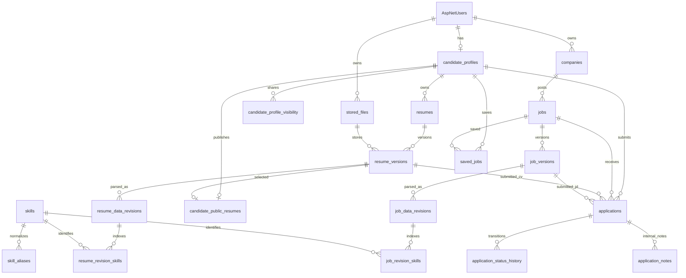
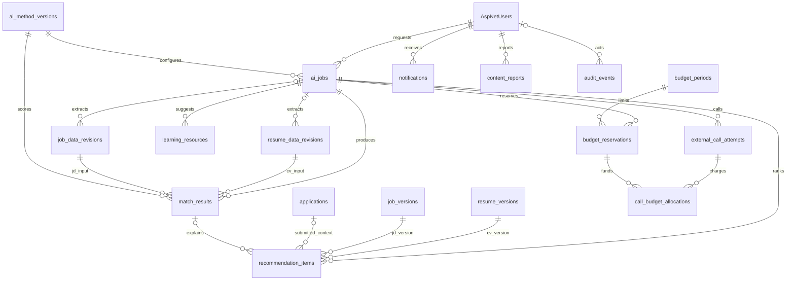

# CareerGap AI – Tài liệu Thiết kế Database

> Lát schema GĐ1 thực tế được ghi tại [hợp đồng/giới hạn](../docs/phase-01-implementation.md). Migrations local mới triển khai tài khoản/DP, owner file/CV versions, job/method và ngân sách tối thiểu; chưa hiện thực toàn bộ thiết kế bên dưới. Những khác biệt về probe output, scope quota, concurrency và đổi kỳ được ghi rõ ở tài liệu thực thi, không thay đổi thiết kế đích ngầm định.

> Thiết kế dữ liệu cho CareerGap AI, thống nhất với đặc tả hệ thống, quyết định công nghệ và roadmap 12 tuần. Bối cảnh: 1 người tự thực hiện, PostgreSQL 16+, .NET 10 monolith và ngân sách phát triển/demo khoảng 4 USD/tháng cho toàn dự án.
>
> Đây là thiết kế đề xuất để triển khai EF Core migrations theo từng giai đoạn, chưa phải schema đã chạy hoặc đã được kiểm thử. Các chính sách nghiệp vụ chưa chốt được ghi riêng ở mục 8; tài liệu không tự mở rộng quyền truy cập hoặc phạm vi tuyển dụng quá bước sàng lọc.

## 1. Tổng quan

**Thứ tự thực hiện từ 15/10/2026:** ưu tiên migrations và kiểm chứng trên PostgreSQL localhost; dừng deploy và migration cloud. Thiết kế dữ liệu đích giữ nguyên. Thông tin Neon đã cấu hình trong [checklist dịch vụ](../docs/phase-01-services-checklist.md) là hiện trạng đã ghi nhận, không phải môi trường phát triển mặc định hoặc quyền tiếp tục thao tác cloud. Chỉ mở lại deploy sau khi sản phẩm hoàn thiện local và người dùng yêu cầu.

### 1.1. Nguyên tắc thiết kế

- Một database PostgreSQL cho Identity và nghiệp vụ, quản lý bằng một `DbContext` như tài liệu 02. Không thêm database vector, message broker hoặc hệ thống phân tích riêng trong bản đầu.
- Dùng bảng quan hệ cho chủ sở hữu, quyền, trạng thái, phiên bản, kỹ năng phục vụ lọc và chi phí. Dùng `jsonb` cho nội dung trích xuất, bằng chứng và cấu hình AI có schema được kiểm tra ở backend.
- PostgreSQL lưu metadata file; PDF/DOCX nằm trong Object Storage riêng tư. Không lưu file nhị phân hoặc URL có chữ ký lâu dài vào bảng CV.
- Tách **tài liệu CV/JD**, **phiên bản nội dung**, **bản dữ liệu trích xuất/xác nhận**, **phương pháp AI** và **kết quả phân tích**. Sửa một lớp không được âm thầm thay đổi lịch sử của lớp khác.
- Công khai CV, chia sẻ trường profile và gửi CV ứng tuyển là ba cơ chế cấp quyền khác nhau. Khóa ngoại chứng minh quan hệ dữ liệu; backend vẫn phải kiểm tra vai trò và quyền trong từng yêu cầu.
- Hành động thay đổi trạng thái đơn ứng tuyển do người dùng có quyền thực hiện. Kết quả AI không tự tạo lịch sử chấp nhận hoặc loại ứng viên.

### 1.2. Quy ước schema

| Quy ước | Áp dụng |
|---|---|
| Tên | Bảng/cột nghiệp vụ dùng `snake_case`; giữ tên bảng Identity theo cấu hình framework để giảm tùy biến |
| Khóa | `id uuid` sinh ở ứng dụng cho bảng nghiệp vụ, trừ bảng dùng PK ghép hoặc PK/FK được nêu rõ; user/role dùng `Guid` từ migration đầu |
| Thời gian | `timestamptz`, lưu UTC; hiển thị theo múi giờ người dùng. `created_at` mặc định `now()` |
| Null | Dấu `?` sau kiểu nghĩa là nullable; các cột còn lại là `NOT NULL`, trừ cột chuẩn do Identity quản lý |
| Bảng thay đổi được | Có `created_at`, `updated_at`, `row_version bigint DEFAULT 0`; cập nhật có điều kiện theo phiên bản và tăng `row_version` trong cùng lệnh |
| Bảng bất biến | Có `created_at`; tạo bản mới thay vì cập nhật nội dung. Không cần `updated_at` hoặc `row_version` |
| Concurrency | `row_version` là token do ứng dụng quản lý trong EF Core, không phải kiểu `rowversion` của SQL Server; lease và đối soát chi phí có cơ chế riêng |
| Tiền/điểm | `numeric`, không dùng `float` cho tiền. Điểm cuối cùng `numeric(5,2)` trong [0,100] |
| Enum | `varchar` + `CHECK`, dễ thay đổi có kiểm soát qua migration; giá trị ở mục 4 |
| Xóa/FK | Mặc định `ON DELETE RESTRICT`; chỉ chọn cascade rõ ràng cho dữ liệu phụ có thể tái tạo và không có yêu cầu giữ lịch sử |
| Chuỗi | Tên/nhãn có giới hạn độ dài ở schema và API; mô tả dùng `text` với giới hạn request. Hash SHA-256 lưu chuỗi hex dài 64 |

Các bảng chi tiết dưới đây chỉ liệt kê cột nghiệp vụ và ràng buộc riêng; áp dụng thêm cột chung theo loại bảng. Với bảng PK ghép/PK là user ID thì không thêm `id` thừa. `CHECK` không thay thế `NOT NULL`, không kiểm tra được quyền hoặc điều kiện của hàng ở bảng khác. [PostgreSQL 16 — Constraints](https://www.postgresql.org/docs/16/ddl-constraints.html)

### 1.3. Module và giai đoạn triển khai

| Module | Nhóm bảng | Giai đoạn trong roadmap |
|---|---|---|
| Tài khoản, profile, công ty | Identity, Data Protection, `candidate_profiles`, `candidate_profile_visibility`, `companies` | GĐ1–2 |
| CV và file | `stored_files`, `resumes`, `resume_versions`, `candidate_public_resumes` | Khung GĐ1; hoàn thiện GĐ2–3 |
| JD và kỹ năng | `jobs`, `job_versions`, `skills`, `skill_aliases`, các bảng data revision/skill projection | GĐ2–3 |
| Ứng tuyển, sàng lọc | `saved_jobs`, `applications`, `application_status_history`, `application_notes` | GĐ2 |
| Điều phối và chi phí AI | `ai_method_versions`, `ai_jobs`, `budget_periods`, `budget_reservations`, `external_call_attempts`, `call_budget_allocations` | Khung và hạn mức GĐ1; mở rộng GĐ3–5 |
| Phân tích/gợi ý | `resume_data_revisions`, `job_data_revisions`, `match_results`, `recommendation_items`, `learning_resources` | GĐ3–5 |
| Thông báo, quản trị | `notifications`, `content_reports`, `audit_events` | Thông báo cơ bản GĐ2; quản trị GĐ5 |

GĐ6 ổn định schema, kiểm thử khôi phục và thực nghiệm; không dành tới cuối dự án mới bổ sung cơ chế quyền, phiên bản hoặc kiểm soát ngân sách.

## 2. Sơ đồ quan hệ (ERD)

Hai sơ đồ thể hiện quan hệ chính. Khóa ghép chống trộn chủ sở hữu, các con trỏ nullable và những FK kỹ thuật được mô tả đầy đủ ở mục 3 và 5.





Quan hệ từ `ai_jobs` tới data revision là tùy chọn ở phía revision: bản nhập tay/xác nhận không bắt buộc có tác vụ AI. User và job bị báo cáo là các FK đích khác với người gửi báo cáo.

## 3. Chi tiết bảng theo module

### 3.1. Tài khoản, profile và công ty

**Identity và Data Protection — GĐ1**

Sử dụng `ApplicationUser : IdentityUser<Guid>` và `IdentityRole<Guid>`. Các bảng nền gồm `AspNetUsers`, `AspNetRoles`, `AspNetUserRoles`, `AspNetUserClaims`, `AspNetRoleClaims`, `AspNetUserLogins`, `AspNetUserTokens`; giữ cấu trúc mật khẩu, security stamp, lockout và token của framework. Khóa user/role là UUID nhưng khóa claim chuẩn vẫn là `int`. Kiểm tra schema version được chọn: Identity 10 schema V3 có thêm `AspNetUserPasskeys`; passkey không phải tính năng bắt buộc của đồ án. [Identity model](https://learn.microsoft.com/en-us/aspnet/core/security/authentication/customize-identity-model?view=aspnetcore-10.0), [Identity 10 source](https://github.com/dotnet/aspnetcore/blob/v10.0.0/src/Identity/EntityFrameworkCore/src/IdentityUserContext.cs)

- Bổ sung vào user: `account_status varchar(24)`, `created_at`, `updated_at`, `deletion_requested_at timestamptz?`. Dùng cơ chế concurrency của Identity cho user, không thêm hệ mật khẩu hoặc refresh token song song.
- Vai trò: `Candidate`, `Recruiter`, `Admin`; người đăng ký không được tự cấp `Admin`. Giữ schema user–role nhiều–nhiều của Identity để tương thích framework, nhưng API bản đầu chỉ cho đăng ký một vai trò Candidate hoặc Recruiter; không tự thêm/chuyển vai trò. Admin cấp riêng có kiểm soát.
- Nếu email là định danh đăng nhập, yêu cầu email và tạo unique index cho `NormalizedEmail` khác null; kiểm tra dữ liệu trùng trước khi thêm. Không giả định index email mặc định của Identity đã unique.
- Lưu Data Protection keys bằng EF với entity chuẩn: `Id int`, `FriendlyName text?`, `Xml text?`. Khóa phải được bảo vệ bằng chứng thư/secret theo tài liệu 02; lưu vào DB không tự mã hóa khóa. Không xóa key cũ tùy tiện khi đang có cookie/token còn dùng. [Key storage providers](https://learn.microsoft.com/en-us/aspnet/core/security/data-protection/implementation/key-storage-providers?view=aspnetcore-10.0), [DataProtectionKey source](https://github.com/dotnet/aspnetcore/blob/v10.0.0/src/DataProtection/EntityFrameworkCore/src/DataProtectionKey.cs)

| Bảng | Cột chính | Ràng buộc và ý nghĩa |
|---|---|---|
| `candidate_profiles` | `user_id uuid` PK/FK user; `display_name varchar(150)`; `headline varchar(250)?`; `summary text?`; `location varchar(250)?`; `contact_email varchar(254)?`; `contact_phone varchar(32)?`; `desired_role varchar(150)?`; `preferred_work_mode varchar(24)?`; `experience_years numeric(5,2)?`; `details jsonb DEFAULT '{}'`; `details_schema_version int` | Bảng thay đổi được. `experience_years >= 0`; schema version > 0. `details` chứa nhóm kinh nghiệm, học vấn, dự án, chứng chỉ, kỹ năng theo schema, không phải dữ liệu JSON tùy ý. Contact của profile không đồng nghĩa email đăng nhập |
| `candidate_profile_visibility` | `candidate_id uuid` FK profile; `field_key varchar(64)` | PK `(candidate_id, field_key)`; chỉ có `created_at`. Có hàng nghĩa là cho nhà tuyển dụng xem trường đó; xóa hàng để ngừng chia sẻ. Mặc định không chia sẻ; danh sách trường hợp lệ ở mục 4 |
| `companies` | `id`; `owner_user_id uuid` FK user; `name varchar(200)`; `slug varchar(200)`; `description text?`; `website_url text?`; `location varchar(250)?`; `industry varchar(100)?`; `size_label varchar(50)?`; `archived_at timestamptz?` | Bảng thay đổi được; unique `slug`. Đã chốt mỗi công ty có một recruiter owner; thiết kế vẫn cho một recruiter nhiều bản ghi, không tự thêm giới hạn số công ty từ quyết định owner. Backend kiểm tra role, không suy ra quyền từ tên công ty giống nhau |

Chưa cần bảng `recruiter_profiles` nếu thông tin người liên hệ dùng các trường chuẩn của user và hồ sơ công ty. Nếu bổ sung trường riêng cho recruiter, thêm bảng PK/FK user trong migration tương ứng. Không xây workspace, mời thành viên hoặc cộng tác nhiều recruiter trong bản đầu. Việc chuyển quyền sở hữu công ty chưa thuộc phạm vi; không mở API đổi owner trực tiếp vì sẽ ảnh hưởng quyền xem hồ sơ đã ứng tuyển.

### 3.2. File, CV và quyền công khai

**GĐ1–3; bảng phiên bản/revision là bất biến, trừ trạng thái file và lựa chọn công khai.**

| Bảng | Cột chính | Ràng buộc và ý nghĩa |
|---|---|---|
| `stored_files` | `id`; `owner_user_id uuid` FK user; `storage_provider varchar(40)`; `bucket varchar(100)`; `object_key text`; `original_name varchar(255)`; `mime_type varchar(100)`; `size_bytes bigint`; `sha256 char(64)?`; `status varchar(24)`; `verified_at timestamptz?`; `deleted_at timestamptz?`; `error_code varchar(80)?` | Bảng thay đổi được. Unique `(id, owner_user_id)` và `(storage_provider, bucket, object_key)`; size >= 0. `ready` yêu cầu hash và thời điểm xác minh. Backend xác minh định dạng, kích thước, checksum trước khi tạo version tham chiếu; không dùng tên file làm object key |
| `resumes` | `id`; `candidate_id uuid` FK profile; `title varchar(200)`; `archived_at timestamptz?` | Bảng thay đổi được; unique `(id, candidate_id)`. Không có `is_public`; quyền công khai do bảng lựa chọn riêng quản lý. Phiên bản gần nhất truy vấn theo `version_no` |
| `resume_versions` | `id`; `resume_id uuid`; `candidate_id uuid`; `version_no int`; `file_id uuid`; `source varchar(24)`; `language varchar(12)`; `document_hash char(64)`; `template_code varchar(80)?`; `template_version varchar(40)?`; `editor_data jsonb?`; `editor_schema_version int?` | Unique `(resume_id, version_no)`, `(id, candidate_id)`, `(id, resume_id)`; version > 0. FK `(resume_id, candidate_id)` → resumes; FK `(file_id, candidate_id)` → stored_files `(id, owner_user_id)`. `generated` yêu cầu đủ template và editor data/schema; `uploaded` không cần. Mỗi version tham chiếu file đã sẵn sàng |
| `resume_data_revisions` | `id`; `resume_version_id uuid`; `candidate_id uuid`; `revision_no int`; `parent_revision_id uuid?`; `origin varchar(24)`; `schema_version int`; `structured_data jsonb`; `source_text jsonb`; `evidence jsonb`; `data_hash char(64)`; `parser_version varchar(80)`; `method_version_id uuid?` FK phương pháp; `ai_job_id uuid?` FK tác vụ; `confirmed_by uuid?` FK user; `confirmed_at timestamptz?` | Unique `(resume_version_id, revision_no)`, `(id, resume_version_id)`, `(id, candidate_id)`; revision/schema > 0. FK `(resume_version_id, candidate_id)` → resume_versions. FK `(parent_revision_id, resume_version_id)` → cùng bảng bảo đảm cùng file version. Bản AI bắt buộc method/job; bản người dùng xác nhận/nhập yêu cầu người xác nhận và thời điểm |
| `resume_revision_skills` | `resume_revision_id uuid` FK revision; `skill_id uuid` FK skill; `experience_years numeric(5,2)?`; `evidence_refs jsonb` | PK `(resume_revision_id, skill_id)`; years >= 0; danh sách evidence refs được kiểm tra theo schema. Projection bất biến để lọc/tìm kiếm, ghi cùng transaction tạo revision |
| `candidate_public_resumes` | `candidate_id uuid` PK/FK profile; `resume_version_id uuid`; `resume_revision_id uuid?`; `published_at timestamptz`; bổ sung GĐ2 đề xuất: `redacted_file_id uuid?`, `redaction_source_hash char(64)?`, `redaction_method_version varchar(80)?`, `redaction_verified_at timestamptz?` | Bảng thay đổi được; FK `(resume_version_id, candidate_id)` → resume_versions; FK `(resume_revision_id, resume_version_id)` → resume_data_revisions. FK `(redacted_file_id, candidate_id)` → stored_files `(id, owner_user_id)` cho bản ẩn liên hệ. PK bảo đảm tối đa một lựa chọn công khai; nhóm metadata redaction cùng null hoặc cùng đủ, kiểm tra đúng source version trong service/transaction |

**Quy tắc phiên bản và dữ liệu:**

- Thay file hoặc nội dung CV tạo `resume_versions` mới. Chạy lại parser hoặc sửa dữ liệu trích xuất tạo `resume_data_revisions` mới, kể cả khi file không đổi. `parent_revision_id` trỏ bản trước, không trỏ chính mình; backend yêu cầu số revision cha nhỏ hơn con.
- `source_text` lưu văn bản đọc được theo trang/phần; `evidence` phân biệt `document_span` và `user_statement`. Bản người dùng xác nhận do chính chủ xác nhận; nội dung bổ sung không trở thành trích dẫn giả từ file gốc. Parser không áp dụng cho bản nhập tay dùng mã quy ước `manual-v1`.
- Dữ liệu mẫu CV nằm trong mã nguồn có `template_code`/`template_version`, không cần bảng quản trị template riêng. File PDF được lưu khi tạo version hoàn chỉnh; bản nháp form chưa xuất file chưa phải CV có thể gửi ứng tuyển.
- Công khai ghim một **file version cụ thể** và revision được chọn, không tự đổi sang bản mới vừa tải lên. Revision công khai, nếu có, phải là bản chính chủ đã xác nhận; công khai lại khi muốn đổi dữ liệu hiển thị/phân tích.
- Có thể công khai CV chưa có revision xác nhận. Nếu đã có bản trích xuất từ đúng file version, chỉ dùng source_text gốc cho tìm nội dung, không lấy user_statement bổ sung sau đó. Nếu chưa trích xuất được, vẫn xem file/tìm theo metadata và hiển thị đang chờ xử lý nội dung. Không gán điểm sâu cho CV chưa đủ dữ liệu; hoàn tất xác nhận rồi cập nhật lựa chọn công khai để bật phân tích đầy đủ.
- Ẩn CV là xóa lựa chọn công khai; không xóa version đã gửi ứng tuyển. Mặc định tải file qua backend kiểm tra quyền theo tài liệu 02. Nếu sau này chọn cấp URL có chữ ký ngắn hạn, kiểm tra quyền trước khi cấp và ghi nhận URL đã cấp vẫn có hiệu lực tới lúc hết hạn; không hứa thu hồi tức thì liên kết đó.

**Bản CV ẩn liên hệ — yêu cầu đã chốt, schema bổ sung còn là đề xuất GĐ2:** ứng viên khác không nhận file gốc, source_text hoặc dữ liệu phụ có liên hệ. Bản dẫn xuất là stored_file riêng, private, đã xác minh và bất biến; không phủ hình lên PDF rồi để text/link/metadata gốc còn đọc được. `redaction_source_hash` phải khớp document_hash của version đang công khai; chỉ gắn con trỏ sau xác minh nội dung và hash, không chỉ kiểm tra cùng owner. Nếu chưa có bản an toàn, ứng viên khác nhận trạng thái chưa sẵn sàng; recruiter còn quyền có thể xem bản có liên hệ. Thay version/công khai lại phải tạo/chọn đúng bản dẫn xuất mới; ẩn CV/đổi quyền chặn cả đường dẫn cũ. Dọn object phải xét cả tham chiếu redacted_file_id; không xóa/sửa file gốc đã dùng ứng tuyển.

### 3.3. Kỹ năng, JD và lưu việc

**GĐ2–3; JD sửa nội dung tạo version, thay trạng thái sửa `jobs`.**

| Bảng | Cột chính | Ràng buộc và ý nghĩa |
|---|---|---|
| `skills` | `id`; `code varchar(100)`; `name varchar(150)`; `category varchar(100)?`; `is_active boolean DEFAULT true` | Bảng thay đổi được; unique `code`. Danh mục phục vụ chuẩn hóa/lọc, ưu tiên CNTT; không giới hạn ngành của toàn hệ thống |
| `skill_aliases` | `id`; `skill_id uuid` FK skill; `normalized_alias varchar(150)`; `language varchar(12)` | Bảng thay đổi được; unique `(normalized_alias, language)`; chuẩn hóa khoảng trắng/chữ hoa thường ở backend. Thay từ điển cần cập nhật phiên bản bộ chuẩn hóa khi tạo kết quả mới |
| `jobs` | `id`; `company_id uuid` FK company; `status varchar(24)`; `current_version_id uuid?`; `current_data_revision_id uuid?`; `published_at timestamptz?`; `closed_at timestamptz?`; `application_deadline timestamptz?` | Bảng thay đổi được. FK `(current_version_id, id)` → job_versions `(id, job_id)`; FK `(current_data_revision_id, current_version_id)` → job_data_revisions `(id, job_version_id)`. CHECK revision có giá trị thì version phải có; `published` yêu cầu version và published_at |
| `job_versions` | `id`; `job_id uuid` FK job; `created_by uuid` FK user; `version_no int`; `title varchar(200)`; `description text`; `requirements_text text`; `benefits_text text?`; `industry varchar(100)?`; `location varchar(250)?`; `employment_type varchar(24)`; `work_mode varchar(24)`; `experience_min numeric(5,2)?`; `experience_max numeric(5,2)?`; `salary_min numeric(18,2)?`; `salary_max numeric(18,2)?`; `salary_currency char(3)?`; `salary_period varchar(16)?`; `language varchar(12)`; `content_hash char(64)` | Bất biến; unique `(job_id, version_no)`, `(id, job_id)`; version > 0, min/max không âm và min <= max khi cùng có. Nếu có salary_min hoặc salary_max thì currency/period bắt buộc; nếu không có cả hai thì currency/period để null. API kiểm tra mã tiền tệ hợp lệ |
| `job_data_revisions` | `id`; `job_version_id uuid` FK version; `revision_no int`; `parent_revision_id uuid?`; `origin varchar(24)`; `schema_version int`; `structured_data jsonb`; `evidence jsonb`; `data_hash char(64)`; `method_version_id uuid?` FK phương pháp; `ai_job_id uuid?` FK tác vụ; `confirmed_by uuid?` FK user; `confirmed_at timestamptz?` | Bất biến; unique `(job_version_id, revision_no)`, `(id, job_version_id)`; revision/schema > 0. FK cha ghép với job_version_id. Quy tắc nguồn/xác nhận tương tự CV; backend kiểm tra người xác nhận quản lý đúng tin |
| `job_revision_skills` | `job_revision_id uuid` FK revision; `skill_id uuid` FK skill; `requirement_refs jsonb` | PK `(job_revision_id, skill_id)`; projection bất biến. Các refs giữ liên hệ tới yêu cầu trong structured_data; không tự suy ra mọi skill là bắt buộc |
| `saved_jobs` | `candidate_id uuid` FK profile; `job_id uuid` FK job | PK `(candidate_id, job_id)`; có created_at, không cần id/updated_at. Tin đóng vẫn có thể nằm trong danh sách đã lưu nhưng hiển thị trạng thái hiện tại |

`structured_data` của JD chứa các yêu cầu có `requirement_key` duy nhất trong một revision, mức ưu tiên và điều kiện kết hợp. Ví dụ “Docker hoặc công cụ tương đương” phải giữ quan hệ lựa chọn; không biến thành nhiều yêu cầu bắt buộc độc lập. Các khoảng kinh nghiệm/lương được kiểm tra bằng CHECK từng hàng; điều kiện tin còn nhận đơn phải kiểm tra ở transaction ứng tuyển, không dùng `CHECK (deadline > now())`.

Tạo tin mới theo transaction: thêm `jobs` dạng draft với con trỏ null → thêm version → cập nhật con trỏ. FK vòng được tạo sau khi các bảng tồn tại trong migration; không tắt toàn bộ kiểm tra FK. Chỉ công khai JD có dữ liệu hợp lệ; lỗi AI không được chặn đăng tin hợp lệ nhập tay. `jobs.company_id`, `companies.owner_user_id`, `resumes.candidate_id` và `stored_files.owner_user_id` không được đổi sau khi tạo trong bản đầu, tránh chuyển quyền đọc tài liệu thông qua sửa khóa sở hữu.

### 3.4. Ứng tuyển và sàng lọc

**GĐ2; không có bảng phỏng vấn, offer hoặc hợp đồng.**

| Bảng | Cột chính | Ràng buộc và ý nghĩa |
|---|---|---|
| `applications` | `id`; `candidate_id uuid` FK profile; `job_id uuid` FK job; `submitted_resume_version_id uuid`; `submitted_resume_revision_id uuid?`; `submitted_job_version_id uuid`; `submitted_job_revision_id uuid?`; `status varchar(24)`; `submitted_at timestamptz`; `status_changed_at timestamptz`; `withdrawn_at timestamptz?`; `submission_key uuid`; `submission_hash char(64)` | Bảng thay đổi được nhưng các cột submitted_* và candidate/job bất biến. Unique `(candidate_id, submission_key)`. FK ghép CV version với candidate, CV revision với CV version; JD version với job, JD revision với JD version. Partial unique một đơn còn hiệu lực trên `(candidate_id, job_id)` ở mục 5 |
| `application_status_history` | `id`; `application_id uuid` FK application; `from_status varchar(24)?`; `to_status varchar(24)`; `actor_user_id uuid` FK user; `changed_at timestamptz`; `reason_code varchar(80)?` | Chỉ thêm, không sửa; bản đầu có from_status null, to_status submitted. Mỗi lần đổi trạng thái phải có actor hợp lệ; AI không là actor ra quyết định |
| `application_notes` | `id`; `application_id uuid` FK application; `author_user_id uuid` FK user; `body text`; `deleted_at timestamptz?` | Bảng thay đổi được, ghi chú nội bộ của recruiter quản lý tin; không trả cho ứng viên hoặc đưa vào kết quả AI dùng chung |

Các phiên bản tại thời điểm gửi là dữ liệu tham chiếu bất biến, đóng vai trò snapshot mà không phải nhân bản file. Ghim thêm JD lúc nộp là **đề xuất thiết kế** để giải thích kết quả khi JD thay đổi. Phân tích lại theo JD mới cần chọn ngữ cảnh rõ và hiển thị đúng phiên bản đã dùng.

Ứng tuyển không chờ AI: revision có thể null nhưng file version và JD version bắt buộc. Khi phân tích sau đó, dùng đúng tài liệu đã ghim; nếu chưa có revision lúc nộp, chỉ tạo/chọn revision trích xuất từ chính tài liệu đó, không tự lấy phần ứng viên bổ sung sau thời điểm gửi. Job AI lưu revision thực sự đã dùng; không điền lại con trỏ submitted_* để làm thay đổi lịch sử.

Các trạng thái còn hiệu lực là `submitted`, `reviewing`, `shortlisted`. Database ngăn hai đơn còn hiệu lực cho cùng cặp ứng viên–tin. Đã chốt cho nộp lại sau rejected/withdrawn nếu không bị recruiter chặn ở chính tin đó; mỗi lần là application mới, submission_key/hash và snapshot riêng. Cùng key trả lại đơn cũ hoặc conflict nếu khác hash; không tái dùng key để giả lần nộp mới. Rút đơn đổi trạng thái và withdrawn_at, không xóa file hoặc lịch sử. CHECK bảo đảm withdrawn_at có giá trị khi và chỉ khi status là withdrawn.

**Bổ sung thiết kế GĐ2 do quyết định mới, chưa có migration:** `job_candidate_blocks` có PK `(job_id, candidate_id)`, FK tới jobs/candidate_profiles, created_by FK user và created_at UTC. Chỉ recruiter phụ trách job được đặt/bỏ chặn; hàng tồn tại chặn nộp mới vào job đó, không lan sang tin khác cùng recruiter/công ty. Ghi đơn phải kiểm tra block, trạng thái/deadline và chống đơn trùng trong transaction có phối hợp khóa với luồng chặn; không để kiểm tra rồi insert ở transaction khác. Block không sửa snapshot/trạng thái đơn cũ, không do AI thực hiện.

**Lưu/xóa đã chốt:** withdrawn/rejected hết quyền đọc qua application sau 90 ngày từ status_changed_at kết thúc của chính đơn; recruiter phụ trách tin còn đọc trước mốc đó nếu tài khoản chưa yêu cầu xóa. Đề xuất bổ sung retention_expires_at cho application và trạng thái purge/deletion request có thể đối soát ở GĐ2, không backfill bằng thời điểm hiện tại khi đã biết mốc kết thúc thật. Yêu cầu xóa tài khoản thu hồi truy cập ngay, cho 7 ngày hủy rồi purge/ẩn danh dữ liệu chính, backup chứa dữ liệu đó hết hạn thêm tối đa 14 ngày; chính sách xóa tài khoản ưu tiên hơn hạn application. Xem [chính sách đầy đủ](../docs/phase-01-data-retention.md). File còn được ngữ cảnh hợp lệ khác tham chiếu không bị xóa chỉ vì một đơn hết hạn; mọi lần đọc vẫn kiểm tra đúng ngữ cảnh. Purge là quy trình riêng có review, không dùng cascade hoặc UPDATE API thông thường để vượt immutable guards.

### 3.5. Tác vụ AI, kết quả và nguồn học

**Khung điều phối GĐ1; trích xuất GĐ3, đối sánh GĐ4, viết CV/nguồn học GĐ5.**

| Bảng | Cột chính | Ràng buộc và ý nghĩa |
|---|---|---|
| `ai_method_versions` | `id`; `code varchar(80)`; `version_no int`; `task_family varchar(40)`; `provider varchar(40)`; `model varchar(120)`; `provider_model_revision varchar(120)?`; `prompt_ref text`; `prompt_hash char(64)`; `output_schema_version varchar(40)`; `parameters jsonb`; `scoring_rules jsonb`; `normalization_version varchar(80)`; `scoring_code_version varchar(80)`; `config_hash char(64)` | Bất biến; unique `(code, version_no)`, version > 0. Lưu snapshot cấu hình, trọng số và phiên bản mã thực thi; prompt_ref trỏ tài nguyên có phiên bản trong repo. Các phần không áp dụng ghi giá trị quy ước rõ, không để thiếu thông tin tái lập |
| `ai_jobs` | `id`; `requested_by uuid` FK user; `method_version_id uuid` FK phương pháp; `scoring_method_version_id uuid?` FK phương pháp chấm cặp; `job_type varchar(40)`; `access_context varchar(32)`; `status varchar(24)`; `resume_version_id uuid?`; `resume_revision_id uuid?`; `job_version_id uuid?`; `job_revision_id uuid?`; `application_id uuid?` FK application; `input_options jsonb`; `input_hash char(64)`; `idempotency_key uuid`; `available_at timestamptz`; `attempt_count int DEFAULT 0`; `max_attempts int`; `lease_owner varchar(100)?`; `lease_until timestamptz?`; `lease_generation bigint DEFAULT 0`; `cancel_requested_at timestamptz?`; `finished_at timestamptz?`; `error_code varchar(80)?`; `output_json jsonb?`; `output_schema_version varchar(40)?` | Bảng thay đổi được; input, người yêu cầu và phương pháp bất biến. Unique `(requested_by, job_type, idempotency_key)`. FK riêng tới version; FK ghép revision+version cho CV/JD; CHECK có revision thì có version. attempt >= 0, max_attempts >= 1, generation >= 0. Chạy nền theo lease; output_json chỉ chứa đầu ra không có bảng riêng như bản viết lại nội dung CV |
| `match_results` | `id`; `resume_revision_id uuid` FK CV revision; `job_revision_id uuid` FK JD revision; `method_version_id uuid` FK phương pháp; `ai_job_id uuid` FK tác vụ; `input_fingerprint char(64)`; `score numeric(5,2)`; `criteria jsonb`; `explanation jsonb`; `schema_version int`; `experiment_run_key uuid?` | Bất biến, chỉ lưu kết quả hợp lệ; CHECK score từ 0 tới 100, schema > 0. Unique `(id, resume_revision_id, job_revision_id)` để item tham chiếu đúng cặp. Partial unique cache theo cặp revision+method+fingerprint khi experiment_run_key null |
| `recommendation_items` | `id`; `ai_job_id uuid` FK tác vụ; `resume_version_id uuid` FK CV version; `resume_revision_id uuid?`; `job_version_id uuid` FK JD version; `job_revision_id uuid?`; `application_id uuid?` FK application; `rank int`; `retrieval_score numeric(12,6)?`; `match_result_id uuid?` | Bất biến; unique `(ai_job_id, rank)`; rank > 0. FK ghép revision với version cho cả CV/JD; FK `(match_result_id, resume_revision_id, job_revision_id)` → match_results. CHECK có match_result thì đủ hai revision. Partial unique theo version/cặp hoặc theo application như mô tả dưới; cho phép mục chưa đủ dữ liệu chấm sâu |
| `learning_resources` | `id`; `ai_job_id uuid` FK tác vụ; `rank int`; `skill_id uuid?` FK skill; `skill_label varchar(150)`; `title text`; `url text`; `source_name varchar(200)`; `language varchar(12)`; `level varchar(40)?`; `recommendation_reason text`; `search_provider varchar(40)`; `fetched_at timestamptz`; `expires_at timestamptz?` | Bất biến trong một lần tìm; unique `(ai_job_id, rank)`, rank > 0. Chỉ lưu link/metadata được phép lưu theo điều khoản nguồn; không sao chép nguyên trang. URL được kiểm tra giao thức và nguồn trả về, không lấy link do LLM tự bịa |

**Đầu vào và quyền của `ai_jobs`:**

| job_type | Đầu vào bắt buộc | Ngữ cảnh và đầu ra |
|---|---|---|
| `extract_cv` | resume_version_id | Chính chủ; tạo CV revision ban đầu. Luồng phân tích hồ sơ đã nộp có thể dùng application và đúng file đã gửi |
| `extract_jd` | job_version_id | Recruiter quản lý tin; tạo JD revision; không tự công khai revision chưa được xác nhận |
| `match_pair` | Cả hai revision và version tương ứng | `self`, `public_pool` hoặc `application`; tạo match_result |
| `recommend_jobs` | CV version/revision | `self`; tìm các JD đang công khai và còn nhận hồ sơ, tạo recommendation_items |
| `recommend_candidates` | JD version/revision | `public_pool`; tìm trên toàn kho CV công khai hiện tại, tạo recommendation_items |
| `rank_applications` | JD version/revision | `application_pool`; chỉ các đơn gửi tới đúng tin do recruiter quản lý, tạo recommendation_items |
| `write_cv` | CV version/revision đã chọn, hoặc snapshot form đã xác nhận trong input_options | `self`; lưu nội dung đề xuất trong output_json; người dùng duyệt rồi mới tạo CV version mới. Form mới không bắt buộc có file trước |
| `search_learning` | Cả hai revision và version tương ứng | `self`; tìm tài liệu cho khoảng thiếu cụ thể, tạo learning_resources |

Backend kiểm tra ma trận trên cùng các quy tắc: version/revision thuộc đúng chủ/ngữ cảnh; `application` cần application_id và tài liệu đúng đơn; `application_pool` gắn với tin gốc của JD và kiểm tra từng đơn; `self` cần CV thuộc người yêu cầu; `public_pool` chỉ dùng CV hiện đang công khai. `input_options` lưu bộ lọc, giới hạn tập, phiên bản cách chọn tập và các tham số đã chuẩn hóa; không dùng JSON để thay FK tài liệu đã có cột riêng. Khi lấy kết quả vẫn kiểm tra quyền hiện tại.

Các `recommendation_items` của `rank_applications` bắt buộc có application_id và cặp CV/JD được xác minh theo ngữ cảnh đơn; các loại gợi ý còn lại không gắn application_id. Dùng partial unique `(ai_job_id, application_id) WHERE application_id IS NOT NULL`; với item không gắn đơn dùng partial unique `(ai_job_id, resume_version_id, job_version_id) WHERE application_id IS NULL`. Trong một lần gợi ý chỉ chọn một revision cho mỗi version. Cách này không gộp nhầm hai đơn dùng cùng CV nếu chính sách cho phép nộp lại. Không suy ra quyền từ một đơn bất kỳ có cùng CV. retrieval_score chỉ phục vụ thứ tự chọn tập, không hiển thị như điểm phù hợp 0–100.

`ai_jobs.scoring_method_version_id` giữ bất biến cùng input. Các job recommend_jobs/recommend_candidates/rank_applications có chấm sâu phải ghim phương pháp chấm cặp này; match_pair dùng method_version_id trực tiếp. Cấu hình pipeline và cấu hình chấm điểm là hai phiên bản khác nhau, phải kiểm tra match_results theo scorer đã ghim. `input_options` ghi rõ có chấm sâu hay chỉ trả baseline; schema/validation không cho bật chấm sâu mà thiếu scorer.

Riêng write_cv từ form, input_options chứa schema version, snapshot các thông tin thật đã được người dùng xác nhận và thời điểm xác nhận; input_hash bao phủ snapshot này. Các FK CV được phép null trong trường hợp đó. Không đọc lại profile hiện hành giữa lúc job chạy và không tự thêm kỹ năng/kinh nghiệm. Nếu dùng revision đã chọn thì không đồng thời lấy form khác để trộn dữ liệu không rõ nguồn.

**Bằng chứng, cache và thực nghiệm:**

- `criteria` lưu requirement_key, mức đáp ứng, thành phần điểm/trọng số, nguồn chứng minh và giải thích. Mục không có bằng chứng vẫn có tham chiếu yêu cầu JD, không tạo trích dẫn CV giả. Backend kiểm tra tổng điểm theo quy tắc trước khi ghi kết quả.
- Lưu nhãn trung lập như `no_evidence`; DTO cho recruiter diễn đạt “chưa tìm thấy bằng chứng về Docker”, DTO cho ứng viên diễn đạt “còn thiếu kỹ năng Docker” kèm giới hạn “theo thông tin trong CV”. Không kết luận người đó thực tế không biết kỹ năng.
- Cache dựa trên revision CV, revision JD, phương pháp bất biến và fingerprint đúng dữ liệu gửi phân tích. Không đưa ghi chú nội bộ, thông tin liên hệ hoặc dữ liệu riêng ngoài ngữ cảnh vào cache dùng chung. Nếu thay tập dữ liệu đầu vào thì fingerprint phải thay đổi.
- Điểm cặp và thứ tự gợi ý là hai dữ liệu khác nhau. Một match_result có thể dùng ở nhiều yêu cầu nếu cùng đầu vào/phương pháp và quyền hợp lệ; item lưu thứ tự của riêng lần truy vấn. Backend kiểm tra match_result có đúng phương pháp/fingerprint mong đợi, ngoài FK bảo đảm đúng cặp.
- Thử nghiệm lặp thật đặt experiment_run_key khác null và bỏ qua cache có chủ đích; không áp unique cache lên các bản đó. Manifest dữ liệu, nhãn giảng viên, split và commit mã đánh giá lưu thành tệp có phiên bản ngoài application DB; liên kết bằng run key và ID kết quả, dữ liệu cá nhân không commit công khai.
- `model` có thể là alias nhà cung cấp, không bảo đảm phiên bản bên dưới bất biến. Lưu model revision nếu nhà cung cấp trả, thời điểm ở call-attempt và cấu hình yêu cầu để nêu giới hạn tái lập.
- Nếu nhà cung cấp search chưa cho phép lưu/tái sử dụng metadata, chưa ghi learning_resources hoặc cache bền vững; trả nội dung trong phiên xử lý và chỉ lưu usage cần thiết. TTL phải được kiểm tra khi đọc; PostgreSQL không tự xóa hàng khi expires_at đến hạn.

### 3.6. Hạn mức và chi phí dịch vụ ngoài

**GĐ1; dùng chung cho phát triển, thực nghiệm và demo.** Hạn mức tháng khoảng 4 USD là ngân sách tổng của dự án một người, không nhân theo môi trường. Phân bổ API/hosting/search theo tài liệu 02; số giới hạn được cấu hình sau khi kiểm tra tài khoản thực tế. Tách đơn vị USD và search credit; không cộng hai đơn vị thành một con số.

| Bảng | Cột chính | Ràng buộc và ý nghĩa |
|---|---|---|
| `budget_periods` | `id`; `scope_kind varchar(16)`; `scope_user_id uuid?` FK user; `service varchar(24)`; `unit varchar(24)`; `period_start timestamptz`; `period_end timestamptz`; `limit_amount numeric(18,8)`; `spent_amount numeric(18,8) DEFAULT 0`; `reserved_amount numeric(18,8) DEFAULT 0` | Bảng thay đổi được. System có user null, user-scope có user bắt buộc; CHECK start < end và các số không âm. Unique `NULLS NOT DISTINCT (scope_kind, scope_user_id, service, period_start)` trên PostgreSQL 16. Kỳ dạng [start,end); backend ngăn kỳ chồng nhau cho cùng scope/service |
| `budget_reservations` | `id`; `ai_job_id uuid` FK tác vụ; `budget_period_id uuid` FK kỳ; `reserved_remaining numeric(18,8)`; `unallocated_amount numeric(18,8)`; `released_at timestamptz?` | Bảng thay đổi được; unique `(ai_job_id, budget_period_id)`; CHECK 0 <= unallocated_amount <= reserved_remaining; released_at chỉ có khi remaining = 0. Giữ chỗ tổng cho job, bao gồm retry được phép |
| `external_call_attempts` | `id`; `ai_job_id uuid` FK tác vụ; `call_no int`; `lease_generation bigint`; `service varchar(24)`; `operation varchar(80)`; `model varchar(120)?`; `provider_request_id text?`; `request_hash char(64)`; `status varchar(32)`; `pricing_snapshot jsonb`; `input_tokens bigint?`; `cached_input_tokens bigint?`; `output_tokens bigint?`; `actual_amount numeric(18,8)?`; `unit varchar(24)`; `provider_usage jsonb?`; `prepared_at timestamptz`; `dispatched_at timestamptz?`; `finished_at timestamptz?`; `reconciled_at timestamptz?` | Bảng vận hành thay đổi theo vòng đời; unique `(ai_job_id, call_no)`, call_no > 0. Token/chi phí đã biết không âm; null nghĩa là chưa biết, không phải 0. Mỗi lần gọi/retry có hàng riêng; không lưu API key hoặc nguyên prompt/CV vào usage |
| `call_budget_allocations` | `call_attempt_id uuid` FK attempt; `budget_reservation_id uuid` FK reservation; `reserved_amount numeric(18,8)`; `actual_amount numeric(18,8)?`; `status varchar(24)` | PK `(call_attempt_id, budget_reservation_id)`; bảng thay đổi được; số không âm. Phân bổ từ khoản đã giữ của job, không cộng thêm một khoản giữ chỗ lần hai |

Đề xuất service/unit của bản đầu: `deepseek`/`usd`, `tavily`/`search_credit`. Chưa tự bật mua search vượt quota; khi dùng gói có phí phải cập nhật đơn vị, dự toán và ràng buộc tương ứng. Dùng số thập phân chính xác cho chi phí. [PostgreSQL — Numeric Types](https://www.postgresql.org/docs/16/datatype-numeric.html)

Một cuộc gọi có thể phân bổ vào hạn mức toàn hệ thống và hạn mức người dùng, nhưng vẫn chỉ có **một chi phí thực tế** tại external_call_attempts. Không cộng tổng cả system và user budgets khi báo cáo hóa đơn. Transaction kiểm tra các allocation cùng job, service, unit và kỳ; FK riêng lẻ không tự bảo đảm các điều kiện này. Không đặt CHECK `spent_amount + reserved_amount <= limit_amount`: nếu hóa đơn thực tế vượt dự trù, vẫn phải ghi được chi phí thật rồi chặn nhận thêm việc.

### 3.7. Thông báo, quản trị và nhật ký

| Bảng | Cột chính | Ràng buộc và ý nghĩa |
|---|---|---|
| `notifications` | `id`; `recipient_user_id uuid` FK user; `notification_type varchar(40)`; `application_id uuid?` FK application; `ai_job_id uuid?` FK tác vụ; `title varchar(200)`; `body text`; `read_at timestamptz?`; `deduplication_key varchar(160)` | Bảng thay đổi được; unique `(recipient_user_id, deduplication_key)`. CHECK tối đa một trong application_id/ai_job_id có giá trị; cả hai null được cho thông báo chung. Chỉ lưu nội dung tối thiểu, không sao chép ghi chú nội bộ hoặc CV vào thông báo |
| `content_reports` | `id`; `reporter_user_id uuid` FK user; `target_user_id uuid?` FK user; `target_job_id uuid?` FK job; `reason_code varchar(80)`; `details text?`; `status varchar(24)`; `reviewed_by uuid?` FK user; `reviewed_at timestamptz?`; `resolution text?` | Bảng thay đổi được; CHECK đúng một target khác null. Trạng thái kết thúc cần reviewer/thời điểm/kết luận; backend kiểm tra quyền Admin. Bản đầu báo cáo tài khoản/tin, không mở quyền đọc mọi CV riêng tư cho admin |
| `audit_events` | `id`; `actor_user_id uuid?` FK user; `event_type varchar(80)`; `entity_type varchar(80)`; `entity_id uuid?`; `metadata jsonb`; `occurred_at timestamptz` | Chỉ thêm; actor null cho sự kiện hệ thống. entity_id là dấu vết tham chiếu có chủ đích, không dùng làm FK hoặc căn cứ cấp quyền; lưu metadata theo allowlist |

Nhật ký chỉ ghi ID, thao tác, thay đổi trạng thái và mã lỗi cần thiết; không lưu password, cookie, token, signed URL, nguyên CV hoặc nội dung liên hệ. Sự kiện gỡ/khóa tài khoản phải ảnh hưởng đến truy vấn quyền hiện tại, không chỉ ghi audit. Gửi email nếu triển khai dùng thông báo làm nguồn kích hoạt có chống lặp; không bắt đầu bằng một hệ thống chiến dịch email riêng.

## 4. Enum & giá trị hợp lệ

| Nhóm/trường | Giá trị bản đầu | Ghi chú |
|---|---|---|
| Identity role | `Candidate`, `Recruiter`, `Admin` | Quản lý bằng Identity, không phải cột enum của user |
| account_status | `active`, `suspended`, `deletion_requested` | Trạng thái nghiệp vụ tách với lockout do đăng nhập sai |
| stored_files.status | `pending`, `ready`, `failed`, `delete_pending`, `deleted` | Không tạo CV version từ file pending/failed |
| resume_versions.source | `uploaded`, `generated` | OCR ngoài phạm vi bản đầu |
| language | `vi`, `en`, `mixed`, `unknown` | Không đồng nghĩa cam kết giao diện song ngữ |
| data revision origin | `ai_extracted`, `user_confirmed`, `user_entered` | Giữ lại bản AI ban đầu để đánh giá trước chỉnh sửa |
| jobs.status | `draft`, `published`, `closed`, `archived` | Tin hết deadline không nhận đơn dù chưa đổi status bằng tác vụ nền |
| employment_type | `full_time`, `part_time`, `internship`, `contract`, `other` | Hình thức việc làm, không tạo module quản lý hợp đồng |
| work_mode | `onsite`, `hybrid`, `remote`, `unspecified` | Dùng cho JD và preferred_work_mode của profile |
| salary_period | `hour`, `day`, `month`, `year`, `project` | Chỉ có khi có ít nhất một mức lương |
| applications.status | `submitted`, `reviewing`, `shortlisted`, `rejected`, `withdrawn` | Dừng ở sàng lọc; chưa có trạng thái hired/interview/offer |
| ai_jobs.job_type / method.task_family | `extract_cv`, `extract_jd`, `match_pair`, `recommend_jobs`, `recommend_candidates`, `rank_applications`, `write_cv`, `search_learning` | Cấu hình phương pháp phải tương thích thao tác; phương pháp chấm cặp có thể được pipeline gợi ý sử dụng |
| ai_jobs.access_context | `self`, `public_pool`, `application`, `application_pool` | Phân biệt quyền và nguồn dữ liệu; không tự suy ra từ role |
| ai_jobs.status | `queued`, `running`, `succeeded`, `failed`, `cancelled` | Retry trở về queued với available_at mới; hết lease không phải kết quả nghiệp vụ |
| criteria.status | `met`, `partial`, `no_evidence`, `not_applicable` | Lưu trong JSON có schema; không tự xem no_evidence là năng lực thực tế bằng 0 |
| budget.scope_kind | `system`, `user` | Hạn mức người dùng chỉ là phần giới hạn trong ngân sách chung |
| budget/call service | `deepseek`, `tavily` | Không lưu thông tin bí mật của tài khoản nhà cung cấp |
| budget/call unit | `usd`, `search_credit` | CHECK cặp service/unit theo cấu hình bản đầu ở mục 3.6 |
| external_call_attempts.status | `prepared`, `in_flight`, `succeeded`, `failed`, `outcome_unknown` | failed vẫn có thể phát sinh phí; reconciled_at cho biết đã đối soát hay chưa |
| call_budget_allocations.status | `allocated`, `outcome_unknown`, `settled`, `released` | settled/released chỉ thực hiện một lần, theo transaction |
| content_reports.status | `open`, `reviewing`, `resolved`, `dismissed` | Không thêm luồng duyệt recruiter trước khi tìm CV công khai |
| notifications.notification_type | `application_submitted`, `application_status_changed`, `ai_job_completed`, `ai_job_failed`, `system_notice` | Bổ sung mã mới bằng migration; không gửi ghi chú nội bộ cho ứng viên |

Allowlist của `candidate_profile_visibility.field_key`: `display_name`, `headline`, `summary`, `location`, `contact_email`, `contact_phone`, `desired_role`, `preferred_work_mode`, `experience_years`, `skills`, `experience`, `education`, `projects`, `certifications`. Các key cuối ánh xạ tới nhóm tương ứng trong details; API lọc từng nhóm, không trả nguyên JSON rồi chỉ ẩn bằng frontend.

Chuyển trạng thái sàng lọc chi tiết vẫn là đề xuất: submitted → reviewing/shortlisted/rejected; reviewing → shortlisted/rejected; shortlisted → reviewing/rejected. Đã chốt ứng viên có thể rút đơn còn hiệu lực sang withdrawn; rejected/withdrawn kết thúc đơn cũ, nộp lại tạo application mới nếu không có đơn hiệu lực và không bị block ở tin đó. Không mở lại đơn cũ để nộp lại. Backend kiểm tra actor, trạng thái hiện tại và concurrency token; CHECK enum chỉ kiểm tra giá trị, không kiểm tra ai được chuyển trạng thái.

JSON phải đúng schema version, giới hạn kích thước/số phần tử, chứa ID bằng chứng hợp lệ và đúng phiên bản tài liệu. `jsonb` chỉ bảo đảm JSON có cú pháp hợp lệ, không thay thế validation nghiệp vụ. Kết quả AI sai schema hoặc chưa có kết quả là trạng thái lỗi/chưa sẵn sàng, không tạo match_result giả với score = 0.

## 5. Chỉ mục & hiệu năng

### 5.1. Ràng buộc duy nhất và khóa ngoại ghép

Ngoài PK, triển khai các unique đã nêu tại mục 3. Các cặp `(id, owner_id)` hoặc `(id, version_id)` tuy có id vốn duy nhất vẫn cần unique constraint đầy đủ làm đích FK ghép. Partial unique dùng cho quy tắc có điều kiện, không dùng làm đích FK. Với FK nullable, dùng `MATCH SIMPLE` và bổ sung CHECK “có revision thì phải có version”; FK riêng của owner/tài liệu vẫn giữ. [PostgreSQL — CREATE TABLE](https://www.postgresql.org/docs/16/sql-createtable.html)

SQL sau minh họa ý định thiết kế, chưa phải migration có thể chạy độc lập:

```sql
-- Chỉ ngăn đơn trùng đang hiệu lực, không quyết định chính sách nộp lại.
CREATE UNIQUE INDEX ux_applications_active_candidate_job
    ON applications (candidate_id, job_id)
    WHERE status IN ('submitted', 'reviewing', 'shortlisted');

-- Kết quả thực nghiệm lặp được lưu riêng, không bị gộp thành cache sản phẩm.
CREATE UNIQUE INDEX ux_match_results_product_cache
    ON match_results (
        resume_revision_id, job_revision_id,
        method_version_id, input_fingerprint
    )
    WHERE experiment_run_key IS NULL;

-- Một UUID tồn tại chưa đủ: version công khai phải thuộc đúng ứng viên.
ALTER TABLE candidate_public_resumes
    ADD CONSTRAINT fk_public_resume_owner
    FOREIGN KEY (resume_version_id, candidate_id)
    REFERENCES resume_versions (id, candidate_id)
    ON DELETE RESTRICT;
```

### 5.2. Chỉ mục theo truy vấn

| Truy vấn | Chỉ mục đề xuất ngoài PK/unique |
|---|---|
| Công ty của recruiter | companies `(owner_user_id)` |
| CV của ứng viên | resumes `(candidate_id, created_at DESC)`; stored_files `(owner_user_id, created_at DESC)` |
| Lấy version/revision gần nhất | Các unique `(resume_id, version_no)`, `(resume_version_id, revision_no)`, `(job_id, version_no)`, `(job_version_id, revision_no)` đã hỗ trợ; tránh tạo index trùng chỉ đổi chiều sort |
| CV/JD theo kỹ năng | resume_revision_skills `(skill_id, resume_revision_id)`; job_revision_skills `(skill_id, job_revision_id)` |
| Tin công khai còn nhận hồ sơ | jobs `(status, application_deadline, id)`; jobs `(company_id, status, created_at DESC)`; cân nhắc index thời gian đăng theo truy vấn thực tế |
| Lọc nội dung JD hiện hành | Index các trường thường lọc trên job_versions sau khi đo; chỉ join version được jobs.current_version_id trỏ tới |
| Danh sách đơn của tin/của ứng viên | applications `(job_id, status, submitted_at DESC, id)` và `(candidate_id, submitted_at DESC, id)` |
| Lịch sử và ghi chú đơn | application_status_history `(application_id, changed_at, id)`; application_notes `(application_id, created_at, id)` |
| Việc đã lưu | PK `(candidate_id, job_id)`; thêm `(candidate_id, created_at DESC)` nếu trang dùng phân trang theo thời điểm |
| Thông báo chưa đọc | notifications `(recipient_user_id, created_at DESC, id) WHERE read_at IS NULL` |
| Worker lấy việc/khôi phục lease | ai_jobs `(available_at, created_at, id) WHERE status = 'queued'`; `(lease_until, id) WHERE status = 'running'` |
| Lịch sử AI của người dùng | ai_jobs `(requested_by, created_at DESC, id)` |
| Kết quả một lần gợi ý | unique recommendation_items `(ai_job_id, rank)` và learning_resources `(ai_job_id, rank)` |
| Đối soát chi phí | budget_reservations `(budget_period_id)`; external_call_attempts `(service, prepared_at)`; `(status, prepared_at) WHERE reconciled_at IS NULL`; allocations theo budget_reservation_id |
| Báo cáo chờ xử lý/audit | content_reports `(status, created_at, id)`; audit_events `(entity_type, entity_id, occurred_at)` |

PostgreSQL không tự tạo index bên tham chiếu FK; EF Core có convention tạo một số index này. Kiểm tra SQL migration để tránh vừa thiếu index quan trọng vừa tạo index trùng. Partial index chỉ được planner dùng khi điều kiện truy vấn phù hợp, không mặc định mọi truy vấn tham số đều dùng được. [PostgreSQL — Constraints](https://www.postgresql.org/docs/16/ddl-constraints.html), [EF Core — Indexes](https://learn.microsoft.com/en-us/ef/core/modeling/relationships/conventions#indexes), [PostgreSQL — Partial Indexes](https://www.postgresql.org/docs/16/indexes-partial.html)

### 5.3. Tìm kiếm và giới hạn tài nguyên

- Tìm CV bắt đầu từ `candidate_public_resumes`, join phiên bản được chọn, tài khoản còn hoạt động và CV không archive. Không query toàn bộ revisions rồi mới lọc quyền sau khi gửi LLM. Tập hồ sơ đã ứng tuyển có truy vấn riêng bắt đầu từ applications và tin thuộc recruiter.
- Profile chỉ cung cấp các trường đã được phép chia sẻ; điểm đối sánh dùng CV/JD được chọn, không âm thầm lấy profile hiện tại để bổ sung vào một snapshot cũ.
- Dùng bộ kỹ năng chuẩn, điều kiện nghiệp vụ và cách tìm từ khóa đơn giản làm baseline; chỉ gửi tập giới hạn cho LLM. CV chưa có revision xác nhận vẫn thuộc kho công khai, nhưng phải được phân biệt chưa đủ dữ liệu chấm sâu; không gán điểm 0 hoặc khẳng định đã đánh giá toàn kho bằng AI.
- Bản đầu có thể tìm tiêu đề/nội dung bằng truy vấn giới hạn và bộ lọc có index. Chỉ bổ sung full-text/trigram cùng kiểm thử Việt–Anh khi số đo cần; không giả định cấu hình tiếng Anh cho kết quả tốt với tiếng Việt.
- Phân trang ổn định bằng thời gian + ID; projection DTO chỉ lấy cột cần thiết. Với tập nhỏ có thể dùng offset, chuyển sang keyset khi đo thấy cần. Không tải mọi source_text/JSON bằng chứng cho trang danh sách.
- Không tạo GIN cho tất cả JSONB hoặc cài pgvector mặc định. Đo kế hoạch query bằng `EXPLAIN (ANALYZE, BUFFERS)` trên dữ liệu thử, đánh đổi dung lượng/index với giới hạn free tier trước khi tối ưu thêm.
- Công khai/ẩn/sửa nội dung làm mất hiệu lực cache tương ứng. Cache result không phải bản sao quyền; mọi lần đọc danh sách và mở chi tiết vẫn kiểm tra quyền hiện tại, kể cả khi URL chứa result ID.

## 6. Chiến lược Migration

### 6.1. Chia migration theo lát chức năng

| Thời điểm | Phạm vi |
|---|---|
| GĐ1 | Identity, Data Protection, candidate_profiles tối thiểu rồi file/CV để đáp ứng đầy đủ FK chủ sở hữu; ai_method_versions, ai_jobs, ngân sách và usage cho luồng thật. Thêm FK đầu vào AI khi bảng được tham chiếu xuất hiện; không tạo CV mồ côi để chờ bổ sung owner ở GĐ2 |
| GĐ2 | Hoàn thiện profile/visibility, công ty, JD/versions, lựa chọn CV công khai, lưu việc, ứng tuyển/history/notes, thông báo cơ bản |
| GĐ3 | CV/JD data revisions, kỹ năng/projection, dữ liệu mẫu CV; các FK revision và quy tắc confirmed/provenance |
| GĐ4 | match_results, recommendation_items, chỉ mục cache, ngữ cảnh gợi ý/sàng lọc và khóa tham chiếu bổ sung |
| GĐ5 | learning_resources, quản trị/báo cáo/audit; hoàn thiện output AI viết CV và các chỉ mục cần thiết |
| GĐ6 | Chỉ sửa lỗi hoặc điều chỉnh đã có lý do đo đạc; khóa phiên bản schema bàn giao và thử khôi phục |

Đây là thứ tự hoàn thiện, không yêu cầu tạo toàn bộ bảng và cột cuối cùng ngay tuần đầu. Các quan hệ vòng được thêm sau khi cả hai bảng đã tồn tại. Khi thêm revision vào hồ sơ cũ, cột submitted_*_revision_id vẫn nullable theo thiết kế; không backfill bằng revision mới nhất vì có thể làm sai snapshot đã gửi.

### 6.2. Quy trình thay đổi schema

1. Cập nhật model/configuration và tài liệu trong cùng thay đổi. Khóa phiên bản SDK, EF Core và Npgsql tương thích như tài liệu 02.
2. Tạo migration bằng EF Core, đọc cả `Up`/`Down` và SQL sinh ra: kiểu UUID/timestamptz/numeric, tên bảng Identity, nullability, delete behavior, unique/partial index và FK ghép.
3. Kiểm tra migration trên **PostgreSQL thật cùng major**: database mới và nâng từ bản trước có dữ liệu mẫu. EF InMemory không thay thế kiểm tra FK, partial index hoặc concurrency PostgreSQL.
4. Với cột bắt buộc trên dữ liệu cũ, dùng thêm nullable/default phù hợp → backfill có kiểm tra → thêm constraint. Đổi enum phải cập nhật dữ liệu cũ trước khi thu hẹp tập giá trị; không sửa migration đã áp dụng ở môi trường dùng chung.
5. Sinh script SQL được review hoặc migration bundle, chạy bằng quyền triển khai trong bước riêng. Không gọi tự động `Database.Migrate()` trên mọi lần API khởi động. Microsoft mô tả script/bundle là các lựa chọn triển khai migrations có kiểm soát. [EF Core — Applying Migrations](https://learn.microsoft.com/en-us/ef/core/managing-schemas/migrations/applying)
6. Sau khi áp dụng, kiểm tra phiên bản trong `__EFMigrationsHistory`, đăng nhập, file riêng tư, công khai CV, ứng tuyển và một job có usage; không chỉ kiểm tra API trả health 200.

### 6.3. Dữ liệu mẫu, sao lưu và khôi phục

- Seed role và bộ kỹ năng tối thiểu có ID/code ổn định. Seed demo tách với dữ liệu thật; không lưu mật khẩu admin cố định, secret hoặc CV thật trong repository. Tài khoản admin được tạo qua cơ chế cấu hình/khởi tạo có kiểm soát.
- Dùng một database/nguồn hạn mức chung cho các cuộc gọi trả phí, hoặc phân chia quota thật sự không vượt tổng dự án. Chỉ có bảng quota ở local không thể kiểm soát chi phí của lời gọi trực tiếp bên ngoài ứng dụng.
- Tách credential runtime và credential migration; runtime không có quyền sửa schema. Connection string lấy từ secrets, chọn đường kết nối phù hợp pooler theo tài liệu 02.
- Trước migration có nguy cơ mất dữ liệu, sao lưu DB và kiểm tra khả năng khôi phục. Sao lưu metadata không bao gồm file Object Storage hoặc chứng thư giải mã Data Protection; phải có kế hoạch cho cả ba.
- Quay lại bản ứng dụng không đồng nghĩa khôi phục được dữ liệu đã xóa. Ưu tiên sửa tiến; khi cần rollback schema, kiểm tra tương thích và mất dữ liệu trước khi dùng Down. Không xóa/reset database dùng chung để xử lý lỗi migration thông thường.

## 7. Toàn vẹn dữ liệu, edge cases & failure modes

### 7.1. Quyền, phiên bản và thao tác đồng thời

| Tình huống | Cách xử lý bắt buộc |
|---|---|
| Gắn CV/file/revision của người khác | FK ghép ngăn dữ liệu chéo chủ/version; backend kiểm tra role, owner và ngữ cảnh trước khi ghi/đọc |
| Sửa nội dung đã được tham chiếu | Các bảng version/revision/result không cung cấp thao tác sửa nội dung. Triển khai guard hoặc trigger chặn UPDATE nội dung bất biến; unique số phiên bản không tự ngăn UPDATE. Xóa thật chỉ theo quy trình lưu giữ đã chốt |
| Hai yêu cầu tạo version/revision | Khóa hàng cha trong transaction ngắn khi cấp số tiếp theo; unique `(parent_id, number)` là chốt bảo vệ. Không dùng MAX + 1 bên ngoài transaction |
| Công khai hai CV đồng thời | Khóa candidate profile, upsert một hàng candidate_public_resumes, kiểm tra owner/version và concurrency; PK bảo đảm tối đa một lựa chọn. Không lưu nhiều cờ is_public rời rạc |
| Sửa CV sau khi ứng tuyển | Tạo version/revision mới, không cập nhật submitted_* của application hoặc nội dung revision cũ |
| Ẩn CV/khóa tài khoản trong khi AI đang chạy | Kiểm tra quyền lúc nhận việc, trước đọc/gửi dữ liệu và trước phát hành/trả kết quả. Loại mục không còn đủ quyền khỏi gợi ý công khai; việc đã gửi provider không thể thu hồi bằng rollback DB |
| Đọc cache sau khi CV bị ẩn | Public context phải kiểm tra đúng lựa chọn/version hiện tại. Recruiter còn quyền qua một application hợp lệ chỉ được đọc trong ngữ cảnh đơn đó |
| Thay/đóng JD cùng lúc ứng tuyển | Transaction ứng tuyển khóa hàng jobs, kiểm tra status/deadline, ghim đúng current version rồi thêm đơn/history/notification. Luồng sửa/đóng tin phối hợp trên cùng hàng khóa; không kiểm tra trạng thái rồi commit đơn ở transaction khác |
| Gửi lại request ứng tuyển | Cùng candidate/submission_key/hash trả đơn đã tạo; cùng key nhưng hash khác trả conflict. Partial unique chặn đơn còn hiệu lực khác key |
| Hai recruiter request đổi trạng thái | Kiểm tra row_version và trạng thái hiện tại; application, status_history, notification ghi trong cùng transaction. Không âm thầm ghi đè thay đổi đến trước |
| Rút đơn/xóa tài khoản | Rút đơn là chuyển trạng thái. Deletion request không cascade ngay sang file, đơn và kết quả; hạn chế truy cập theo trạng thái tài khoản, xử lý lưu giữ/xóa theo chính sách được chốt |
| Ghi chú nội bộ | Authorization tại truy vấn/DTO; không đưa vào profile công khai, thông báo ứng viên, match_result dùng chung hoặc prompt ngoài phạm vi đã cho phép |

Các ràng buộc SQL áp dụng trên từng hàng/quan hệ đã mô tả; quy tắc liên bảng như “file ready”, “recruiter sở hữu tin”, “revision xác nhận bởi đúng chủ” phải kiểm tra trong service/transaction và kiểm thử tích hợp. Không viết CHECK có truy vấn bảng khác để giả lập authorization.

### 7.2. File ngoài database

Tạo metadata pending → upload vào object key riêng → xác minh file → chuyển ready → tạo CV version. Sau ready, nội dung object và các cột định danh nội dung (provider/bucket/object_key/hash/size) bất biến; sửa nội dung phải tạo object/file ID mới, không ghi đè file đang được snapshot tham chiếu. Khi tạo version, kiểm tra document_hash trùng checksum file đã xác minh. Không giữ transaction PostgreSQL trong suốt upload hoặc gọi AI. Khi lưu file thành công nhưng cập nhật DB thất bại, tác vụ đối soát tìm object/bản ghi mồ côi và chỉ dọn sau thời gian đệm được cấu hình.

Trước khi xóa object, đánh dấu delete_pending và kiểm tra mọi tham chiếu từ CV versions, public selection và applications. Không xóa file chỉ vì CV không còn công khai. Nếu file đã bị mất ngoài DB, báo tài liệu không sẵn sàng, ghi mã lỗi và xử lý khôi phục; không tạo bản CV rỗng rồi tiếp tục chấm. Thời hạn lưu file lỗi, source_text, CV đã rút và dữ liệu tài khoản yêu cầu xóa phải được chốt riêng; không mặc định lưu vô hạn hoặc xóa ngay.

### 7.3. Job bền vững, idempotency và lease

1. Nhận yêu cầu sau authorization; chuẩn hóa input và hash. Cùng requested_by/job_type/idempotency_key với cùng hash trả job hiện có, khác hash trả conflict. Tạo job và đặt trước ngân sách trong cùng transaction; nếu không đủ thì không để lại job runnable không có dự trù.
2. Worker nhận một job đến hạn bằng transaction ngắn, dùng row lock và `FOR UPDATE SKIP LOCKED`, đổi thành running, tăng lease_generation và đặt lease_owner/lease_until rồi commit. SKIP LOCKED phù hợp hàng đợi nhưng không dùng để đọc đầy đủ danh sách nghiệp vụ. [PostgreSQL — Locking Clause](https://www.postgresql.org/docs/16/sql-select.html#SQL-FOR-UPDATE-SHARE)
3. Trước lời gọi ngoài, gia hạn/kiểm tra lease bằng thời gian DB và chuẩn bị call-attempt có dự trù. Không giữ transaction khi chờ provider. Lease cần được gia hạn trong công việc dài, không chỉ đặt timeout cố định rồi mặc định worker luôn là chủ.
4. Khi hoàn tất, kiểm tra job còn running, đúng owner/generation, lease chưa hết và chưa có yêu cầu hủy; ghi kết quả/revisions/items và trạng thái succeeded trong cùng transaction. Worker cũ không được phát hành kết quả hoặc thay con trỏ hiện hành sau khi bị reclaim.
5. Reclaim job hết lease tăng generation, xử lý retry có giới hạn/backoff và giữ lịch sử các external attempts. Hủy job cũng vô hiệu hóa generation cũ; running chỉ chuyển cancelled khi đã ghi trạng thái hủy theo transaction.
6. Retry cho lỗi phù hợp tối đa một lần như tài liệu 02; tính cả khả năng cuộc gọi trước đã bị tính phí. Khi một bước đã có kết quả hợp lệ, tái sử dụng theo phiên bản thay vì gọi lại toàn pipeline. Số lần gọi ngoài được ghi riêng, không suy từ attempt_count của worker.

Lease chỉ ngăn worker cũ ghi kết quả nội bộ, không bảo đảm provider chỉ nhận đúng một request. Worker cũ vẫn phải được ghi nhận/đối soát chi phí của call-attempt đã được cấp phép; đường xử lý này không được cập nhật trạng thái hoàn thành job hoặc phát hành kết quả AI.

### 7.4. Giữ chỗ và đối soát ngân sách

1. **Giữ chỗ khi nhận job:** khóa các budget_periods liên quan theo thứ tự ID cố định, kiểm tra `spent + reserved + estimate <= limit` trên từng scope/service. Tạo reservations, tăng reserved và commit cùng job; một quota không đủ thì rollback toàn bộ. Ước lượng bao gồm giới hạn token, search, số cặp được chấm và retry cho phép.
2. **Phân bổ trước mỗi lần gọi:** dưới lease hợp lệ, tạo external_call_attempts và call_budget_allocations, giảm unallocated_amount trong reservations. Phần allocation lấy từ khoản giữ sẵn; reserved_remaining của job và reserved_amount của kỳ chưa tăng lần nữa. Không để hai worker tiêu cùng phần dự trù.
3. **Gửi request:** chuyển prepared → in_flight bằng cập nhật có điều kiện, ghi dispatched_at rồi gửi. Nếu tiến trình chết ở khoảng giữa cập nhật DB và nhận phản hồi, kết quả có thể chưa rõ; không coi request là miễn phí chỉ vì không có response. Không gửi lại cùng attempt; retry tạo attempt mới và cần dự trù riêng.
4. **Đối soát một lần:** khóa attempt/allocations/budget rows theo thứ tự thống nhất; nếu đã reconciled thì không tính lại. Ghi token/credit và actual_amount, tăng spent bằng chi phí thực, giảm reserved của kỳ và reserved_remaining bằng khoản đã phân bổ cho lần gọi; chuyển allocation settled. Chi phí lớn hơn dự trù vẫn được ghi đúng, sau đó chặn nhận thêm nếu không còn ngân sách.
5. **Timeout/kết quả chưa rõ:** đánh dấu outcome_unknown và tiếp tục giữ phần allocation có thể đã phát sinh phí. Khi job kết thúc hoặc bị hủy chỉ hoàn phần unallocated chắc chắn chưa dùng; không giải phóng tự động mọi reservation. Đối soát bằng usage/nhật ký provider; nếu không có đủ bằng chứng thì vẫn giữ khoản chưa rõ để không cấp vượt ngân sách.
6. **Đổi kỳ tháng:** phần chưa dispatch phải trả về kỳ cũ và kiểm tra/giữ lại ở kỳ hiện tại trước khi gửi. Các call đã có thể phát sinh phí giữ liên kết kỳ đã được cấp phép để đối soát, không dùng khoản dư tháng trước để gọi thêm tháng sau. Cấu hình ranh giới kỳ theo lịch quota của provider; thời điểm lưu UTC.

Ví dụ: job giữ 0,01 USD, phân bổ 0,004 USD cho một call; phần chưa phân bổ còn 0,006 USD, tổng giữ vẫn là 0,01 USD. Call thực tốn 0,003 USD thì spent tăng 0,003 USD, reserved giảm 0,004 USD; khi job xong, hoàn tiếp 0,006 USD chưa dùng. Nếu call timeout chưa rõ, vẫn giữ 0,004 USD đó. Đây là ví dụ kế toán, không phải giá một lượt DeepSeek.

Các số tổng hợp budget phải đối soát được với reservations/allocations/attempts. Reservation có thể bị giữ dù job đã terminal; dọn job không được xóa usage đang đối soát. Hạn mức nội bộ không thay thế hóa đơn provider hoặc kiểm soát được API key bị dùng ngoài ứng dụng.

### 7.5. Các kiểm thử tích hợp cần có khi triển khai

| Nhóm kiểm tra | Kết quả mong đợi |
|---|---|
| FK chéo owner/version | Từ chối công khai file/CV/revision người khác; từ chối trỏ current JD version thuộc tin khác |
| Public profile/CV | Recruiter chỉ thấy trường profile được chia sẻ; ứng viên không thấy profile người khác qua API; CV công khai vẫn theo ma trận quyền riêng |
| Snapshot ứng tuyển | Sửa CV/JD không đổi nội dung đã nộp; đơn thiếu revision vẫn hợp lệ và phân tích sau từ đúng file đã ghim |
| Cạnh tranh | Hai publish vẫn chỉ một lựa chọn; hai apply chỉ một đơn hiệu lực; đóng tin và apply có thứ tự nhất quán; đổi status không mất history |
| Cache và ngữ cảnh | Ẩn/thay CV chặn public result cũ; application riêng không lọt kho công khai; result ID và notification link không vượt quyền |
| AI sai dữ liệu | JSON sai/bị cắt hoặc bằng chứng không hợp lệ không được ghi thành điểm 0; sửa fact tạo cache key mới |
| Ranking | Item không tham chiếu result của cặp khác; rank_applications luôn gắn đúng application; không hiển thị retrieval_score như score 100 |
| Lease/restart | Worker mất lease không ghi kết quả; chi phí attempt đã gửi vẫn được ghi một lần; job không mất chỉ vì container restart |
| Ngân sách | Hai job cạnh tranh không dùng vượt phần còn lại; settlement lặp không tính hai lần; timeout giữ dự trù; đổi tháng kiểm tra quota mới |
| File/migration | Upload dở có thể dọn an toàn; không dọn file có đơn tham chiếu; migration mới/nâng cấp/khôi phục giữ đúng quyền và lịch sử |

Đây là tiêu chí cho các giai đoạn phát triển, chưa phải báo cáo kiểm thử đã chạy. Khi chỉ cập nhật tài liệu này, kiểm tra cấu trúc và tính nhất quán; chỉ kết luận schema hoạt động sau khi có migrations và kiểm thử trên PostgreSQL.

## 8. Giả định & tham chiếu

### 8.1. Giả định thiết kế và quyết định còn mở

| Nội dung | Cách thể hiện trong thiết kế | Việc cần chốt |
|---|---|---|
| Công ty và recruiter | Đã chốt một recruiter owner/công ty | Hiện thực quyền GĐ2; không tự thêm nhiều recruiter/mời/chuyển owner |
| Vai trò tài khoản | Giữ schema nhiều–nhiều Identity, API chỉ đăng ký một role Candidate/Recruiter | Đã chốt; Admin cấp riêng, không API tự chuyển/thêm role |
| CV công khai | Một lựa chọn ghim version/revision; cập nhật nội dung cần chọn công khai lại | Xác nhận cách hiển thị và thao tác công khai lại, không tự công khai mọi bản mới |
| Liên hệ trong CV công khai | Đã chốt ứng viên khác chỉ bản ẩn liên hệ, recruiter bản có liên hệ | Bổ sung file dẫn xuất/private/metadata kiểm chứng GĐ2; chưa có bản an toàn thì không fallback file gốc |
| Khách/admin xem CV | Đã chốt khách chỉ JD, CV phải đăng nhập; admin không mặc định đọc private | Hiện thực truy vấn/DTO/file/cache đúng quyền, không mở bucket public |
| Snapshot đơn | Ghim CV và đề xuất ghim JD tại thời điểm nộp; revision được phép null | Cách chọn JD cũ/mới khi phân tích lại và hiển thị cho người dùng |
| Rút đơn/nộp lại | Đã chốt được nộp lại trừ block theo job; mỗi lần là đơn mới; recruiter đọc snapshot sau rút trong hạn | Bổ sung job_candidate_blocks và hạn đọc 90 ngày, test cạnh tranh/chặn chỉ đúng tin |
| Xóa tài khoản/dữ liệu | Đã chốt thu hồi ngay, 7 ngày hủy, purge/ẩn danh rồi backup hết hạn thêm tối đa 14 ngày | Bổ sung deletion request/purge ledger, kiểm tra mọi tham chiếu/file dẫn xuất và restore; chưa coi đã có worker/API |
| Trọng số chấm điểm | Phương pháp bất biến, criteria có bằng chứng và schema | Rubric, trọng số, ngưỡng hiển thị thống nhất với giảng viên; không hardcode một thang tùy ý vào schema |
| Kho CV chưa có revision | Công khai/xem vẫn được; phân biệt tình trạng chưa đủ dữ liệu phân tích | Luồng xác nhận dữ liệu và mục tiêu độ phủ tìm kiếm/chấm sâu trước nghiệm thu GĐ4 |
| Search và ngân sách | Metadata có TTL nếu được phép, quota theo provider/unit | Điều khoản lưu kết quả, quota thực tế, phân bổ từ tổng khoảng 4 USD/tháng |
| Môi trường và bảo mật khóa | Một schema chung, migration có kiểm soát, DP key lưu DB có bảo vệ riêng | Khóa phiên bản package/schema Identity, cấu hình secrets và thử khôi phục ở GĐ1 |

Không có bảng thanh toán thương mại, lịch phỏng vấn, hợp đồng, mạng xã hội ứng viên, OCR, chatbot tổng quát hoặc vector embeddings trong thiết kế bản đầu. Việc thêm các module đó cần cập nhật cả đặc tả, roadmap và ngân sách.

### 8.2. Tham chiếu và cách duy trì tài liệu

- [01-system-specification.md](./01-system-specification.md): phạm vi chức năng, ma trận quyền, hành vi AI và các quyết định nghiệp vụ chưa chốt.
- [02-tech-stack-decisions.md](./02-tech-stack-decisions.md): monolith, Identity/cookie, PostgreSQL/Object Storage, job nền, cache và hạn mức dịch vụ.
- [03-roadmap.md](./03-roadmap.md): giai đoạn 12 tuần, điều kiện nghiệm thu và kế hoạch thực nghiệm.
- Các tài liệu PostgreSQL 16, ASP.NET Core Identity/Data Protection và EF Core được liên kết tại từng quyết định kỹ thuật ở trên. Kiểm tra lại phiên bản package/schema thực tế khi khởi tạo; không sao chép SQL minh họa thay cho migration đã review.

Mỗi thay đổi schema cần cập nhật cột/constraint, ERD nếu quan hệ đổi, migration và ca kiểm thử liên quan trong cùng thay đổi. Các quyết định đang là giả định chỉ chuyển sang đã chốt khi có xác nhận nghiệp vụ hoặc bằng chứng triển khai tương ứng; hoàn thành tài liệu không có nghĩa database đã được tạo.
