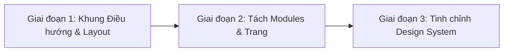

# CareerGap AI – Kiến Trúc Tách Trang & Hệ Thống Thiết Kế Giao Diện (Design System)

> **Cập nhật triển khai 29/10:** frontend hiện dùng hash multi-view, Trung tâm CV và Trung tâm tuyển dụng có sub-nav; sidebar mobile là drawer modal. Đã triển khai Style Guide owner cung cấp, xem [báo cáo kiểm chứng](report/frontend-style-guide-2026-10-29.md) và [bản yêu cầu nguồn](frontend-style-guide.md). Các URL `react-router-dom` và page decomposition bên dưới vẫn là phương án kiến trúc, không phải toàn bộ route đã triển khai.

> **Mục đích tài liệu:** Đánh giá hiện trạng giao diện frontend của dự án CareerGap AI, thiết lập bản thiết kế tách trang chức năng (Modular Page Decomposition) từ kiến trúc monolithic hiện tại sang cấu trúc Route-based chuẩn mực, và định hình phong cách thiết kế UI/UX đồng nhất (Anti-slop Design System) cho toàn bộ nền tảng.

---

## PHẦN 1: ĐÁNH GIÁ HIỆN TRẠNG & ĐỘNG LỰC TÁI CẤU TRÚC

### 1.1. Hiện trạng Frontend hiện tại
Hiện tại, toàn bộ giao diện của CareerGap AI được tích hợp trong file [`frontend/src/main.tsx`](file:///d:/CareerGapAI/frontend/src/main.tsx) với mô hình Single-Page monolith điều hướng bằng URL Hash (`#jobs`, `#applications`, `#cv-builder`, `#private-resumes`, `#profile`, `#recruiter-jobs`, `#shared-profile`, `#public-resumes`, `#administration`, `#account`, `#access`):
- **Phụ thuộc vào Hash navigation:** Việc dùng anchor `#` khiến ứng dụng không có URL tĩnh rõ ràng cho từng tài nguyên (ví dụ không thể chia sẻ trực tiếp link chi tiết một công việc như `/jobs/jd-en-02` hay đơn ứng tuyển cụ thể).
- **Trạng thái và logic dồn cục (State coupling):** Quản lý phiên làm việc (`Session`), danh sách CV (`Resume[]`), tác vụ AI (`Job`), đối chiếu revision và polling dữ liệu đều tập trung trong một component gốc `App()`, dẫn đến re-render diện rộng khi trạng thái thay đổi.
- **Tải giao diện nặng:** Mặc dù `ResumeBuilderPanel` đã được tách lazy loading, nhưng phần lớn các phân hệ của Ứng viên, Nhà tuyển dụng và Quản trị viên vẫn nằm chung trên một màn hình cuộn dọc kéo dài (vertical card stack).

### 1.2. Mục tiêu tái cấu trúc
1. **Tách trang theo phân quyền và ngữ cảnh:** Phân tách rõ ràng giữa phân hệ Công khai (Guest/Public), Ứng viên (Candidate), Nhà tuyển dụng (Recruiter), Quản trị viên (Admin) và Cài đặt bảo mật (Account Settings).
2. **Hỗ trợ Deep-linking & SEO/Chia sẻ:** Mỗi màn hình, mỗi tài nguyên chính (Job, CV Version, Application) đều có URL định danh chuẩn mực qua `react-router-dom`.
3. **Áp dụng Design System chuẩn mực:** Loại bỏ giao diện mặc định thô sơ, đưa vào ngôn ngữ thiết kế **B2B Editorial Minimalism** hiện đại, đáng tin cậy, không "AI slop", chuẩn quy cách typography tiếng Việt và hiển thị minh bạch dữ liệu đối chứng của AI.

---

## PHẦN 2: DANH SÁCH CÁC TRANG CHỨC NĂNG CẦN TÁCH RỜI (PAGE DECOMPOSITION)

Hệ thống được chia thành 5 phân hệ với ma trận route chi tiết:

```mermaid
flowchart TD
    Root["CareerGap AI Navigation"] --> Public["1. Khách & Công khai (Public)"]
    Root --> Candidate["2. Không gian Ứng viên (Candidate)"]
    Root --> Recruiter["3. Không gian Tuyển dụng (Recruiter)"]
    Root --> Admin["4. Quản trị hệ thống (Admin)"]
    Root --> Account["5. Tài khoản & Bảo mật (Shared)"]

    Public --> P1["/ (Landing Page)"]
    Public --> P2["/jobs (Khám phá việc)"]
    Public --> P3["/jobs/:id (Chi tiết JD)"]
    Public --> P4["/talent-pool (Kho CV công khai)"]
    Public --> P5["/auth/* (Đăng nhập / Đăng ký)"]

    Candidate --> C1["/candidate/dashboard (Tổng quan)"]
    Candidate --> C2["/candidate/profile (Hồ sơ & Chia sẻ)"]
    Candidate --> C3["/candidate/resumes (Quản lý CV riêng)"]
    Candidate --> C4["/candidate/resumes/:id/extraction (Rà soát trích xuất)"]
    Candidate --> C5["/candidate/builder (Soạn CV & AI Writing)"]
    Candidate --> C6["/candidate/matching (Đối sánh CV-JD)"]
    Candidate --> C7["/candidate/learning (Nguồn học bù kỹ năng)"]
    Candidate --> C8["/candidate/applications (Theo dõi đơn)"]

    Recruiter --> R1["/recruiter/dashboard (Tổng quan tuyển dụng)"]
    Recruiter --> R2["/recruiter/company (Hồ sơ doanh nghiệp)"]
    Recruiter --> R3["/recruiter/jobs (Quản lý tin đăng)"]
    Recruiter --> R4["/recruiter/jobs/new & :id/edit (Biên tập JD)"]
    Recruiter --> R5["/recruiter/jobs/:id/candidates (Sàng lọc đơn)"]
    Recruiter --> R6["/recruiter/talent-search (Sàng lọc kho CV)"]
    Recruiter --> R7["/recruiter/profiles/:id (Xem hồ sơ chia sẻ)"]

    Admin --> A1["/admin/accounts (Quản lý tài khoản)"]
    Admin --> A2["/admin/jobs (Kiểm duyệt tin)"]
    Admin --> A3["/admin/reports (Xử lý báo cáo)"]
    Admin --> A4["/admin/audit-logs (Nhật ký hệ thống)"]
    Admin --> A5["/admin/usage-ledger (Sổ cái AI & Search)"]
```



---

### Phân hệ 1: Khách & Công khai (Guest / Public Pages)

Các trang dành cho mọi người dùng khi chưa đăng nhập hoặc truy cập nhanh thông tin mở:

| Mã trang | Đường dẫn (Route) | Tên màn hình | Các chức năng & Khối thành phần chính |
| :--- | :--- | :--- | :--- |
| **P-01** | `/` | **Trang chủ (Landing Page)** | - Hero Banner khẳng định tôn chỉ: *"Rõ hồ sơ. Đúng cơ hội. AI hỗ trợ, bạn quyết định."*<br>- Luồng hướng dẫn 3 bước minh bạch (Kể chuyện nghề nghiệp -> Hiểu yêu cầu -> Bước tiếp theo).<br>- Tóm tắt các vị trí tuyển dụng nổi bật và giá trị cốt lõi không tự động quyết định thay con người. |
| **P-02** | `/jobs` | **Khám phá Việc làm** | - Thanh tìm kiếm từ khóa, vị trí, công ty.<br>- Bộ lọc đa tiêu chí: Lĩnh vực, Địa điểm, Hình thức làm việc (Onsite, Remote, Hybrid), Loại hợp đồng, Mức kinh nghiệm.<br>- Danh sách Job Cards có phân trang, đánh dấu trạng thái "Đang nhận hồ sơ" / "Đã hết hạn". |
| **P-03** | `/jobs/:jobId` | **Chi tiết Tin tuyển dụng (JD)** | - Chi tiết mô tả vị trí, yêu cầu kỹ thuật (Bắt buộc vs Ưu tiên), quyền lợi, dải lương.<br>- Thông tin công ty tuyển dụng.<br>- Hộp thao tác ứng tuyển: Chọn phiên bản CV gửi nộp (hoặc nút nhắc đăng nhập với Ứng viên).<br>- Nút Lưu việc và Báo cáo vi phạm nội dung. |
| **P-04** | `/talent-pool` | **Kho CV công khai (Chế độ xem chung)** | - Dành cho ứng viên & khách khám phá hồ sơ mẫu trong cộng đồng.<br>- **Quy tắc bảo mật:** Chỉ hiển thị bản dẫn xuất đã làm sạch và che giấu toàn bộ thông tin liên hệ (Email, SĐT, Link cá nhân).<br>- Tìm kiếm theo chức danh và từ khóa kỹ năng. |
| **P-05** | `/auth/login` | **Đăng nhập** | - Form nhập email và mật khẩu.<br>- Liên kết đến Đăng ký và Quên mật khẩu.<br>- Hỗ trợ thông báo tài khoản đang trong trạng thái chờ xóa (Deletion Pending). |
| **P-06** | `/auth/register` | **Đăng ký tài khoản** | - Chọn 1 trong 2 vai trò: **Ứng viên (Candidate)** hoặc **Nhà tuyển dụng (Recruiter)** (không có tự đăng ký Admin).<br>- Nhập email, mật khẩu (tối thiểu 12 ký tự), tên hiển thị. |
| **P-07** | `/auth/forgot-password` | **Khôi phục mật khẩu** | - Gửi link reset mật khẩu qua email.<br>- Hộp thư giả dev mailbox khi chạy môi trường local kiểm thử. |
| **P-08** | `/auth/reset-password` | **Đặt lại mật khẩu mới** | - Tiếp nhận `resetToken` và `resetEmail` từ query parameters để cập nhật mật khẩu mới. |

---

### Phân hệ 2: Không gian Ứng viên (Candidate Workspace)
*Yêu cầu xác thực vai trò `Candidate`.*

| Mã trang | Đường dẫn (Route) | Tên màn hình | Các chức năng & Khối thành phần chính |
| :--- | :--- | :--- | :--- |
| **C-01** | `/candidate/dashboard` | **Bàn làm việc Ứng viên** | - Widget tóm tắt: Đơn đang nộp, CV đang công khai, việc làm mới phù hợp.<br>- Truy cập nhanh chức năng Soạn CV, Tải file và Xem kết quả gợi ý. |
| **C-02** | `/candidate/profile` | **Hồ sơ cá nhân & Phân quyền chia sẻ** | - Form cập nhật: Họ tên, Tiêu đề nghề nghiệp, Địa điểm, Mong muốn việc làm, Số năm kinh nghiệm, Tóm tắt bản thân, Danh sách kỹ năng.<br>- **Bảng chọn trường cho phép Recruiter xem:** Độc lập lựa chọn trường nào được hiển thị cho nhà tuyển dụng (Contact, Summary, Experience...).<br>- Link xem trước hồ sơ dạng Recruiter nhìn thấy (`/candidate/preview-shared-profile`). |
| **C-03** | `/candidate/resumes` | **Quản lý Kho CV riêng tư** | - Danh sách các bộ CV riêng của người dùng (hỗ trợ nhiều CV cho nhiều mục tiêu nghề nghiệp).<br>- Quản lý phiên bản (`v1`, `v2`, `v3`...) cho mỗi CV: Tải file PDF/DOCX mới, tải về file gốc, đổi tên CV.<br>- Bảng điều khiển kích hoạt "CV công khai" (chọn chính xác 1 phiên bản làm CV công khai cho cộng đồng). |
| **C-04** | `/candidate/resumes/:resumeId/versions/:versionNo/extraction` | **Rà soát dữ liệu trích xuất (Extraction Review)** | - Kiểm tra dữ liệu mà AI đã đọc từ tài liệu PDF/DOCX.<br>- Đối chiếu 2 tầng dữ liệu: Kỹ năng nhanh (L02) và Đọc toàn bộ CV (L04 - schema v3).<br>- Khối đối chứng bằng chứng (`Evidence Spans`): Hiển thị đoạn trích nguyên văn từ file gốc, chỉ số phân trang/vị trí.<br>- Form tự xác nhận của người dùng (User Statement): Chấp nhận dữ liệu hoặc tự bổ sung kỹ năng, lưu thành `Revision` chính thức. |
| **C-05** | `/candidate/builder` | **Soạn thảo CV & Trợ lý viết AI (CV Builder)** | - Trình soạn thảo cấu trúc chuẩn một cột `simple-v1`.<br>- **AI Writing Assistant:** Trợ lý viết tóm tắt (`summary`), diễn đạt kinh nghiệm làm việc và dự án dựa trên dữ kiện đã xác nhận. Hỗ trợ chuyển ngữ Việt - Anh.<br>- Xem trước bản in thời gian thực và xuất PDF chất lượng cao có dấu tiếng Việt bằng `@react-pdf/renderer`.<br>- Tự động lưu bản nháp vào Local/Session Storage để phục hồi khi mất kết nối. |
| **C-06** | `/candidate/matching` | **Gợi ý việc làm & Đối sánh CV–JD** | - Chọn 1 phiên bản CV riêng để so khớp với toàn bộ JD đang tuyển.<br>- **Tầng 1 (Baseline L09):** Xếp hạng danh sách việc làm theo điểm từ khóa trùng khớp (0–1).<br>- **Tầng 2 (Deep AI Pair Matching):** Phân tích sâu theo rubric 100 điểm, bóc tách từng yêu cầu bắt buộc / ưu tiên, chỉ ra bằng chứng có trong CV hoặc trạng thái thiếu bằng chứng. |
| **C-07** | `/candidate/learning` | **Thu hẹp khoảng cách & Nguồn học** | - Hiển thị các tiêu chí còn thiếu hoặc đáp ứng một phần so với JD mục tiêu.<br>- Tra cứu tài liệu học tập qua API tìm kiếm web (Tavily Search): Lựa chọn chủ đề, ngôn ngữ (Việt/Anh), trình độ (Cơ bản/Trung cấp).<br>- Danh sách liên kết tài liệu chính thống có nguồn gốc và tóm tắt lý do đề xuất. |
| **C-08** | `/candidate/applications` | **Quản lý Đơn ứng tuyển** | - Danh sách toàn bộ việc làm đã nộp hồ sơ kèm phiên bản CV đã dùng tại thời điểm nộp.<br>- Dòng thời gian trạng thái sàng lọc: *Đã nộp (`submitted`) -> Đang xem xét (`reviewing`) -> Qua sàng lọc (`shortlisted`) / Không tiếp tục (`rejected`)*.<br>- Nút rút đơn an toàn (`withdrawn`) và nộp lại bằng hồ sơ mới (nếu tin còn nhận và không bị chặn). |

---

### Phân hệ 3: Không gian Nhà tuyển dụng (Recruiter Workspace)
*Yêu cầu xác thực vai trò `Recruiter`.*

| Mã trang | Đường dẫn (Route) | Tên màn hình | Các chức năng & Khối thành phần chính |
| :--- | :--- | :--- | :--- |
| **R-01** | `/recruiter/dashboard` | **Bàn làm việc Tuyển dụng** | - Tổng quan nhanh: Số tin đang đăng, tổng số hồ sơ mới nhận, hồ sơ đang chờ sàng lọc.<br>- Danh sách việc làm cần xử lý gấp. |
| **R-02** | `/recruiter/company` | **Hồ sơ Doanh nghiệp** | - Quản lý hồ sơ công ty: Tên doanh nghiệp, Logo, Quy mô nhân sự, Địa chỉ trụ sở, Website, Lĩnh vực hoạt động, Giới thiệu chung. |
| **R-03** | `/recruiter/jobs` | **Quản lý Tin tuyển dụng** | - Bảng danh sách các tin đăng: Bản nháp (`draft`), Đang nhận hồ sơ (`published`), Đã đóng (`closed`), Đã ẩn (`archived`).<br>- Thống kê số lượng hồ sơ nộp vào từng tin, hạn chót nhận đơn, nút đóng/mở lại tin. |
| **R-04** | `/recruiter/jobs/new`<br>`/recruiter/jobs/:jobId/edit` | **Đăng tin & Biên tập JD** | - Form nhập JD đầy đủ: Tiêu đề, Mô tả, Yêu cầu công việc, Quyền lợi, Ngành nghề, Địa điểm, Mức lương, Hình thức làm việc, Kinh nghiệm yêu cầu.<br>- **AI Trích xuất yêu cầu JD:** Hỗ trợ bóc tách danh sách yêu cầu công việc thành cấu trúc có phân loại (Bắt buộc / Tùy chọn) và lưu `JobDataRevision` để chuẩn bị cho đối sánh AI. |
| **R-05** | `/recruiter/jobs/:jobId/candidates` | **Sàng lọc Hồ sơ Ứng viên theo Tin** | - Danh sách hồ sơ đã ứng tuyển vào tin tuyển dụng.<br>- Xem file CV snapshot tại thời điểm nộp.<br>- Điểm đối sánh AI Pair Matching và giải thích bằng chứng theo từng tiêu chí tuyển dụng của vị trí.<br>- **Thao tác sàng lọc thủ công:** Chuyển trạng thái (*Đang xem xét*, *Được chọn tiếp*, *Không tiếp tục*).<br>- Thêm ghi chú nội bộ (chỉ recruiter phụ trách tin nhìn thấy).<br>- Quyền chặn / bỏ chặn ứng viên nộp lại vào tin này. |
| **R-06** | `/recruiter/talent-search` | **Sàng lọc Ứng viên từ Kho CV công khai** | - Chọn 1 JD của công ty để đối sánh với toàn bộ kho CV công khai trên hệ thống.<br>- Bảng xếp hạng ứng viên tiềm năng theo mức độ phù hợp.<br>- Xem CV gốc (bao gồm thông tin liên hệ được ứng viên công khai cho recruiter). |
| **R-07** | `/recruiter/candidates/:candidateId` | **Xem Hồ sơ Ứng viên được chia sẻ** | - Xem chi tiết Profile ứng viên theo đúng các trường thông tin mà ứng viên cho phép hiển thị. |

---

### Phân hệ 4: Không gian Quản trị viên (Admin Portal)
*Yêu cầu xác thực vai trò `Admin`.*

| Mã trang | Đường dẫn (Route) | Tên màn hình | Các chức năng & Khối thành phần chính |
| :--- | :--- | :--- | :--- |
| **A-01** | `/admin/accounts` | **Quản trị Tài khoản** | - Danh sách tài khoản hệ thống (Candidate, Recruiter, Admin).<br>- Tìm kiếm theo email, kiểm tra trạng thái (*Active*, *Suspended*, *Deletion Pending*).<br>- Thao tác: Tạm khóa tài khoản (`suspend`), mở lại tài khoản (`activate`) kèm lý do kiểm duyệt bắt buộc.<br>- **Bảo vệ quyền riêng tư:** Admin tuyệt đối không có quyền mở đọc CV riêng tư của người dùng. |
| **A-02** | `/admin/jobs` | **Kiểm duyệt Tin tuyển dụng** | - Quản lý toàn bộ tin tuyển dụng trên hệ thống.<br>- Thao tác gỡ hoặc ẩn tin vi phạm (`archive`), khôi phục tin (`restore`). |
| **A-03** | `/admin/reports` | **Xử lý Báo cáo Vi phạm** | - Hàng đợi các báo cáo từ người dùng về tin tuyển dụng hoặc CV công khai có nội dung không phù hợp.<br>- Xem lý do báo cáo, đối tượng bị báo cáo.<br>- Quyết định xử lý: Đã giải quyết (`resolved`) hoặc Bỏ qua (`dismissed`). |
| **A-04** | `/admin/audit-logs` | **Nhật ký Hoạt động Hệ thống** | - Bảng log kiểm tra toàn bộ hành vi quản trị, người thực hiện, thời gian thực hiện, lý do nghiệp vụ và kết quả. |
| **A-05** | `/admin/usage-ledger` | **Giám sát Sổ cái AI & Chi phí** | - **Sổ cái AI DeepSeek:** Theo dõi hạn mức trần (budget limit $2.00/tháng), số tiền đã chi, số tiền giữ chỗ (reservation hold), số token sử dụng.<br>- **Search Credit:** Thống kê lượt gọi Tavily Search (credit xác định và credit chờ đối soát).<br>- **Email Ledger:** Trạng thái gửi email phục hồi.<br>- **Thống kê lỗi AI:** Bảng đếm lỗi theo mã lỗi (`errorCode`) và nhà cung cấp để hỗ trợ kỹ thuật kịp thời. |

---

### Phân hệ 5: Cài đặt Tài khoản & Bảo mật (Shared Account Settings)

| Mã trang | Đường dẫn (Route) | Tên màn hình | Các chức năng & Khối thành phần chính |
| :--- | :--- | :--- | :--- |
| **U-01** | `/account/security` | **Bảo mật & Đổi mật khẩu** | - Đổi mật khẩu đăng nhập (yêu cầu mật khẩu hiện tại, mật khẩu mới >= 12 ký tự).<br>- Quản lý phiên đăng nhập. |
| **U-02** | `/account/delete` | **Yêu cầu Xóa tài khoản & Hủy xóa** | - Gửi yêu cầu xóa tài khoản: Thu hồi ngay quyền truy cập, chuyển trạng thái sang `deletion_pending`.<br>- Thông báo mốc thời gian 7 ngày ân hạn để người dùng có thể nhập mật khẩu hủy yêu cầu xóa.<br>- Hiển thị thời điểm dự kiến xóa vĩnh viễn và chính sách dọn dẹp dữ liệu/file backup. |
| **U-03** | `/dev/pdf-probe` | **Kiểm thử Xuất PDF Tiếng Việt** | - Công cụ kỹ thuật kiểm tra bộ font Noto Sans / OFL, kiểm tra phân trang, dấu thanh tiếng Việt và khả năng copy chữ trên file PDF mẫu. |

---

## PHẦN 3: HỆ THỐNG THIẾT KẾ GIAO DIỆN CHUNG (DESIGN SYSTEM)

Để loại bỏ hoàn toàn các khiếm khuyết thiết kế thường thấy của AI (AI slop, gradient lòe loẹt, thẻ lồng thẻ rối mắt, khoảng cách chật chội, dùng emoji tùy tiện), CareerGap AI tuân thủ triệt để bộ quy chuẩn thiết kế **B2B Editorial Minimalism & High-Trust Engineering**.

### 3.1. Triết lý Thiết kế (Design Philosophy)

1. **Minh bạch và Đáng tin cậy (High-Trust & Provenance First):**
   Mọi nội dung do AI trích xuất hoặc đề xuất phải có nguồn gốc rõ ràng (có nhãn trích đoạn, vị trí trang hoặc nhãn *"Thông tin người dùng tự xác nhận"*). Không bao giờ tự bịa đặt hay che giấu nguồn gốc dữ liệu.
2. **Quyền quyết định thuộc về Con người (Human-in-the-Loop):**
   AI chỉ đóng vai trò phân tích, xếp hạng gợi ý và hỗ trợ hành văn. Nhà tuyển dụng tự quyết định sàng lọc; Ứng viên tự duyệt bản nháp trước khi lưu. Thiết kế UI phải thể hiện rõ các nút *"Xác nhận"*, *"Chấp nhận đề xuất"* hoặc *"Bỏ qua"*.
3. **Thanh lịch, Kiềm chế, Đậm chất Nghiệp vụ (Restrained B2B Editorial):**
   Sử dụng bảng màu trầm ấm tự nhiên, tương phản chữ cao, khoảng trắng hào phóng (macro-spacing). Nói **KHÔNG** với gradient tím sặc sỡ, hiệu ứng viền neon, bóng đổ quá đậm (heavy dropshadows) hoặc các thẻ lồng thẻ vô nghĩa (nested card loops).
4. **Cấm Emojis trong Giao diện (Anti-Emoji Policy):**
   Tuyệt đối không dùng emoji (🚀, 💡, 🔥, 📌,...) trong mã nguồn, nút bấm, nhãn hoặc nội dung trang. Thay thế hoàn toàn bằng hệ thống icon vector chuyên nghiệp, sắc nét từ thư viện `@phosphor-icons/react`.

---

### 3.2. Bảng Màu Hệ Thống (Calibrated Color System)

```
[ Canvas: #f7f8f4 ] ── [ Card: #ffffff ] ── [ Border: #e0e5dd ]
         │                     │                    │
         ▼                     ▼                    ▼
[ Primary: #245c48 ]   [ Text: #29362e ]   [ Muted: #68746b ]
```

| Nhóm màu | Tên mã | Giá trị HEX | Vai trò & Mục đích sử dụng |
| :--- | :--- | :--- | :--- |
| **Primary Brand** | Pine Forest | `#245c48` | Màu thương hiệu chủ đạo: Logo, nút bấm chính (Primary button), biểu tượng nổi bật, viền tab đang chọn. |
| | Pine Deep (Hover) | `#194735` | Trạng thái hover/active của nút bấm chính. |
| | Pine Subtle Tint | `#eaf0e6` | Nền nhạt cho badge, item menu đang active, highlight nhẹ tiêu chí đạt. |
| **Canvas & Surfaces** | Warm Sand Canvas | `#f7f8f4` | Nền toàn trang (Page background). Ấm dịu, chống mỏi mắt so với nền trắng tinh `#fff`. |
| | Card Surface | `#ffffff` | Nền các khối thẻ nội dung (Card), bảng dữ liệu, modal. Tách biệt tự nhiên với nền canvas. |
| | Muted Surface | `#edf1eb` | Nền cho các ô input, code block, avatar placeholder, secondary buttons. |
| **Borders & Dividers**| Soft Border | `#e0e5dd` | Đường viền thẻ (Card border), đường kẻ ngang phân tách các mục. |
| | Focus / Input Line | `#d8dfd4` | Viền input ở trạng thái bình thường; chuyển sang `#245c48` khi focus. |
| **Typography** | Dark Charcoal | `#29362e` | Tiêu đề chính (H1, H2, H3) và văn bản quan trọng. Độ tương phản cao, dễ đọc. |
| | Slate Neutral | `#465349` | Nhãn form (Form labels), tiêu đề cột bảng dữ liệu. |
| | Sage Muted | `#68746b` | Chú thích phụ (Caption), mốc thời gian, mô tả phụ, gợi ý. |
| **Semantic Badges** | Success / Met | `#1f6d4d` / `#eaf5ee` | Tiêu chí đạt, đã nộp đơn, tài khoản đang hoạt động. |
| | Warning / Review | `#926010` / `#fdf6e7` | Cần người dùng rà soát, đáp ứng một phần, tin sắp hết hạn. |
| | Danger / Missing | `#9e2a2b` / `#fbeeed` | Thiếu kỹ năng bắt buộc, đơn bị từ chối, nút xóa tài khoản, lỗi AI. |
| | Neutral Info | `#59665c` / `#f0f3ed` | Tiêu chí tùy chọn, mô phỏng local (Fake provider), chưa công bố. |

---

### 3.3. Quy Chuẩn Typography & Phông Chữ

- **Bộ phông chủ đạo:** `'Geist', 'Noto Sans', sans-serif`
  - `Geist`: Phông chữ hình học hiện đại, hiển thị sắc nét các con số, chỉ số kỹ thuật và giao diện dashboard.
  - `Noto Sans`: Đảm bảo dấu tiếng Việt hiển thị hoàn hảo, không bị nhảy dòng, vỡ glyph hoặc lệch dấu thanh.
- **Thang kích thước & Nhịp điệu chữ (Type Hierarchy):**

| Cấp bậc | Kích thước (px / rem) | Font-weight | Tracking (Letter-spacing) | Ứng dụng |
| :--- | :--- | :--- | :--- | :--- |
| **Display / Hero H1** | `40px` / `2.5rem` | 600 (Semibold) | `-0.04em` | Tiêu đề lớn trang chủ, slogan mở đầu không gian. |
| **Section H2** | `22px` / `1.375rem` | 600 (Semibold) | `-0.025em` | Tiêu đề các khối chức năng chính, tên trang. |
| **Card Title H3** | `16px` / `1rem` | 600 (Semibold) | `-0.015em` | Tiêu đề thẻ công việc, tên mục CV, tên bảng. |
| **Subheading H4** | `14px` / `0.875rem` | 500 (Medium) | `0em` | Tiêu đề nhóm nhỏ, tên công ty phụ, fieldset legend. |
| **Body Text** | `13px - 14px` | 400 (Regular) | `0em` | Nội dung mô tả JD, kinh nghiệm làm việc, hướng dẫn. |
| **Micro / Caption** | `11px - 12px` | 500 (Medium) | `+0.02em` | Tag, mốc thời gian, nhãn trích dẫn nguồn, ghi chú phụ. |
| **Eyebrow Label** | `10px` / `0.625rem` | 600 (Semibold) | `+0.15em` (Uppercase)| Nhãn danh mục nhỏ nằm trên tiêu đề chính (ví dụ: `KHÔNG GIAN NGHỀ NGHIỆP`). |

---

### 3.4. Cấu Trúc Khung Khối & Giao Diện Tổng Thể (Shell & Layout Architecture)

Toàn bộ ứng dụng sử dụng cấu trúc **Workspace App Shell** 2 cột nhất quán:

```
┌─────────────────┬──────────────────────────────────────────────────────────────┐
│ [Brand Logo]    │ Topbar: Breadcrumbs / Role Badge / User Actions              │
├─────────────────┼──────────────────────────────────────────────────────────────┤
│ Nav Section 1   │ Content Canvas (Max-width: 1400px, Padding: 24px - 40px)     │
│  - Trang 1      │                                                              │
│  - Trang 2      │ ┌──────────────────────────┐ ┌─────────────────────────────┐ │
│ Nav Section 2   │ │ Card A (Metric/Overview) │ │ Card B (Actions/Form)       │ │
│  - Trang 3      │ └──────────────────────────┘ └─────────────────────────────┘ │
│                 │ ┌──────────────────────────────────────────────────────────┐ │
│ [Privacy Note]  │ │ Main Data Table / Content Feed / AI Inspection View      │ │
│ [User Profile]  │ └──────────────────────────────────────────────────────────┘ │
└─────────────────┴──────────────────────────────────────────────────────────────┘
```

1. **Thanh điều hướng bên trái (Sticky Sidebar):**
   - Độ rộng cố định `240px`, bám sát màn hình (`position: sticky; top: 0; height: 100dvh`).
   - Phân chia rõ ràng 2 nhóm: *Nhóm chức năng nghiệp vụ* và *Thông tin người dùng / Đăng xuất* ở góc dưới cùng.
   - Hiển thị thông điệp cốt lõi cố định: *"Hồ sơ của bạn, quyền của bạn."* nhắc nhở về quyền riêng tư.
   - Hỗ trợ co dãn thành Drawer menu trên màn hình điện thoại/tablet.
2. **Thanh tiêu đề trên (Header Topbar):**
   - Chiều cao `60px`, nền trắng `#ffffff`, viền đáy nhẹ `#e0e5dd`.
   - Chứa Breadcrumb chỉ rõ vị trí hiện tại (ví dụ: `Ứng viên / Soạn & Cải thiện CV`) và Badge vai trò hiện tại (*Ứng viên*, *Nhà tuyển dụng*, *Quản trị*).
3. **Vùng nội dung chính (Content Canvas):**
   - Giới hạn độ rộng tối đa `max-w-[1400px] mx-auto` để mắt người đọc không bị mỏi trên màn hình siêu rộng.
   - Đảm bảo khoảng cách lề `px-6 py-8` (màn hình vừa) và `px-10 py-10` (màn hình lớn).

---

### 3.5. Quy Chuẩn Thiết Kế Thành Phần Giao Diện (Component Patterns)

#### A. Card Thẻ Thông Tin (Cards & Bento Grid)
- Nền trắng `#ffffff`, viền mỏng `1px solid #e0e5dd`, bo góc nhẹ `8px`.
- Không lồng card 3 tầng. Nếu có nội dung con, sử dụng bảng danh sách phẳng hoặc dải phân cách bằng viền nhẹ.
- Khoảng đệm bên trong (padding) chuẩn: `20px` đến `24px`.

#### B. Nút Bấm & Thao Tác (Button System)
- Chiều cao chuẩn: `40px` (Medium) và `32px` (Compact).
- **Primary Button:** Nền `#245c48`, chữ trắng, bo góc `6px`, hover sang `#194735`.
- **Secondary Button:** Nền `#edf1eb`, viền trong suốt hoặc viền nhẹ `#d8dfd4`, chữ `#29362e`, hover sang `#e2e8df`.
- **Danger Button:** Dùng riêng cho các hành động xóa, tạm khóa hoặc hủy: Nền `#fbeeed`, chữ `#9e2a2b`, hover sang `#f7dcda`.
- **Trạng thái Loading:** Hiển thị spinner mảnh kèm nhãn rõ ràng (ví dụ: *"Đang phân tích..."*, *"Đang lưu..."*), disable nút để chống bấm đúp (double-click).

#### C. Khối Hiển Thị Đối Chứng AI (Evidence Citation Blocks)
Đây là thành phần cốt lõi tạo nên sự khác biệt của CareerGap AI:
- Khi AI đưa ra nhận định (kỹ năng đạt, tiêu chí phù hợp), thông tin chứng minh phải được đặt trong một khối `blockquote` đặc biệt:
  ```html
  <div class="evidence-quote">
    <p>“Có 3 năm phát triển hệ thống backend với C# và PostgreSQL...”</p>
    <div class="evidence-meta">
      <span class="source-tag">Trích đoạn từ CV · Trang 1</span>
      <span class="confidence-tag">AI trích xuất tự động</span>
    </div>
  </div>
  ```
- Nếu là thông tin do ứng viên tự khai bổ sung, phải gắn nhãn: `Thông tin ứng viên tự xác nhận; không phải trích dẫn từ CV gốc`.

#### D. Hiển Thị Điểm Phù Hợp (Match Score Indicator)
- Điểm hiển thị trên thang 100 dạng số lớn kèm thanh đo tiến trình mảnh.
- Luôn đính kèm câu ghi chú bắt buộc:
  > *“Điểm đối chiếu thuật toán cho cặp CV–JD này, không phải xác suất trúng tuyển hay kết luận năng lực tổng thể.”*
- Thể hiện rõ số lượng tiêu chí bắt buộc chưa có bằng chứng (ví dụ: *"Còn 2 yêu cầu bắt buộc chưa tìm thấy bằng chứng trong hồ sơ"*).

#### E. Biểu Mẫu & Trường Nhập Liệu (Forms & Inputs)
- Chiều cao input chuẩn `40px - 42px`, viền `#d8dfd4`, nền trắng.
- Khi focus: Viền đổi sang `#245c48` kèm hiệu ứng viền ngoài `outline: 2px solid #397558; outline-offset: 2px`.
- Nhãn trường (`label`) đặt ngay phía trên input, font-weight 500, cỡ chữ 12px, màu `#465349`.
- Hiển thị rõ ràng thông báo lỗi kiểm thực (validation error) màu đỏ gạch `#9e2a2b` ngay bên dưới trường nhập.

---

## PHẦN 4: KẾ HOẠCH TRIỂN KHAI TÁI CẤU TRÚC (REFACTORING ROADMAP)

Để đảm bảo không làm gián đoạn các bài test hồi quy (E2E Playwright và Vitest hiện có), quá trình tái cấu trúc giao diện được khuyến nghị thực hiện theo 3 giai đoạn:



### Giai đoạn 1: Thiết lập Khung Điều hướng & Router
1. Cài đặt thư viện `react-router-dom` (phiên bản ổn định) vào `frontend/package.json`.
2. Tạo thư mục cấu trúc mới:
   ```
   frontend/src/
   ├── layouts/               # WorkspaceLayout, PublicLayout, AuthLayout, AdminLayout
   ├── components/            # UI Primitives: Button, Card, Badge, Modal, EvidenceBlock, ScoreDial
   ├── pages/                 # Thư mục chứa các trang chức năng đã phân rã
   │   ├── public/
   │   ├── candidate/
   │   ├── recruiter/
   │   ├── admin/
   │   └── account/
   ├── routes/                # Cấu hình danh mục tuyến đường AppRoutes.tsx
   └── styles/                # Biến giao diện CSS & Design tokens
   ```
3. Tạo `AppRoutes.tsx` ánh xạ toàn bộ 5 phân hệ trang, hỗ trợ guard kiểm tra quyền `Candidate`, `Recruiter`, `Admin`.

### Giai đoạn 2: Phân rã và Chuyển đổi Trang
1. **Chuyển đổi Phân hệ Public & Auth:** Tách `AccountAccess` thành các trang độc lập `/auth/login`, `/auth/register`, `/auth/forgot-password`.
2. **Chuyển đổi Phân hệ Candidate:**
   - Đưa `CandidateProfilePanel` ra trang `/candidate/profile`.
   - Đưa danh sách CV và phiên bản ra `/candidate/resumes`.
   - Tách `FullCvReview` thành trang rà soát trích xuất chuyên sâu.
   - Tách `ResumeBuilderPanel` sang `/candidate/builder`.
   - Tách các module matching & learning (`matching.tsx`, `pairMatching.tsx`, `learning.tsx`) thành trang đối sánh `/candidate/matching`.
3. **Chuyển đổi Phân hệ Recruiter:** Tách `RecruiterJobManager`, `RecruiterProfileLookup` và luồng xem đơn ứng viên thành trang độc lập.
4. **Chuyển đổi Phân hệ Admin:** Đưa `AdminPanel` thành `/admin/accounts`, `/admin/jobs`, `/admin/reports`, `/admin/usage-ledger`.

### Giai đoạn 3: Chuẩn hóa Giao diện theo Design System
1. Cập nhật mã màu Tailwind v4 trong [`frontend/src/style.css`](file:///d:/CareerGapAI/frontend/src/style.css) theo hệ màu chuẩn đã định nghĩa ở Phần 3.
2. Áp dụng đồng bộ các khối `Evidence Citation Blocks`, `Score Indicators` và các bảng dữ liệu `Data Tables`.
3. Kiểm thử toàn diện E2E bằng Playwright để đảm bảo toàn bộ luồng đăng nhập, nộp đơn, xem CV, xuất PDF và quản trị tiếp tục hoạt động chính xác 100%.

---

## KẾT LUẬN

Tài liệu này cung cấp bản quy hoạch toàn diện để chuyển đổi CareerGap AI từ cấu trúc giao diện thử nghiệm sang một sản phẩm web chuyên nghiệp, phân tách mô-đun rõ ràng, chuẩn mực về UX/UI và sẵn sàng phục vụ việc đánh giá, demo cũng như mở rộng lâu dài. Mọi cải tiến đều bám sát tôn chỉ: **Minh bạch, Tôn trọng dữ liệu thật, Đặt người dùng làm trung tâm quyết định.**
