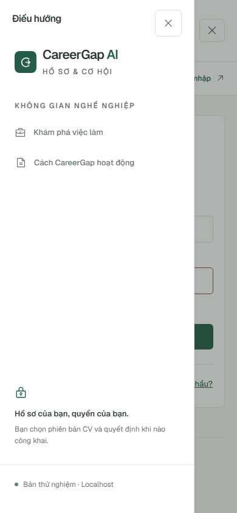
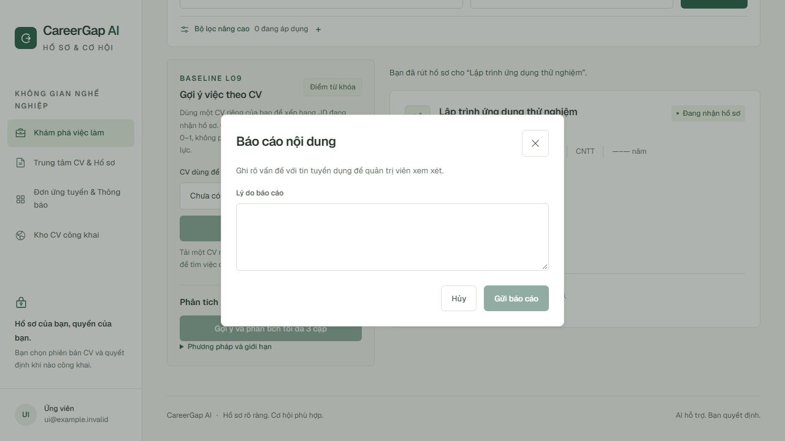
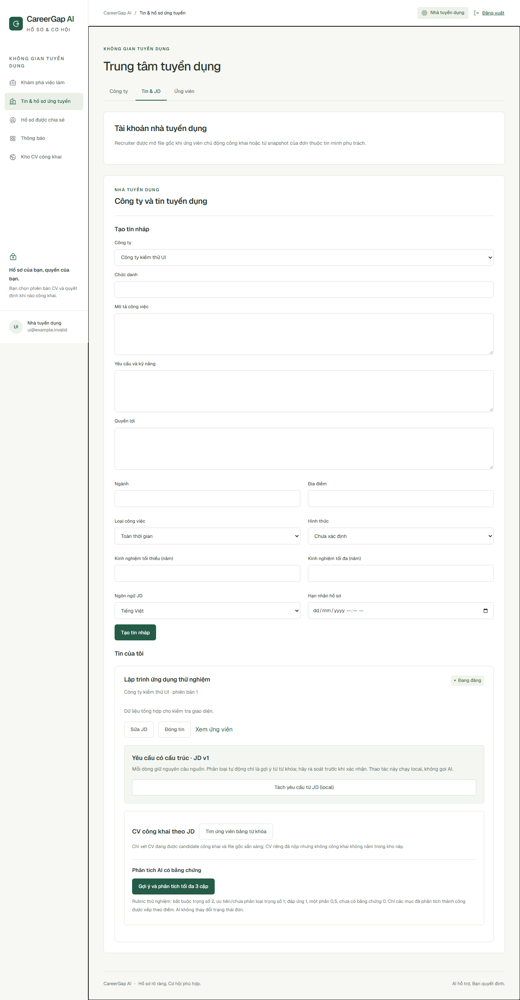

# Triển khai Design System & Style Guide — 29/10/2026

## Phạm vi và nguồn

Thực hiện đủ ba phase của file owner cung cấp `CareerGapAI - Design System & Style Guide.md`. Bản nguồn giữ nguyên ở [frontend-style-guide.md](../frontend-style-guide.md); xem các hiệu chỉnh sau đo ở dưới. Làm trực tiếp trên working directory đã có thay đổi của owner, có snapshot trước sửa tại `.local/design-guide-20261029-before/`. Không reset hoặc thay thế các thay đổi trước đó.

## Phase 1 — Accessibility

- Bổ sung token màu và 7 bậc typography trong `frontend/src/style.css`. Footer, caption logo và placeholder sử dụng các màu mới; chữ nghiệp vụ tối thiểu 12px, bảng quản trị mobile 14px. Badge mang trạng thái nghiệp vụ cũng dùng 12px; eyebrow trang trí dùng 11px.
- Sidebar chỉ đánh dấu mục điều hướng hiện hành. “Cách CareerGap hoạt động” là button mở hướng dẫn, không nhận `aria-current`; vẫn hỗ trợ deep link `#how-it-works` cũ.
- Nút lịch sử đơn có `aria-expanded` và `aria-controls` trỏ đến vùng lịch sử.
- `ValidatedForm` dùng chung cho các form hiện có: giữ native constraint validation, đặt `aria-invalid`, nối lỗi với field bằng `aria-describedby`, giữ mô tả sẵn có và gỡ lỗi khi nhập hợp lệ. Lỗi nằm ngoài label để không đổi tên truy cập. `FieldError` hỗ trợ lỗi số mục trong builder và nội dung writing bị xóa trắng. Không gán lỗi kết nối/quyền/quota cho một field tùy tiện.
- Mỗi màn hình chính có H1; heading onboarding đổi thành H2 để không tạo hai H1 ở trang việc làm.
- `prefers-reduced-motion` bao gồm cả tab CV và tab tuyển dụng.
- Lựa chọn Việt/English được dùng chung giữa AI writing và heading PDF, có thể chọn cả khi nhập CV thủ công. Đổi ngôn ngữ làm hết hiệu lực preview cũ và buộc tạo preview mới trước khi lưu.

Nguồn code: `ui.tsx`, `workspace.tsx`, `navigation.ts`, `onboarding.tsx`, `jobs.tsx`, `main.tsx`, `resumeBuilder.tsx`, `resumeBuilderPdf.tsx`, `writing.tsx`, `style.css` trong `frontend/src/`.

### Hiệu chỉnh màu có bằng chứng

Mã hex trong file nguồn là đề xuất. Đo theo foreground/background thực tế, không làm tròn lên để xét ngưỡng:

| Cặp màu | Tỷ lệ cuối |
|---|---:|
| Footer `#5E685F` / nền `#F7F8F4` | 5,437:1 |
| Caption `#5A6359` / trắng | 6,243:1 |
| Placeholder `#5E685F` / trắng | 5,799:1 |
| AI `#2F5586` / `#EEF2F8` | 6,761:1 |
| Badge đã xác nhận `#41654D` / `#EDF2E9` | 5,786:1 |
| Chữ phụ `#67736A` / panel `#F4F6F1` | trên 4,5:1 |
| Tin nháp `#846A39` / `#F8F4E8` | 4,656:1 |
| Tin đóng `#826456` / `#F3EEEB` | trên 4,5:1 |

Ba ngoại lệ so với bảng màu đề xuất: secondary `#68746B` → `#67736A`, draft `#886E3C` → `#846A39`, closed `#86685A` → `#826456`. Màu cũ lần lượt chỉ đạt 4,489/4,398/4,404 trên đúng nền sử dụng; ưu tiên tiêu chí AA của mục 1 và yêu cầu đo lại cuối file. Chữ sidebar/topbar `#727B75` được đưa về token secondary; thông báo đã đọc dùng nền phụ thay vì giảm opacity của cả chữ. Primary, nền và định hướng thẩm mỹ được giữ.

Đây là kiểm tra các cặp màu chữ liên quan, không phải chứng nhận WCAG toàn ứng dụng. Viền trang trí nhạt không được coi là chỉ báo trạng thái duy nhất; badge luôn có chữ. Chưa chạy audit screen reader trên nhiều hệ điều hành.

## Phase 2 — Elevation và trạng thái AI

- Card tĩnh không có shadow. `useStickyFit` phân biệt panel vừa viewport và panel thực sự đang ghim; chỉ trường hợp sau dùng `--shadow-sm`. Panel quá cao hoặc trên mobile trở về luồng trang và bỏ shadow.
- Dialog dùng chung cho yêu cầu xóa tài khoản, rút đơn, báo cáo nội dung và drawer mobile. Dùng native `showModal`, tên truy cập, khóa cuộn nền, Tab/Shift+Tab trong dialog, Escape, click nền và trả focus cho trigger. Khi request đang gửi, chặn đóng/gửi lặp. Hủy dialog không gọi mutation.
- Badge AI có hai biến thể cùng kích thước: xanh lam trầm khi còn đề xuất; xanh thường sau xác nhận. Writing chỉ chuyển badge đã đưa vào draft khi callback áp dụng thành công; proposal đã duyệt từ trước nhưng chưa áp dụng vào draft hiện tại không bị ghi nhãn sai. Rà soát CV chuyển theo revision xác nhận trả từ API. Matching giữ badge AI vì không có hành động chấp nhận tương ứng; không thêm quyết định tuyển dụng tự động.

Nguồn: `ui.tsx`, `useStickyFit.ts`, `pairMatching.tsx`, `writing.tsx`, `fullCvReview.tsx`, `style.css`.

## Phase 3 — Cấu trúc

Trung tâm tuyển dụng có sub-nav theo cùng mẫu Trung tâm CV:

| Hash | Nội dung |
|---|---|
| `#recruiter-company` | Công ty |
| `#recruiter-jobs` | Tin & JD; giữ hash cũ |
| `#recruiter-applicants` | Ứng viên theo từng tin |

Các route mới dùng cùng guard Recruiter, khách về access, Candidate/Admin không mở được giao diện Recruiter. Manager vẫn giữ state khi chuyển sub-view; dữ liệu/CRUD/quyền snapshot không đổi. Sidebar mobile là drawer modal phủ nội dung, đóng khi bấm nền/Escape/chọn mục và không đẩy main xuống.

Nguồn: `navigation.ts`, `workspace.tsx`, `persistentView.tsx`, `main.tsx`, `jobs.tsx`.

## Kiểm chứng PDF và sửa lỗi phát hiện thêm

Thử xuất Việt → Anh trong cùng phiên tái hiện PDF nhìn đúng nhưng lớp ToUnicode của một số ký tự bị lỗi (`PROFILE` có thể chỉ copy được `PROFIL`). Hai bộ đọc pdfplumber và pypdf xác nhận; không lấy ảnh render làm bằng chứng đủ cho copy text.

Mỗi lượt dựng builder PDF hiện chạy trong một Web Worker mới, tự kết thúc sau khi trả blob/lỗi hoặc timeout. Renderer/font cache không dùng chung giữa các tài liệu. Template là document factory không có DOM/hook, tránh Fast Refresh truy cập `window` trong worker ở chế độ dev. Không sửa font nguồn, dependency hay cấu trúc revision backend.

Bản cuối đã xuất liên tiếp Việt → Anh → Việt từ production bundle, đủ 6 heading ở mỗi bản. Cả pdfplumber và pypdf đọc đúng heading, nội dung nguồn tiếng Việt, không replacement/control character; 3/3 PDF A4 một trang, ký tự trong trang. Đã render PNG bằng Poppler và xem bố cục. Ngôn ngữ là tùy chọn trình bày frontend; không thêm field/schema backend và không tuyên bố đã lưu lựa chọn ngôn ngữ trong revision server.

Nguồn: `pdfGeneration.ts`, `resumePdf.worker.tsx`, `resumeBuilderPdf.tsx`, `resumeBuilder.tsx`. Dấu vết PDF cuối: `.local/design-guide-20261029-production/evidence/pdf-checks.json`.

## Kết quả kiểm tra

- Lint, typecheck, build đạt. Unit test 11/11.
- Toàn bộ 21/21 E2E đạt với PostgreSQL tmpfs/API/Vite riêng, AI/search/email Fake; gồm account deletion/cancel, application withdrawal, company/JD, private CV/PDF/version, full review, failed-save recovery, writing worker, matching và snapshot tải xuống.
- Sau hiệu chỉnh màu cuối, build lại và chạy 7/7 kiểm tra style guide trên **production bundle**: single active menu, guide action, native field feedback, modal focus/Tab/Escape/backdrop, cancel không mutation, 3 recruiter sub-view/state/reload, breakpoint 320/390/768/1024/1440, reduced-motion, mobile admin table 14px, contrast và shadow sticky. Fixture/API của 7 bài này được mock; không xem chúng là bằng chứng tích hợp backend.
- Full E2E run: `.local/frontend-step3-20261029-053123-c4ec/result.json` và `e2e.json`; `completed=true`, `cleanup=true`, non-Fake methods=0, USD budgets=0.
- Production UI run: `.local/design-guide-20261029-production/e2e.json`. Các run thử lỗi được giữ ở `.local/design-guide-20261029-check*`, không gán là đạt.
- Không chạy lại full backend test suite cho thay đổi UI này (`--skip-backend`); runner vẫn build backend và chạy migrations trên DB test riêng để phục vụ E2E. Không dùng kết quả backend lịch sử cho binary mới.

Bundle PDF/worker vẫn lớn khoảng 1,2 MB và build có cảnh báo chunk size; worker chỉ được tải khi yêu cầu dựng PDF. Việc dịch nội dung CV tự do không được thêm; chỉ heading PDF đổi theo lựa chọn.

## Ảnh kiểm chứng

Ảnh dùng dữ liệu tổng hợp/mocked, không phải dữ liệu tuyển dụng thật. Manifest của thay đổi: [frontend-style-guide-2026-10-29.json](../evaluation/frontend-style-guide-2026-10-29.json).

## Phạm vi giữ nguyên

Không sửa backend/API/schema/phương pháp matching, không tăng benchmark/human labels, không thay ledger/quyền provider hoặc dùng DB demo. Không gọi provider thật, gửi email, push, merge hay deploy. Không sửa file Word owner. Các mốc M3/M6/chất lượng đại diện vẫn giữ trạng thái trước công việc UI này.

Tham chiếu kỹ thuật: [WAI-ARIA modal dialog](https://www.w3.org/WAI/ARIA/apg/patterns/dialog-modal/), [W3C contrast minimum](https://www.w3.org/WAI/WCAG22/Understanding/contrast-minimum.html). Các tỷ lệ ở trên được tính từ code và kiểm lại qua computed CSS trong browser.
